<p align="center">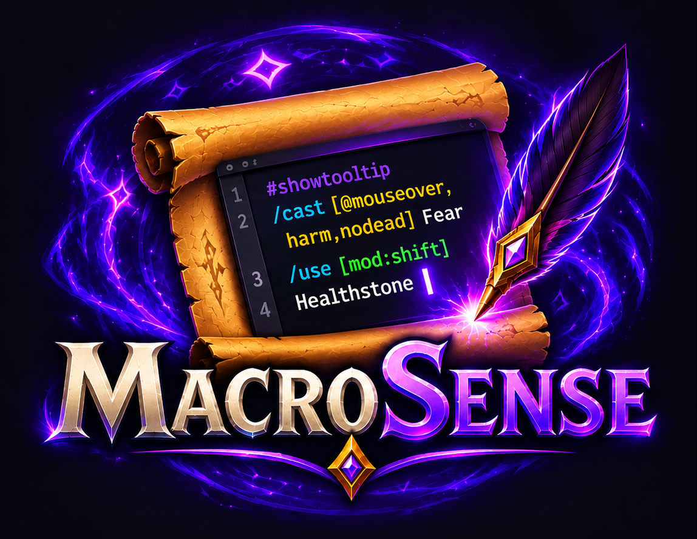</p>

<p align="center">
  A macro editor for <b>World of Warcraft</b> that knows macros<br>
  macro wizard · macro sets · macros from the spellbook · autocomplete · syntax highlighting · error checks · live preview · icon picker
</p>

<p align="center">
  <b>English</b> · <a href="README_UA.md">Українська</a>
</p>

---

> **Early development.** MacroSense is young and still growing. If something looks wrong or you miss a
> feature, please [open an issue](https://github.com/v-gachkovsky/macro-sense/issues): I read every report and try to fix things fast. `/ms bug` in game
> prints the details to include.

**New to macros?** [Macros, step by step](docs/GUIDE.md) explains what macros are, what they can do and how to
make them, with pictures and ready-made macros. In game, **?** in the editor's title bar (or `/ms help`) opens
the same guide in short, section by section, and **Create** next to a ready-made macro makes it for you. Its
**Practice** gives tasks with your own spells and class: write the macro in the editor, and **Check** says whether
it does what the task asks, or what to change.

## Overview

The Blizzard macro window is a plain text box. MacroSense opens your macros in a real editor: it suggests
commands, conditions, units, spells and items as you type, colors the syntax, underlines mistakes and
shows next to each line what it would do right now. The macros are the game's own (`CreateMacro` / `EditMacro`), so the Blizzard window, action bars and other
addons see every change. **New (Wizard)** builds them from a few simple questions, or from a form: mouseover,
focus, party members, modifier keys, trinkets and more. "From Spellbook" makes macros for the spells of your
spellbook, many at once.

Open it with the button on the minimap, `/ms` (or `/macrosense`, `/msense`), the **MacroSense** button in
the title bar of the Blizzard macro window, or **Shift + right-click** on a macro on an action bar, which opens
that macro. Drag the editor's title bar to move it and the dotted corner to resize it (780 x 460 at least).
Drag the minimap button to move it along the edge; `/ms minimap` hides it. On Retail, MacroSense is in the
addon menu by the minimap too.

In combat the game doesn't let addons change macros. **Save** then keeps your change, and the macro is saved
as soon as combat ends; other changes (deleting, copying, the wizard) wait until combat is over.

**Clients:** Retail, Mists of Pandaria Classic, TBC Anniversary, Classic Era and WoW Forever
(`## Interface: 120105, 50504, 20506, 11509, 16001`).

## Installation

Install it from [CurseForge](https://www.curseforge.com/wow/addons/macro-sense), or download the zip from
[Releases](https://github.com/v-gachkovsky/macro-sense/releases) and unpack it into
`World of Warcraft/<client>/Interface/AddOns/`. For development, symlink the `MacroSense` folder from this
repository instead.

## Macro wizard

<p align="center">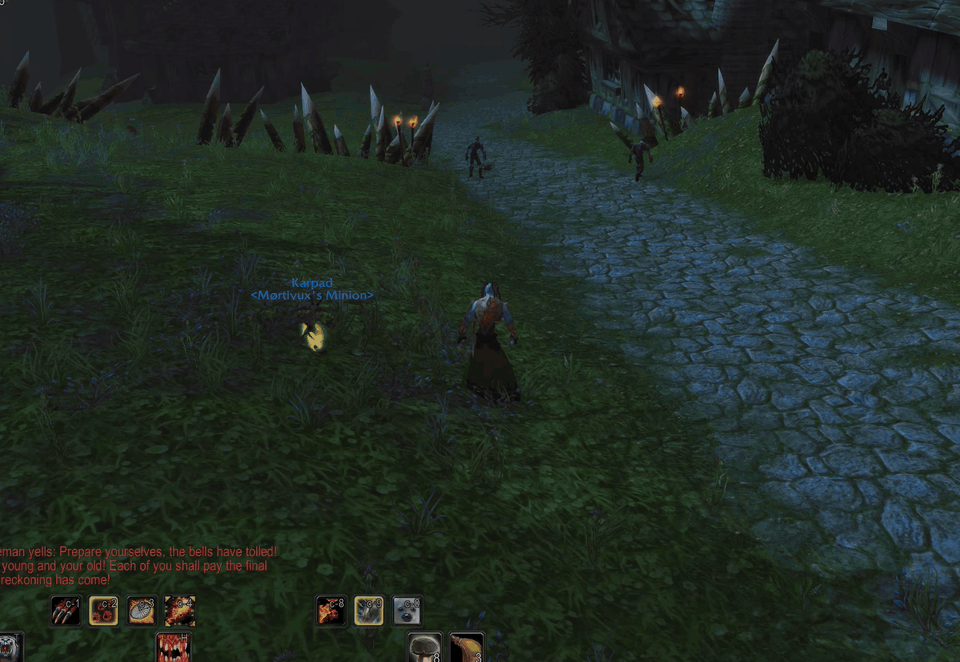</p>

**New (Wizard)**, next to New, opens a window for a new macro. The first time it asks **step by step**, one
question at a time in plain words, for whoever has never written a macro. **All options** in its title bar
shows the whole form at once instead, with the answers so far, and **Step by step** goes back to the
questions; the wizard opens as you left it.

### Step by step

<p align="center">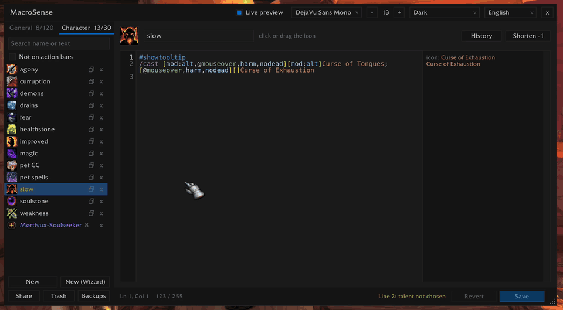</p>

- **What should the macro do?** Cast a spell, use an item, several spells in turn, one of several at random,
  target someone, set your focus, take someone's target, command your pet, ride a mount.
- Then what that needs: the spell or item (type a few letters, or pick it from the list) and
  its rank when it has several (Classic),
  the spells of a list in their order and what starts a sequence over, what the pet does.
- **Where should Flash Heal go?** On your target as usual, on whoever is under the mouse, on the ground under
  the cursor, on yourself, your focus, a party member... Each answer shows the macro's words for it
  (`@mouseover`), and its tooltip says what it is. When that one may not be there, the next question asks
  who then (**And if nobody is under the mouse?**), up to three. A spell or item that goes to nobody but you
  (Demon Armor, Bear Form: the game says it has no range) is not asked about.
- **On your group's tank** and **On your group's healer** (Group's tank and Group's healer in the form):
  `@tank` and `@heal` in the macro, see below.
- **Who is it for?** Friends, enemies, anyone, or friends dead or alive (for a resurrection): asked only when
  the game doesn't say what the spell is for (an item, Holy Shock). A spell for enemies is not offered for
  yourself, your pet, party members or your group's tank and healer, one for friends not for arena enemies.
- **Shift, Ctrl, Alt** (and **Cmd** on a Mac): for each key held, what it casts instead and where.
- **Ride a mount**: which mount, then one where you can fly and one for water (each may stay empty), what a press
  does on a mount (get off, but not in the air; get off anywhere; nothing), and a mount of their own for the keys
  held.
- **Put on gear**: which item, the slot it goes to (the default one, or a trinket, ring or hand slot) and when (always,
  or only with a key held), then another one, up to four; first an equipment set, when you have some.
- **Should the macro work only at certain times?** In or out of combat, in stealth, in a group, with your pet out,
  while channeling a spell or not, in a form; then, for a spell or item, what it casts the rest of the time.
- **Would you like to add anything else?** The same as the form's Also.
- Last, the name and who keeps the macro: all your characters or only this one. **Create macro**, or Enter in
  the name, saves it and opens it in the editor.

The macro shows at the bottom from the first answer. A click on an answer or a spell from the list only
chooses it, so you can see what it writes and choose another; **Next >** goes on, and **< Back** goes back with
the answers kept.

### A macro you already have

**Wizard**, next to History above the text, opens the macro shown in the wizard, with its answers filled in: the
spell, the units in order, the keys, the When row, the mounts, the gear. Change what you like with a few clicks,
then **Put in editor**. The new text goes into the editor, and Save keeps it (Ctrl+Z, Cmd+Z on a Mac, takes it
back). It works for macros the wizard could have made, also typed by hand or taken from a guide. When the wizard
writes some lines its own way or has no place for them (`/run`, a second `/cast`), it says so before you open it,
and the window shows those lines under **lines will change**. `[nomod]` (no key held) is the macro's own spell to
it: the wizard writes the keys first, then that spell, which does the same.

### Your group's tank and healer: @tank and @heal

`/cast [@tank,help,nodead][@pet,help,nodead] Misdirection` goes to your group's tank: the one with the tank role,
other than you, a raid's main tank first; `@heal` to its healer. The game doesn't know these units, so the macro
it keeps has the name instead (`@Bob`, `@Ann-Realm` from another realm), or `@none` while nobody has the role,
and MacroSense writes it again when your group changes, out of combat. A new tank or healer in your macros is
said in red mid-screen: `MacroSense: your group's new tank is Bob`, and so is one a macro has no room for (a
macro takes 255 characters). In MacroSense the macro stays with
`@tank`: change it and save, and it keeps working. The live preview runs it with the names, the explanations say
"your group's tank". Small letters only: `@Tank` is a player named Tank. A macro changed outside MacroSense (the
Blizzard window) keeps the names it has and is no longer kept up to date. The game finds the tank only when the
role is chosen (the group finder does it; in a group made by hand someone picks it) or, in a raid, a main tank
is set.

### The form

- **Command**: `/cast` or `/use` for one spell or item (it follows what you pick: an item sets `/use`),
  `/castsequence` for spells in turn, `/castrandom` for one of several at random. The form changes with it:
  a sequence asks what starts it over (a new target, the end of combat, Shift / Ctrl / Alt, some seconds
  without a press). `/use` offers your items first, then the equipment slots whose item has a use effect
  (`13`, `14`). `/target`, `/focus` and `/assist` take only units, party members among them: a key can take
  other units or clear the target / focus, and `/target` can also go by name (a rare, say). **Pet commands**:
  what the pet does without a key (attack, on units in order, follow, stay, move to the cursor, passive,
  defensive, aggressive, dismiss), and with each key held. **Mount**: a mount for anywhere, one where you can fly
  (from TBC on) and one for water, picked from your mounts only, and **On a mount**: what a press does there
  (`/cast [nomounted,swimming] Sea Turtle; [nomounted,flyable] Gryphon; [nomounted] Steed`,
  `/dismount [mounted,noflying]`). A key held calls another mount (a ground one where you could fly). **Put on
  gear**: up to four items from your bags or what you wear, each with its slot (`/equipslot 14` for the second
  trinket) and when it goes on (always, or with Shift, Ctrl or Alt held, or with no key), and an equipment set
  (`/equipset PvP`) where the game has them.
- **Cast** / **Use**: the spell or item. Type a few letters, or the first letters of its words in capitals (`FB`),
  and your spells and usable items come up; any other name works too. A spell with several learned ranks
  (Classic) then lists them: the spell itself first (the highest rank, also after you learn a new one), then
  each rank (`Fireball(Rank 3)`).
- **On**: who it goes to, in order, up to three: As usual (your target, or you when the game casts on you by
  itself), Your target, Mouseover, Focus, Group's tank, Group's healer (`@tank`, `@heal`), Yourself, Your pet,
  Party member 1-4, Target's target, Arena enemy 1-3, At the cursor. When one is not there, the next one is tried. A spell that goes to nobody but you
  (Demon Armor) sets As usual.
- **Only**: friends, enemies or anyone there, and **Alive only**. It follows the spell you pick, when the game
  knows what it is for; a key's own spell is checked for what it is for.
- **With a key held**: Shift, Ctrl and Alt (and Cmd on a Mac) can cast another spell, or the same one on someone else, with a
  fallback of their own (Alt: Frostbolt on Mouseover, then Your target).
- **When**: only in or out of combat, in stealth or not, in a group, a raid or alone, with your pet out or not, in
  one of your forms or none; every branch checks it (`[combat,@mouseover,harm,nodead][combat] Fireball`). A
  channeled spell (Drain Soul) stops when you press another one: **Not while channeling it** keeps a press of the
  macro from starting its own spell over (`[nochanneling:Drain Soul]`), **Not while channeling** waits for any of
  them (`[nochanneling]`). For `/cast` and `/use` the box under them says what it casts otherwise (`; Frostbolt`).
- **Also**: stop your cast first, use trinket 1 / 2 (named by what is in the slot), the nearest enemy if
  none is targeted, start auto attack, leave your form first, your pet attacks your target, get off your mount
  first, **Don't turn it off** for `/cast` and `/use` (`!Shoot`: pressed again, the macro doesn't turn off Auto
  Shot, Stealth, a form or an aura), cancel a buff first (it offers the buffs on you now, then those you have had), and say something in
  chat last (`%t` is your target's name).
- **Name** and **Tab**: the name follows the spell until you type your own; the tab is the one open first.

The macro shows under the form as you choose, with its colors and length. **Create macro** saves it under a
free name (`Frostbolt 2` when a macro has that name) and opens it in the editor, with its live preview.

| You choose | You get |
|------------|---------|
| Flash Heal on Mouseover, then As usual; friends | `/cast [@mouseover,help,nodead][] Flash Heal` |
| ... then Your target, then Yourself | `/cast [@mouseover,help,nodead][help,nodead][@player] Flash Heal` |
| Counterspell on Focus, then As usual; enemies; stop your cast first | `/stopcasting`, then `/cast [@focus,harm,nodead][] Counterspell` |
| Flash Heal on Party member 1; Shift on 2, Ctrl on 3, Alt on 4 | `/cast [mod:shift,@party2,help,nodead]...[@party1,help,nodead] Flash Heal` |
| Blizzard At the cursor | `/cast [@cursor] Blizzard` |
| /castsequence Corruption, Immolate; start over on a new target | `/castsequence reset=target Corruption, Immolate` |
| /focus on Mouseover, then Your target; Shift: Clear focus | `/clearfocus [mod:shift]`, `/stopmacro [mod:shift]`, `/focus [@mouseover,exists,nodead][@target,exists,nodead]` |
| /target Party member 1; Shift on 2, Ctrl on 3, Alt on 4 | `/target [mod:shift,@party2,help,nodead]...[@party1,help,nodead]` |
| Pet: Attack on Mouseover, then As usual; Shift: Follow; Ctrl: Move to the cursor | `/petattack [nomod:shift/ctrl,@mouseover,harm,nodead][nomod:shift/ctrl]`, `/petfollow [mod:shift]`, `/petmoveto [mod:ctrl,@cursor]` |
| Frostbolt as usual; Shift: Polymorph on Focus; trinket 1 | `#showtooltip Frostbolt`, `/use 13`, `/cast [mod:shift,@focus,harm,nodead] Polymorph; Frostbolt` |

## Macros from the spellbook

<p align="center">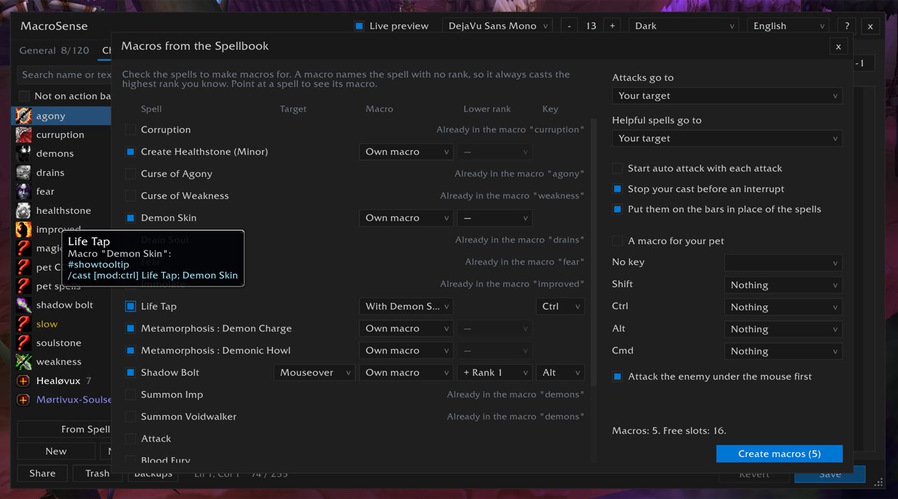</p>

"From Spellbook" (or `/ms book`) makes macros for the spells of your spellbook, many at once. Tick the spells:
each gets a macro that names its spell with no rank, so in the Classic clients it always casts the highest rank
you know, also after you learn a new one. Point at a spell to see its macro.

- **Where they go.** Attacks and helpful spells go to your target at first. Pick the enemy (or the friend) under
  the mouse, or your focus, for all of them at once. "Target" on a spell's row sends only that spell elsewhere;
  "—" keeps the choice for all.
- **Not enough slots.** A character has 30 macro slots, and the count at the bottom shows how many you would use.
  "Macro" on a row puts the spell into another spell's macro, cast while you hold Shift, Ctrl or Alt (Cmd on a
  Mac): `/cast [mod:shift] Frost Nova; Frostbolt`.
- **Lower rank** (Classic clients) puts a cheaper rank of the spell on a key: to heal a little, to put a cheap
  spell on an enemy for them to dispel, or to waste a warrior's Spell Reflection on it:
  `/cast [mod:shift] Shadow Bolt(Rank 1); Shadow Bolt`.
- **Auto attack** starts with each attack if you tick it (it is on at first for the classes that fight in
  melee), but never with spells that keep an enemy out of the fight, such as Sap or Polymorph: it would break
  them. Interrupts stop your cast first.
- **The pet.** Hunters and warlocks get one macro for the pet: what it does with no key held, and with each key.
- **On the bars.** The macros go into the character's tab, and onto the action bars in place of their spells.
  Delete such a macro in MacroSense and its spell comes back onto those buttons, if the macro still casts it.

Spells that some macro casts already are not ticked, nor those you left out before; you can still tick them.
Next time, only the spells you learned since are ticked. **Select all** ticks every spell (all ticked, it is
**Clear all**), and **Offer all again** forgets which spells you left out and which macros you deleted. With macro
sets on, the macros that find no free slot are made behind the scenes. If the game doesn't make a macro, the chat
says which.

**A new rank.** In the Classic clients a macro with `/cast Shadow Bolt` kept the rank it had when you learned a
new one, until you edited it. MacroSense now saves such macros again by itself, after combat if you are in one,
and the history keeps no version of it.

## Autocomplete

<p align="center">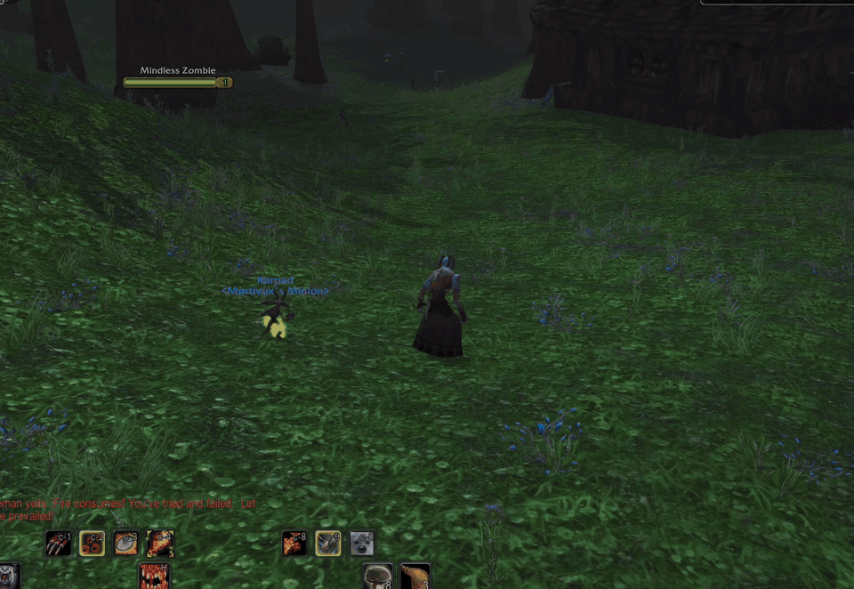</p>

| You type | You get |
|---|---|
| `/` | slash commands, emotes, chat commands (Blizzard and addons) |
| `/cast [` | macro conditions |
| `[@` / `[target=` | unit ids, then `...target` / `...pet` after one (`party1target`) |
| `[mod:` | `shift`, `ctrl`, `alt`, `cmd` on Mac, left / right keys (`lshift`, ...) |
| `[form:` / `[stance:` | your forms with their names (`1` Bear Form, ...) |
| `[spec:` / `[equipped:` / `[group:` / `[bar:` / `[btn:` / `[pet:` | specializations, weapon and armor types, `party` / `raid`, bar pages, buttons, your pet |
| `/cast ` or after `]` / `;` | spells (another specialization's with its name), then usable items from bags |
| a spell with several learned ranks (Classic) | its ranks, highest first: Tab inserts `Fireball(Rank 2)`, Esc keeps `Fireball` |
| `/use ` | usable items from bags and gear, then spells |
| `/equip ` / `/equipslot 13 ` | gear from bags |
| `/cancelaura ` | the buffs on you now, then those you have had (the last 200 seen, kept for each character) |
| `/use 1` / `/equipslot ` | equipment slots by number, with what is in them (`13` Trinket 1: ...) |
| `/use 0 ` | the slots of that bag that hold something, with the item (`/use 0 1`) |
| `/click ` | the buttons there are now, with what is on them: the game's bars, Bartender4, ElvUI, Dominos; then `LeftButton` ..., then `true` (a click on key press) |
| `/castsequence reset=` | `target`, `combat`, `shift`, `ctrl`, `alt` or seconds (`10`); after `/` the ones not used yet |
| `#` | `#showtooltip`, `#show` |

Two capitals or more are the first letters of words: `DA` finds Demon Armor, `SWP` Shadow Word: Pain, `CA` Curse
of Agony (words may be left out), and so does `CoA` (a small letter for a small word). The names with just those
first letters come first. Small letters stay in one word: first the names that start with them, then those with a
word that starts with them (`fi` finds Soul Fire; a space goes on to the next word, `sh wo` finds Shadow Word:
Pain), those that have them inside, and last those with a word that has them in that order from its start (`nmd`
finds `nomod`; `ds` doesn't find Demon Skin, `DS` does). Capitals that are no name's first letters count as small
ones, so Caps Lock doesn't get in the way.

Keys: **Tab** / **Enter** accept, **Up / Down** move, **PageUp / PageDown** jump 10, **Esc** closes the list.
The list shows 10 rows and scrolls (also with the mouse wheel) through the rest. Deleting never opens the list.
Editor: **Ctrl+S** save, **Ctrl+Z** undo, **Ctrl+Y** / **Ctrl+Shift+Z** redo, **Ctrl+F** search the macros,
**Ctrl+H** find and replace (Cmd instead of Ctrl on Mac).
Typing `[` adds the closing `]` with the cursor inside; typing `]` before it steps over it, and Backspace in
an empty `[]` removes both.

## Highlighting and error checks

<p align="center">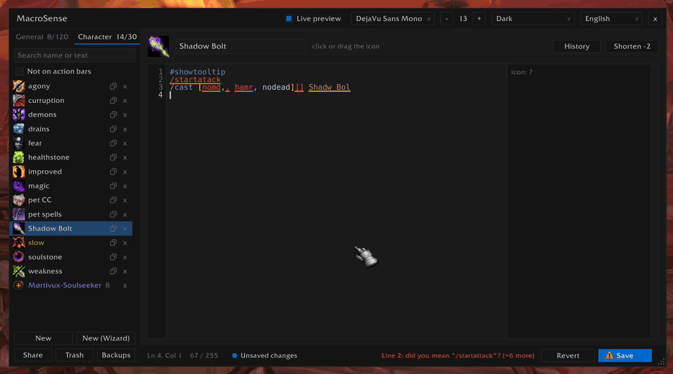</p>

- Line numbers in a gutter on the left, as in a code editor: a long line that wraps keeps one number, the
  cursor's line is bright, and the gutter follows the font and its size. Error messages refer to them.

- Fonts: DejaVu Sans Mono (default), JetBrains Mono, Fira Mono, Source Code Pro, Inconsolata, game fonts
  and any LibSharedMedia font. Size 8 to 28.
- Schemes: In-game (default): the game's own window background and border, red buttons and gold letters, in
  each client's art; and Dark, Light, Graphite, Charcoal, Paper, Monokai, Solarized Dark (palettes after the
  built-in themes of VS Code and JetBrains IDEs). Each macro token has a semantic role (keyword, property, string,
  ...), and a scheme colors roles, so new schemes are easy to add in `Themes.lua`.
- Syntax errors are underlined, the status bar names the first one with its line (all of them on hover, a
  click goes there) and Save shows a warning sign: unknown command or condition, `[` without `]`, `]` without `[`, an empty
  condition (`[harm,,dead]`), `@` or `target=` without a unit, `mod:` without a value, a wrong value
  (`btn:7`, `group:arena`, `mod:shfit`), a value for a condition that takes none (`combat:1`), a wrong
  `reset=` value (`reset=tagret`, `reset=1.5`), `reset=` outside `/castsequence`, a slot that doesn't exist
  (`/use 23`), `/equipslot` without the slot or the item, `item:` without a number. Spaces after
  commas are fine. A word you are typing that may still become valid (`comb` on its way to `combat`) is
  marked only after a short pause or on Save; a typo that can't (`mousovr`, `btn:7`) is marked at once.
- Ctrl+click on the status bar fixes what is clear (a plain click goes to the line): a typo in a command, condition, unit or value (`/cats` →
  `/cast`, `harmm` → `harm`, `@mousover` → `@mouseover`), a missing `]` or `[`, a stray `]`, an empty condition's
  comma, a value where none belongs (`combat:1`). Its tooltip says what the click does; Ctrl+Z takes it back.
  Ctrl+click on the underlined text in the editor does the same.
- Warnings are underlined in yellow and don't mark Save: an unknown unit (`@mousover`) may be a player's
  name, which macros allow.
- `/click`: a name no button has now is a warning (an addon may make it later), and so is a frame that is
  not a button; a misspelled mouse button (`RigthButton`) gets a fix; `down` as the last word is a warning,
  since the game reads it as no (`true` clicks on key press).
- A command this game version has but does nothing with is a warning: `/petmoveto` in Classic Era and TBC
  (the pet's Move To came with Cataclysm).
- A part that never runs is a warning: in `/cast [@mouseover,harm][] Arcane Shot; [mod:alt] Hunter's Mark`
  the game always stops at `[]` (empty brackets are always true, and so is a part with no conditions), so
  the Alt part has to come first, and Ctrl+click puts it there. The same for a line after one that always
  casts a spell with the global cooldown: that cooldown stops the spells with it below. When the spell above
  has a cooldown of its own, the warning says the line below works only while that spell is on cooldown. A
  spell below without the global cooldown is fine. When a key chooses each part of the line below
  (`[mod:alt]`), Ctrl+click moves them into the line above, first; without a key it is not clear what the
  macro was meant to do, and nothing is changed.
- In the macro list, a macro with errors has a red name and the warning sign, one with only warnings a
  yellow name; hover it to see the issues. The marks follow the saved text. **With mistakes** under the search
  keeps only those, from every macro at once; the tabs say how many each has.
- Typos in spell and item names: a name close to a known one (`Shadwo Bolt`) gets a warning,
  `did you mean "Shadow Bolt"?`; click it in the status bar to fix the name. Known names: your spells,
  your pets' spells (remembered from every pet you summon), items in your bags and seen before, Retail
  mounts. A name nothing is close to stays unmarked.
- Spells of yours the macro can't cast now are a warning: a talent you haven't chosen (`"Shadowfury": a talent
  you haven't chosen, the macro can't use it now`), another specialization's spell (`"Chaos Bolt" belongs to
  Destruction`), one you learn later (`you learn it at level 40`). A branch whose conditions check that
  themselves (`[spec:2]`, `[talent:...]`, `[known:...]`) is not marked. Such a macro turns yellow on the action
  bars too, and its tooltip there says why. The warnings follow your talents and specialization as they change,
  and a change that breaks macros on your bars says so on the screen, their names in chat.
  Retail and WoW Forever know your talent tree, Mists of Pandaria the talents of each row and the other
  specializations' spells, Classic Era and TBC the talents with no points.
- Mac: when a macro with `[mod:cmd]` is on a key that macOS uses with Cmd (Cmd+Q quits the game, Cmd+W,
  Cmd+H, Cmd+Tab, Cmd+Space, ...), the status bar warns, and so does the macro's tooltip on the action bar;
  the button with that key turns red.
  Keys are found from a direct `MACRO name` binding and the standard action bars; bars of addons (Bartender,
  ElvUI) are not checked.

<p align="center">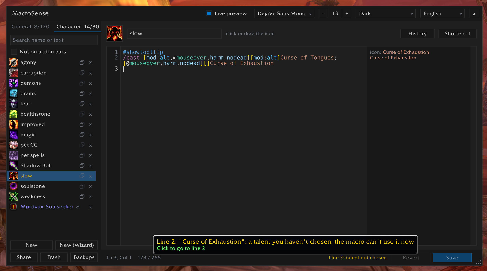</p>
<p align="center">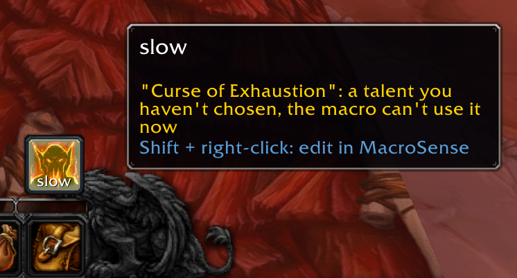</p>

<p align="center">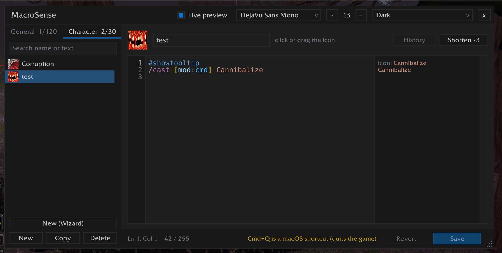</p>
<p align="center">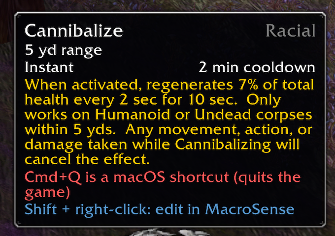
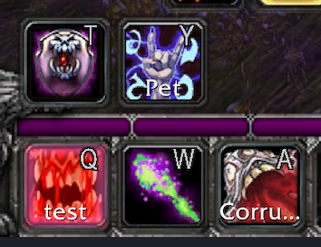</p>

## Live preview

Next to each line, a note says what it would do if you pressed the macro right now:

- the spell or item it casts, and on whom: `Fear @mouseover`
- `conditions not met` when none of its conditions hold, so the line does nothing; `does nothing` when one
  holds but names no spell or item
- the other commands it runs, by name: `runs /startattack`, `runs /target @focus`, chat and emotes
  (`runs /yell`); `says it in chat` for a line without a command
- `stops here` for a `/stopmacro` that fires, and `not reached` for the lines after it
- for `#showtooltip`, the icon the macro shows (`?` when nothing would be cast)

The notes follow the game several times a second: hold Shift, Ctrl, Alt (Cmd on Mac), change your target,
summon another pet or enter combat, and they change with it. While the mouse is on the editor there is no
mouseover unit: point at a unit in the world or at a unit frame to see the `@mouseover` branch. The game
itself checks the conditions (`SecureCmdOptionParse`, what macros run with). Lines with syntax errors get
no note. **Live preview** in the title bar turns it off; the text then takes the whole width.

Point at a line's number, or at its note, to read what the whole line does in plain words: every branch, not only
the one that would run now. `/cast [mod:shift,@focus,harm,nodead] Polymorph; Frostbolt` reads `with Shift held:
Polymorph on your focus, if it is an enemy and alive`, then `otherwise: Frostbolt`; a unit tried after another
one comes under it (`if not, on your target`). The line numbers explain with the live preview off too.

Drag a spell, mount or item from your spellbook, bags or action bars onto the text, or Shift-click it while
typing: its name goes in at the cursor, after `/cast` or `/use` on an empty line.

Point at a word for what it means: a command (`/stopmacro`), a condition (`nodead`, `mod:shift`), a unit
(`@focus`, `@party2target`), `#showtooltip`, `reset=`, the `!` of `!Shoot` (only turns it on: a press doesn't stop
your shooting or take you out of stealth). A spell or item shows the game's own tooltip. A line with `!` says so
in plain words too: `Shoot (only turns it on)`.

<p align="center">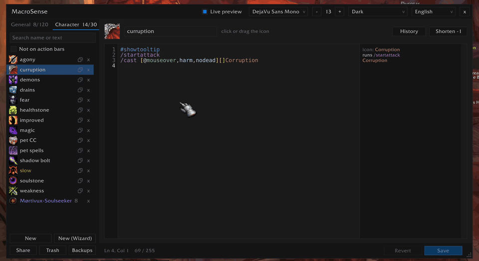</p>

## Shorten

<p align="center">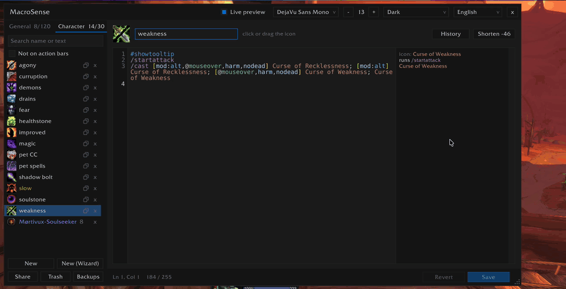</p>

Macros are limited to 255 characters. **Shorten** in the header writes the same macro in fewer characters
and says how many it saves (`Shorten -41`):

- `target=focus` becomes `@focus`; `modifier`, `button`, `actionbar`, `stance`, `equipped` become `mod`,
  `btn`, `bar`, `form`, `worn` (also their `no` forms)
- `[@mouseover,harm,nodead] Fear; Fear` becomes `[@mouseover,harm,nodead][]Fear`
- `[pet:Succubus][pet:Incubus]` becomes `[pet:Succubus/Incubus]`, `[mod:alt] X; [mod:shift] X` becomes
  `[mod:alt/shift]X` (only conditions that take alternatives, and not their `no` forms)
- spaces the game doesn't need and empty lines go

Chat, `/run`, commands of other addons and lines with errors stay as they are. Ctrl+Z (Cmd+Z on Mac)
brings the old text back.

## History

The game keeps only the last text of a macro; MacroSense keeps the ones before it. Every change saved to a
macro, in this editor, in the Blizzard macro window or by another addon, keeps the text it replaced (the last
10 per macro). **History** in the header lists them with when they were saved and how long they are: hover
one to see what it changes in the text now, as a diff (`- ` red: the line goes, `+ ` green: it comes back),
click it to put it in the editor. It is an unsaved change then: **Save** keeps it, Ctrl+Z
(Cmd+Z on Mac) takes it back. The versions follow a macro renamed, here or in the game's macro window.
General macros keep theirs for the account, character macros for the character.

## Macro list

The list shows the General or the Character tab, with how many macros each holds and how many fit.
**Search** above it keeps the macros whose name or text has what you type, in any case; the tabs then say how
many match in each (`General  (3)`). Enter opens the first match, Esc clears the search.

**Replace** next to the search (Ctrl+H) changes a word or a spell in many macros at once: what to find, what to
put instead, and where: General and Character, or with macro sets on each of the sets (in the game and behind the
scenes). Big and small letters count. It says how many it finds in how many macros before **Replace all**. The
game's macros keep the texts they had in their History; a macro that would get longer than 255 characters stays
as it is, and the chat says which. Not in combat.

Each macro in the list has two buttons at its end. **...** (a right click too) copies or moves it: **Duplicate**
into the same tab, **Copy to Character** / **Copy to General** into the other one, **Move to Character** / **Move
to General** there; with macro sets on, what can be done with it in the sets is there too. Dragging it onto the
other tab moves it, with Ctrl copies it. The copy gets a free name (`Fear 2`,
cut to fit 16 letters), because two macros with one name would share a key binding, and opens. The macro
being edited is copied with what the editor shows (name, icon, text) and keeps its saved text; another one is
copied as saved. **x** deletes the macro, after asking; the macro being edited stays open when another one
goes.

**Ctrl+click** (Cmd+click on a Mac) picks a macro, to do the same with many at once; a right click on a group's
name with macro sets on picks the whole group. A row over the list says how many are picked, and its **Actions**
share them in one code, move them into the other tab (while it has free slots), put them into a set, delete them
(those in the game go into the Trash), pick all the list shows or none. **x** on that row clears the picks.

**Add a note**, last in **...**, keeps a line of your own about the macro (`For the Onyxia pull`), outside its 255
characters: the macro's tooltip in the list shows it. The note follows the macro renamed or moved, goes into the
Trash with it and comes back with it. General macros keep theirs for the account, character macros for the
character.

Your other characters' own macros are in the **Character** tab too, under your macros: each character's name (your
realm first), and a click shows its macros, as they were when you last played it with MacroSense; with macro sets,
those behind the scenes too, with their set's name. Hover one to
read it; a click, or its "...", copies it into this character's tab or General, under a free name. The search
finds them too. The **x** next to a character forgets it: its macros and action bars are no longer shown or
counted, until you log in with it again.

**Move to Character** / **Move to General** in the same menu moves the macro into the other tab, which the game's
macro window can't do: its buttons on your action bars stay, its history goes along, and it doesn't land in the
trash. It keeps its name, unless the other tab has a macro of that name (then `Fear 2`).

Hover a macro to see where it is on the action bars: `On 2 buttons of your action bars`, `On the bars of
Destruction, Alt`. The game shows only the bars of the specialization you are in, so MacroSense remembers those of
each of your specializations and characters as it last saw them (each specialization has bars of its own, and
general macros are every character's). **Not on action bars** under the search keeps only the macros on no bar,
handy when a tab is full. Deleting a macro says where it is before it asks, and moving one that the bars of
another specialization or character have asks first: there it will be gone.

**Share** under the list makes a code of the macro, of the tab or of all your macros: copy it and send it
(Discord, a forum), and anyone with MacroSense makes the macros with **Share > Import a code or text**. Before
anything is made, the window says what the code holds and where each macro goes. Nothing is replaced: a
taken name gets a number (`Fear 2`), and a macro with no free slot in its tab is left out. The code is one
line of letters and digits, which chat apps leave as it is, ending in a dot, so words around it don't
matter; a code cut short or changed is refused. **Share > Export macro sets...** does the same for your
[macro sets](#macro-sets).

Guides (Wowhead, Icy Veins) and forums write macros as plain text, so **Import a code or text** takes that too:
paste the macro, or several split by an empty line, and each is made in the tab you are in, named after its first
spell. **Share > Copy this macro's text** gives the text the other way, to post anywhere.

**Share > Link this macro in chat**, or Shift-click on a macro in the list (yours or an alt's), puts
`[MacroSense: Fear MO]` into your message, or opens the chat with it, wherever the cursor is. Players with MacroSense see it as a link: a click asks you for the
macro (an addon whisper, no chat lines) and opens its code in the import window, where they see what it holds
before they import it. Without MacroSense it is just the name. Only the macros you link are given, as they were
when you linked them: the last 20. In combat in an instance the game blocks addon messages, and on Retail the
link stays plain text there.

<p align="center">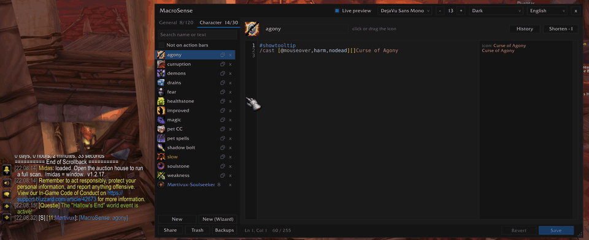</p>

**Trash** next to it keeps the macros you delete, here, in the game's macro window or with another addon:
the last 30 of each tab, General ones for the account, Character ones for the character. Hover one to
read it, click it to bring it back into its tab, under a free name if its own is taken; its **x** deletes it
for good. A macro renamed in the game's window is not taken for deleted.

**Backups** keeps all your macros as they were: one is made by itself on your first login of a day when
they changed, and **Back up now** makes one whenever you like (the last 10 for each character, each with
the General macros and the character's). Pick one to restore it: its macros get their text and icon back,
the deleted ones are made again, and the macros made since stay as they are. A backup of your macros now is
made first, so a restore can be undone too. The **x** next to a backup deletes it.

## Macro sets

A character has only 30 macro slots. Tick **Macro sets** in the editor, and MacroSense keeps more: each
specialization gets macros of its own, and only those you need now take a slot. They are off until you turn them
on, and a backup of your macros is made first.

- **Three kinds of sets.** **Class macros** are the same on all your characters of one class: change one, and the
  others get it too. **This character's** stay in every specialization; all your character macros start here. A
  **specialization's** macros come into the game when you choose it, onto the same buttons they had, and wait
  behind the scenes while you play another one. A macro of the same name in two specializations just changes its
  text, so its buttons never move. In Classic Era, TBC, Mists of Pandaria and WoW Forever the specializations are
  your two talent groups, **Primary** and **Secondary**: each has its own action bars there.
- **In the game and behind the scenes.** With the sets on, the Character tab has two parts: the macros in your
  slots, and those MacroSense keeps behind the scenes, which take no slot. Open, change, make and delete them
  there like any other. Class macros are yellow, the specialization now green, the rest behind the scenes red; one
  you keep behind the scenes on purpose has a grey name.
- **"..." on a macro** (a right click too): **Put away** / **Take in**, **Keep behind the scenes** for a
  specialization not chosen now, **Move to** / **Copy to** another set, **Duplicate**, **Remove** (back to this
  character's), and the other tab.
- **Dragging.** Drag a macro onto a group or a part of the list to move it there; hold Ctrl to copy it. Onto the
  General or Character tab it moves or copies there too, with the sets off as well. A sign by the mouse shows
  whether it can go there, and the chat says why not.
- **No free slot.** A macro that finds no free slot waits behind the scenes. A new one (New, the wizard, a copy,
  the trash, From Spellbook, an import) is then made behind the scenes, in this character's, after asking.
- **Sort by spells** looks at the spells each macro casts and offers to move it where it works, once you have
  played each specialization.
- **Turned off,** the macros behind the scenes come into the game, as many as fit; if not all fit, you choose
  which. Turned on again, they go back where they were, with what you changed meanwhile.
- **On another character.** **Share > Export macro sets...** makes a code of the sets you tick (**Select all** /
  **Clear all**). **Share > Import a code or text...** takes such a code, or the sets of another character of
  yours: each set into its own, another class's into this character's (said first), a taken name with a number,
  the very same macro skipped, all behind the scenes.
- **All or nothing.** If a change breaks halfway, MacroSense undoes it: your macros, sets and buttons are as they
  were. The chat says so; please report the error then.

`/ms sets log` prints what the sets did, for a bug report.

## Icons and action bars

Click the macro icon to choose another one: the question mark first (`#showtooltip` then picks the icon),
then icons of your spells and items, then every macro icon of the game, with the icons you put in
`Interface\Icons` yourself, as in the game's macro window. Search matches the names of your
spells and items, and of any spell in the game that uses an icon (achievements too, on Retail and Mists of
Pandaria). The game has no names for its icons, so the first time the grid opens they are looked up in the
background for a few seconds; its bottom line shows how far. MacroSense keeps them, so after that they are there
at once, until the next patch of the game. Point at an icon to see its names.
Drag its dotted corner to show more icons at once. It sits next to the editor; drag it by an empty spot to
move it away, and drop it next to the editor's right edge to dock it again (its border lights up).

A new macro starts with `#showtooltip` on the first line, and the cursor waits on the second.

**Tab** or **Enter** in the name goes on to the macro's text. A new macro is saved with the question mark
unless you pick an icon, so in the game its icon changes the way `#showtooltip` changes it. The editor and the
list show the icon the game shows, and it changes there too while you hold a key. Where the game shows only
the question mark (a new macro, or one just saved), MacroSense picks the icon as the game does: of what
`#showtooltip` shows right now, else of the first line that casts or uses something right now
(`/cast [mod:shift] Polymorph; Frostbolt` gives Frostbolt, or Polymorph while you hold Shift). If that gives
nothing (no line works right now, or the item isn't in your bags), the icon is that of the first spell or item
the text names, whatever its conditions; the game knows the icons of items you don't carry too. Last comes
the macro's name: `Kick Focus` gives Kick, `Poly MO` Polymorph. Such an icon is greyed while your action bars
show the question mark, and its tooltip says so. In the editor it follows what you type. An icon
you picked yourself is saved and shown as it is. In a macro with `#showtooltip` it gets a padlock in its
corner: the game won't change that icon. To let it, choose the question mark.

Drag a macro from the list, or its icon from the header, onto an action bar. **Shift + right-click** on it
there opens it in the editor instead of running it, and its tooltip says so: on the game's bars and those of
Bartender, Dominos and ElvUI. A macro with a spell you don't have now (a talent you haven't chosen, another
specialization's spell) turns yellow there, and its tooltip says why.

## Language

MacroSense speaks English and Ukrainian: pick one in the list in the editor's header, left of the color
scheme. The texts are made in the language when they are shown, so switching it reloads the interface (it
asks first, in the language picked). Everything MacroSense says is translated: the window, the wizard, menus,
tooltips, the error checks, the live preview and its chat lines; spell and item names stay as the game gives
them. The game has no Ukrainian client, so this is MacroSense's own setting, and on a client whose font has
no Cyrillic letters it writes with the game's own Friz Quadrata that has them.

## Commands

- `/ms` - open / close the editor
- `/ms help` - the macro guide in game, with ready-made macros and a link to the [full guide](docs/GUIDE.md)
- `/ms book` - macros from the spellbook
- `/ms sets` - what macro sets are, and turning them on; `/ms sets log` - what they did, for a bug report
- `/ms minimap` - hide / show the minimap button
- `/ms bug` - print the versions to include in a bug report
- `/ms autocomplete` - toggle autocomplete
- `/ms debug` - print the editor's key events and underline positions

## Development

### Layout

- `MacroSense/Locale.lua`, `MacroSense/Ukrainian.lua`: texts in the chosen language, by their English text;
  the Ukrainian translations. Pure Lua.
- `MacroSense/Parser.lua`: what the word under the cursor is. Pure Lua.
- `MacroSense/Highlight.lua`: tokenizer, colorizer, syntax errors, cursor mapping between raw and colored
  text. Pure Lua.
- `MacroSense/Completion.lua`: ranks suggestions. Pure Lua.
- `MacroSense/Spelling.lua`: the closest known name to a typo. Pure Lua.
- `MacroSense/Shorten.lua`: the same macro in fewer characters. Pure Lua.
- `MacroSense/Preview.lua`: what each line does now, for the live preview. Pure Lua; the game's condition
  check comes in from `Sources.lua` (`tests/fakeparse.lua` stands in for it in tests).
- `MacroSense/Explain.lua`: what a line does in plain words, every branch of it, for its tooltip. Pure Lua.
- `MacroSense/Docs.lua`: what a word of a macro means, for the tooltip of the word under the mouse. Pure Lua.
- `MacroSense/Editing.lua`: auto-closing brackets. Pure Lua.
- `MacroSense/Data.lua`, `MacroSense/Themes.lua`: static commands, conditions, units; fonts, schemes.
- `MacroSense/Conditions.lua`: condition values and unit ids, their checks and suggestions. Pure Lua.
- `MacroSense/Sources.lua`: live slash commands, spellbook and items (Retail and Classic APIs).
- `MacroSense/Shortcuts.lua`: macOS shortcut check for `[mod:cmd]`.
- `MacroSense/Wizard.lua`: the wizard's form as macro text. Pure Lua.
- `MacroSense/WizardRead.lua`: a macro back in the wizard's form, and the lines it would write otherwise. Pure Lua.
- `MacroSense/Questions.lua`: the wizard's form as questions, one at a time. Pure Lua.
- `MacroSense/Spellbook.lua`: macros from the spellbook: the spells to offer, the macros the choices make, what
  was made before. Pure Lua; the spellbook comes in a kit made in game.
- `MacroSense/Ranks.lua`: macros saved again when a spell gets a new rank. Which spells and macros is pure Lua.
- `MacroSense/History.lua`: earlier saved texts of each macro. The lists are pure Lua; watching the macros
  needs the game.
- `MacroSense/Share.lua`: macros and macro sets as a code and back. Pure Lua.
- `MacroSense/Sets.lua`: macro sets: the layers, what comes into the game with a specialization, the buttons put
  back, and every change all or nothing. The planning is pure Lua.
- `MacroSense/SetsWindow.lua`: what macro sets are, turning them on and off, and the questions they ask.
- `MacroSense/Backups.lua`: backups of all the macros, which to keep and what a restore does. Pure Lua.
- `MacroSense/ShareWindow.lua`: the window of a code, to export and to import.
- `MacroSense/Links.lua`: macros linked in chat. The text of a link and the parts of a code are pure Lua.
- `MacroSense/Roles.lua`: your group's tank and healer, and the macros with `@tank` or `@heal`, written again as
  the group changes.
- `MacroSense/CodeBox.lua`: the highlighted EditBox with undo, line numbers, error underlines and the
  notes column.
- `MacroSense/Autocomplete.lua`, `MacroSense/Popup.lua`: suggestion list.
- `MacroSense/IconPicker.lua`: icon grid.
- `MacroSense/IconNames.lua`: names for the game's icons from its spells and achievements, looked up in
  the background.
- `MacroSense/WizardWindow.lua`: the wizard's window.
- `MacroSense/SpellbookWindow.lua`: the window of macros from the spellbook.
- `MacroSense/Widgets.lua`, `MacroSense/Window.lua`: the window: the editor, its status bar and how it is built.
  `MacroSense/WindowList.lua`: its macro list; `MacroSense/WindowShare.lua`: the Share menu;
  `MacroSense/WindowTrash.lua`: the Trash and Backups menus; `MacroSense/WindowNotes.lua`: the notes on the
  macros; `MacroSense/WindowReplace.lua`: find and replace;
  `MacroSense/WindowPick.lua`: many macros picked at once. They share the window's state and helpers through `ns.WindowShared`.
- `MacroSense/MinimapButton.lua`: the minimap button. Where it sits on the edge is pure Lua.
- `MacroSense/ActionBars.lua`: Shift + right-click on a macro on an action bar, caught in the game's secure
  code, and the line in its tooltip; the tints: red for a macOS shortcut, yellow for a spell you don't have now.

### Tests

```sh
lua tests/run.lua   # parser, completion, highlighting, errors, typos, preview, explanations, shorten, history, wizard, its questions, macros from the spellbook, new ranks, schemes, shortcuts, minimap, icon names, share codes, backups
lua tests/ui.lua    # the whole addon against a fake WoW API
```

### Release

Push a version tag (`v0.1.0`, or `v0.1.0-beta1` for a pre-release). The GitHub workflow puts the version
into the TOC, packs the zip, makes a GitHub Release and uploads it to CurseForge, with the notes from
`CHANGELOG.md`. CurseForge needs the repository secret `CF_API_KEY` and the variable `CURSEFORGE_PROJECT_ID`.
The CurseForge description is in `docs/CURSEFORGE.md`.

## Support

MacroSense is free. If it helps you, you can support its development:

- [Ko-fi](https://ko-fi.com/mortivux)
- [monobank jar](https://send.monobank.ua/jar/2GZjyGouqJ)

Found a bug or have an idea? Tell me any way you like:

- comments on [CurseForge](https://www.curseforge.com/wow/addons/macro-sense)
- [GitHub Issues](https://github.com/v-gachkovsky/macro-sense/issues)
- email: [volodymyr.hachkovsky@icloud.com](mailto:volodymyr.hachkovsky@icloud.com)

## License

Code: MIT, see `LICENSE`; so are the icons, drawn for MacroSense (`MacroSense/Media/*.tga`). Fonts
keep their own free licenses: DejaVu (Bitstream Vera license), JetBrains Mono, Fira Mono, Source Code Pro
and Inconsolata (SIL OFL 1.1); the texts are in `MacroSense/Media/Fonts/`.

---

With ❤️ from 🇺🇦
