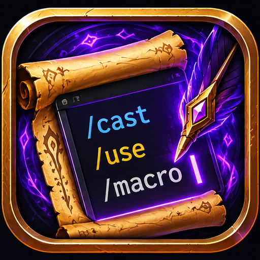

<p align="center"></p>

<h1 align="center">MacroSense</h1>

<p align="center">
  A macro editor for <b>World of Warcraft</b> that knows macros<br>
  autocomplete · syntax highlighting · error checks · icon picker
</p>

<p align="center">
  <b>English</b> · <a href="README_UA.md">Українська</a>
</p>

---

> **Early development.** MacroSense is young and still growing. If something looks wrong or you miss a
> feature, please [open an issue](https://github.com/v-gachkovsky/macro-sense/issues): I read every report and try to fix things fast. `/ms bug` in game
> prints the details to include.

## Overview

The Blizzard macro window is a plain text box. MacroSense opens your macros in a real editor: it suggests
commands, conditions, units, spells and items as you type, colors the syntax and underlines mistakes.
The macros are the game's own (`CreateMacro` / `EditMacro`), so the Blizzard window, action bars and other
addons see every change.

Open it with `/ms` (or `/macrosense`, `/msense`), or the **MacroSense** button next to the Blizzard macro
window. Drag the title bar to move it and the dotted corner to resize it (780 x 460 at least).

**Clients:** Retail, Mists of Pandaria Classic, TBC Anniversary, Classic Era and WoW Forever
(`## Interface: 120105, 50504, 20506, 11509, 16001`).

## Installation

Copy the `MacroSense` folder into `World of Warcraft/<client>/Interface/AddOns/`, or install it from
CurseForge once it is published. For development, symlink the folder from this repository instead.

## Autocomplete

| You type | You get |
|---|---|
| `/` | slash commands, emotes, chat commands (Blizzard and addons) |
| `/cast [` | macro conditions |
| `[@` / `[target=` | unit ids |
| `[mod:` | `shift`, `ctrl`, `alt`, and `cmd` on Mac |
| `/cast ` or after `]` / `;` | spells, then usable items from bags |
| a spell with several learned ranks (Classic) | its ranks, highest first: Tab inserts `Fireball(Rank 2)`, Esc keeps `Fireball` |
| `/use ` | usable items from bags and gear, then spells |
| `/equip ` / `/equipslot 13 ` | gear from bags |
| `#` | `#showtooltip`, `#show` |

Keys: **Tab** / **Enter** accept, **Up / Down** move, **Esc** closes the list. Deleting never opens the list.
Editor: **Ctrl+S** save, **Ctrl+Z** undo, **Ctrl+Y** / **Ctrl+Shift+Z** redo.
Typing `[` adds the closing `]` with the cursor inside; typing `]` before it steps over it, and Backspace in
an empty `[]` removes both.

## Highlighting and error checks

- Fonts: DejaVu Sans Mono (default), JetBrains Mono, Fira Mono, Source Code Pro, Inconsolata, game fonts
  and any LibSharedMedia font. Size 8 to 28.
- Schemes: Dark, Light, Graphite, Charcoal, Paper, Monokai, Solarized Dark (palettes after the built-in
  themes of VS Code and JetBrains IDEs). Each macro token has a semantic role (keyword, property, string,
  ...), and a scheme colors roles, so new schemes are easy to add in `Themes.lua`.
- Syntax errors are underlined, the status bar names the first one with its line (all of them on hover) and
  Save shows a warning sign: unknown command or condition, `[` without `]`, `]` without `[`, an empty
  condition (`[harm,,dead]`), `@` or `target=` without a unit, `mod:` without a value. Spaces after commas
  are fine. The word being typed is not marked until you move on.
- Mac: when a macro with `[mod:cmd]` is on a key that macOS uses with Cmd (Cmd+Q quits the game, Cmd+W,
  Cmd+H, Cmd+Tab, Cmd+Space, ...), the status bar warns. Keys are found from a direct `MACRO name` binding
  and the standard action bars; bars of addons (Bartender, ElvUI) are not checked.

## Icons and action bars

Click the macro icon to choose another one: the question mark first (`#showtooltip` then picks the icon),
then icons of your spells and items, then every macro icon of the game. Search matches spell and item names.
Drag its dotted corner to show more icons at once. It sits next to the editor; drag it by an empty spot to
move it away, and drop it next to the editor's right edge to dock it again (its border lights up).

Drag a macro from the list, or its icon from the header, onto an action bar.

## Commands

- `/ms` - open / close the editor
- `/ms bug` - print the versions to include in a bug report
- `/ms autocomplete` - toggle autocomplete
- `/ms debug` - print the editor's key events and underline positions

## Development

### Layout

- `MacroSense/Parser.lua`: what the word under the cursor is. Pure Lua.
- `MacroSense/Highlight.lua`: tokenizer, colorizer, syntax errors, cursor mapping between raw and colored
  text. Pure Lua.
- `MacroSense/Completion.lua`: ranks suggestions. Pure Lua.
- `MacroSense/Editing.lua`: auto-closing brackets. Pure Lua.
- `MacroSense/Data.lua`, `MacroSense/Themes.lua`: static commands, conditions, units; fonts, schemes.
- `MacroSense/Sources.lua`: live slash commands, spellbook and items (Retail and Classic APIs).
- `MacroSense/Shortcuts.lua`: macOS shortcut check for `[mod:cmd]`.
- `MacroSense/CodeBox.lua`: the highlighted EditBox with undo and error underlines.
- `MacroSense/Autocomplete.lua`, `MacroSense/Popup.lua`: suggestion list.
- `MacroSense/IconPicker.lua`: icon grid.
- `MacroSense/Widgets.lua`, `MacroSense/Window.lua`: the window.

### Tests

```sh
lua tests/run.lua   # parser, completion, highlighting, errors, schemes, shortcuts
lua tests/ui.lua    # the whole addon against a fake WoW API
```

### Release

Push a version tag (`v0.1.0`, or `v0.1.0-beta1` for a pre-release). The GitHub workflow puts the version
into the TOC, packs the zip, makes a GitHub Release and uploads it to CurseForge, with the notes from
`CHANGELOG.md`. CurseForge needs the repository secret `CF_API_KEY` and the variable `CURSEFORGE_PROJECT_ID`.
The CurseForge description is in `docs/CURSEFORGE.md`.

## License

Code: MIT, see `LICENSE`. Fonts keep their own free licenses: DejaVu (Bitstream Vera license),
JetBrains Mono, Fira Mono, Source Code Pro and Inconsolata (SIL OFL 1.1); the texts are in
`MacroSense/Media/Fonts/`.

---

With ❤️ from 🇺🇦
