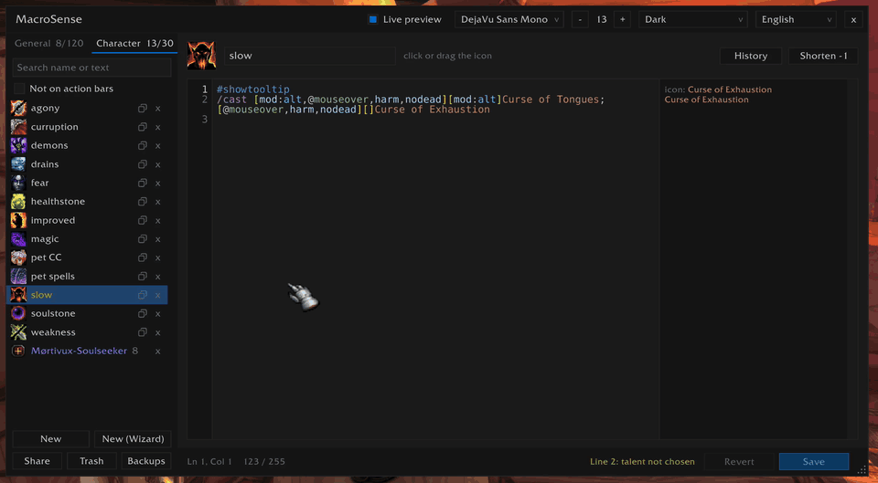
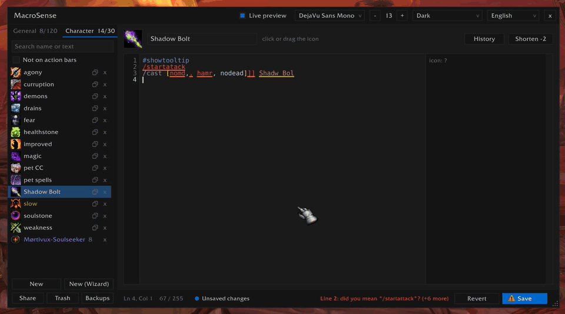
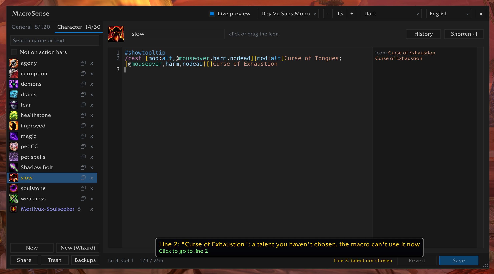
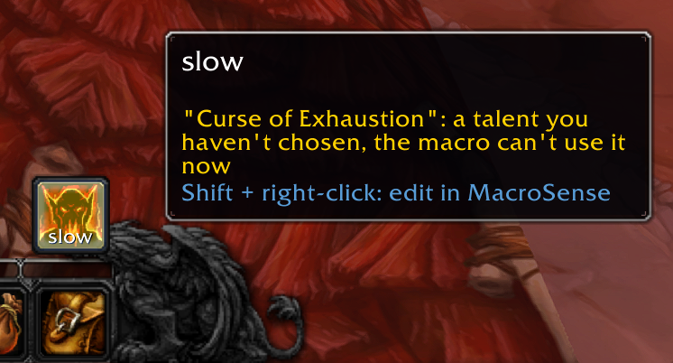
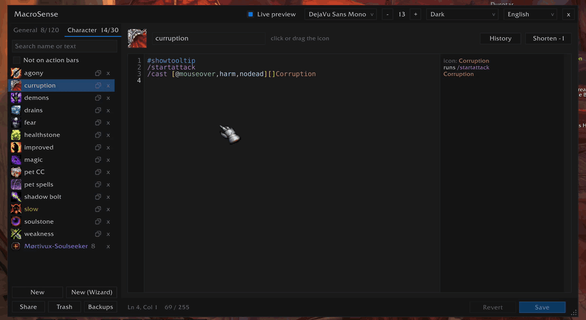
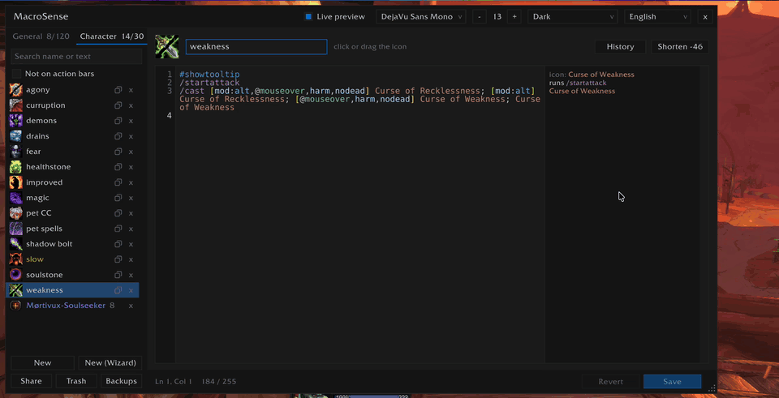
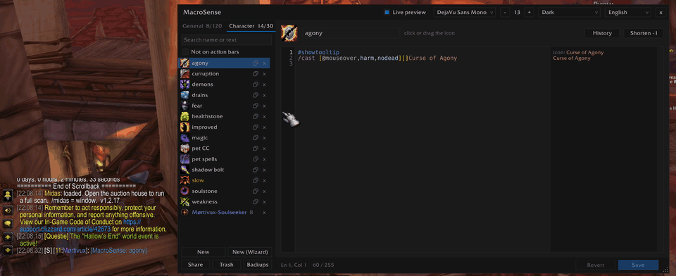

<p align="center"></p>

<p align="center">
  A macro editor for <b>World of Warcraft</b> that knows macros<br>
  macro wizard · autocomplete · syntax highlighting · error checks · live preview · icon picker
</p>

<p align="center">
  <b>English</b> · <a href="README_UA.md">Українська</a>
</p>

---

> **Early development.** MacroSense is young and still growing. If something looks wrong or you miss a
> feature, please [open an issue](https://github.com/v-gachkovsky/macro-sense/issues): I read every report and try to fix things fast. `/ms bug` in game
> prints the details to include.

## Overview

The Blizzard macro window is a plain text box. MacroSense opens your macros in a real editor: it suggests
commands, conditions, units, spells and items as you type, colors the syntax, underlines mistakes and
shows next to each line what it would do right now. The macros are the game's own (`CreateMacro` / `EditMacro`), so the Blizzard window, action bars and other
addons see every change. **New (Wizard)** builds them from a few simple questions, or from a form: mouseover,
focus, party members, modifier keys, trinkets and more.

Open it with the button on the minimap, `/ms` (or `/macrosense`, `/msense`), the **MacroSense** button in
the title bar of the Blizzard macro window, or **Shift + right-click** on a macro on an action bar, which opens
that macro. Drag the editor's title bar to move it and the dotted corner to resize it (780 x 460 at least).
Drag the minimap button to move it along the edge; `/ms minimap` hides it. On Retail, MacroSense is in the
addon menu by the minimap too.

**Clients:** Retail, Mists of Pandaria Classic, TBC Anniversary, Classic Era and WoW Forever
(`## Interface: 120105, 50504, 20506, 11509, 16001`).

## Installation

Install it from [CurseForge](https://www.curseforge.com/wow/addons/macro-sense), or download the zip from
[Releases](https://github.com/v-gachkovsky/macro-sense/releases) and unpack it into
`World of Warcraft/<client>/Interface/AddOns/`. For development, symlink the `MacroSense` folder from this
repository instead.

## Macro wizard

<p align="center"></p>

**New (Wizard)**, next to New, opens a window for a new macro. The first time it asks **step by step**, one
question at a time in plain words, for whoever has never written a macro. **All options** in its title bar
shows the whole form at once instead, with the answers so far, and **Step by step** goes back to the
questions; the wizard opens as you left it.

### Step by step

<p align="center"></p>

- **What should the macro do?** Cast a spell, use an item, several spells in turn, one of several at random,
  target someone, set your focus, take someone's target, command your pet, ride a mount.
- Then what that needs: the spell or item (type a few letters, or pick it from the list: picked, it goes on) and
  its rank when it has several (Classic),
  the spells of a list in their order and what starts a sequence over, what the pet does.
- **Where should Flash Heal go?** On your target as usual, on whoever is under the mouse, on the ground under
  the cursor, on yourself, your focus, a party member... Each answer shows the macro's words for it
  (`@mouseover`), and its tooltip says what it is. When that one may not be there, the next question asks
  who then (**And if nobody is under the mouse?**), up to three. A spell or item that goes to nobody but you
  (Demon Armor, Bear Form: the game says it has no range) is not asked about.
- **On your group's tank** and **On your group's healer** (Group's tank and Group's healer in the form):
  `@tank` and `@heal` in the macro, see below.
- **Who is it for?** Friends, enemies, anyone, or friends dead or alive (for a resurrection): asked only when
  the game doesn't say what the spell is for (an item, Holy Shock). A spell for enemies is not offered for
  yourself, your pet, party members or your group's tank and healer, one for friends not for arena enemies.
- **Shift, Ctrl, Alt** (and **Cmd** on a Mac): for each key held, what it casts instead and where.
- **Ride a mount**: which mount, then one where you can fly and one for water (each may stay empty), what a press
  does on a mount (get off, but not in the air; get off anywhere; nothing), and a mount of their own for the keys
  held.
- **Put on gear**: which item, the slot it goes to (the default one, or a trinket, ring or hand slot) and when (always,
  or only with a key held), then another one, up to four; first an equipment set, when you have some.
- **Should the macro work only at certain times?** In or out of combat, in stealth, in a group, with your pet out,
  in a form; then, for a spell or item, what it casts the rest of the time.
- **Would you like to add anything else?** The same as the form's Also.
- Last, the name and who keeps the macro: all your characters or only this one. **Create macro**, or Enter in
  the name, saves it and opens it in the editor.

The macro shows at the bottom from the first answer. A click on an answer goes on; **< Back** goes back with
the answers kept, and **Next >** keeps the one chosen.

### A macro you already have

**Wizard**, next to History above the text, opens the macro shown in the wizard, with its answers filled in: the
spell, the units in order, the keys, the When row, the mounts, the gear. Change what you like with a few clicks,
then **Put in editor**. The new text goes into the editor, and Save keeps it (Ctrl+Z, Cmd+Z on a Mac, takes it
back). It works for macros the wizard could have made, also typed by hand or taken from a guide. When the wizard
writes some lines its own way or has no place for them (`/run`, a second `/cast`), it says so before you open it,
and the window shows those lines under **lines will change**.

### Your group's tank and healer: @tank and @heal

`/cast [@tank,help,nodead][@pet,help,nodead] Misdirection` goes to your group's tank: the one with the tank role,
other than you, a raid's main tank first; `@heal` to its healer. The game doesn't know these units, so the macro
it keeps has the name instead (`@Bob`, `@Ann-Realm` from another realm), or `@none` while nobody has the role,
and MacroSense writes it again when your group changes, out of combat. A new tank or healer in your macros is
said in red mid-screen: `MacroSense: your group's new tank is Bob`, and so is one a macro has no room for (a
macro takes 255 characters). In MacroSense the macro stays with
`@tank`: change it and save, and it keeps working. The live preview runs it with the names, the explanations say
"your group's tank". Small letters only: `@Tank` is a player named Tank. A macro changed outside MacroSense (the
Blizzard window) keeps the names it has and is no longer kept up to date. The game finds the tank only when the
role is chosen (the group finder does it; in a group made by hand someone picks it) or, in a raid, a main tank
is set.

### The form

- **Command**: `/cast` or `/use` for one spell or item (it follows what you pick: an item sets `/use`),
  `/castsequence` for spells in turn, `/castrandom` for one of several at random. The form changes with it:
  a sequence asks what starts it over (a new target, the end of combat, Shift / Ctrl / Alt, some seconds
  without a press). `/use` offers your items first, then the equipment slots whose item has a use effect
  (`13`, `14`). `/target`, `/focus` and `/assist` take only units, party members among them: a key can take
  other units or clear the target / focus, and `/target` can also go by name (a rare, say). **Pet commands**:
  what the pet does without a key (attack, on units in order, follow, stay, move to the cursor, passive,
  defensive, aggressive, dismiss), and with each key held. **Mount**: a mount for anywhere, one where you can fly
  (from TBC on) and one for water, picked from your mounts only, and **On a mount**: what a press does there
  (`/cast [nomounted,swimming] Sea Turtle; [nomounted,flyable] Gryphon; [nomounted] Steed`,
  `/dismount [mounted,noflying]`). A key held calls another mount (a ground one where you could fly). **Put on
  gear**: up to four items from your bags or what you wear, each with its slot (`/equipslot 14` for the second
  trinket) and when it goes on (always, or with Shift, Ctrl or Alt held, or with no key), and an equipment set
  (`/equipset PvP`) where the game has them.
- **Cast** / **Use**: the spell or item. Type a few letters, or the first letters of its words in capitals (`FB`),
  and your spells and usable items come up; any other name works too. A spell with several learned ranks
  (Classic) then lists them: the spell itself first (the highest rank, also after you learn a new one), then
  each rank (`Fireball(Rank 3)`).
- **On**: who it goes to, in order, up to three: As usual (your target, or you when the game casts on you by
  itself), Your target, Mouseover, Focus, Group's tank, Group's healer (`@tank`, `@heal`), Yourself, Your pet,
  Party member 1-4, Target's target, Arena enemy 1-3, At the cursor. When one is not there, the next one is tried. A spell that goes to nobody but you
  (Demon Armor) sets As usual.
- **Only**: friends, enemies or anyone there, and **Alive only**. It follows the spell you pick, when the game
  knows what it is for; a key's own spell is checked for what it is for.
- **With a key held**: Shift, Ctrl and Alt (and Cmd on a Mac) can cast another spell, or the same one on someone else, with a
  fallback of their own (Alt: Frostbolt on Mouseover, then Your target).
- **When**: only in or out of combat, in stealth or not, in a group, a raid or alone, with your pet out or not, in
  one of your forms or none; every branch checks it (`[combat,@mouseover,harm,nodead][combat] Fireball`). For
  `/cast` and `/use` the box after them says what it casts otherwise (`; Frostbolt`).
- **Also**: stop your cast first, use trinket 1 / 2 (named by what is in the slot), the nearest enemy if
  none is targeted, start auto attack, leave your form first, your pet attacks your target, get off your mount
  first, cancel a buff first (it offers the buffs on you now, then those you have had), and say something in
  chat last (`%t` is your target's name).
- **Name** and **Tab**: the name follows the spell until you type your own; the tab is the one open first.

The macro shows under the form as you choose, with its colors and length. **Create macro** saves it under a
free name (`Frostbolt 2` when a macro has that name) and opens it in the editor, with its live preview.

| You choose | You get |
|------------|---------|
| Flash Heal on Mouseover, then As usual; friends | `/cast [@mouseover,help,nodead][] Flash Heal` |
| ... then Your target, then Yourself | `/cast [@mouseover,help,nodead][help,nodead][@player] Flash Heal` |
| Counterspell on Focus, then As usual; enemies; stop your cast first | `/stopcasting`, then `/cast [@focus,harm,nodead][] Counterspell` |
| Flash Heal on Party member 1; Shift on 2, Ctrl on 3, Alt on 4 | `/cast [mod:shift,@party2,help,nodead]...[@party1,help,nodead] Flash Heal` |
| Blizzard At the cursor | `/cast [@cursor] Blizzard` |
| /castsequence Corruption, Immolate; start over on a new target | `/castsequence reset=target Corruption, Immolate` |
| /focus on Mouseover, then Your target; Shift: Clear focus | `/clearfocus [mod:shift]`, `/stopmacro [mod:shift]`, `/focus [@mouseover,exists,nodead][@target,exists,nodead]` |
| /target Party member 1; Shift on 2, Ctrl on 3, Alt on 4 | `/target [mod:shift,@party2,help,nodead]...[@party1,help,nodead]` |
| Pet: Attack on Mouseover, then As usual; Shift: Follow; Ctrl: Move to the cursor | `/petattack [nomod:shift/ctrl,@mouseover,harm,nodead][nomod:shift/ctrl]`, `/petfollow [mod:shift]`, `/petmoveto [mod:ctrl,@cursor]` |
| Frostbolt as usual; Shift: Polymorph on Focus; trinket 1 | `#showtooltip Frostbolt`, `/use 13`, `/cast [mod:shift,@focus,harm,nodead] Polymorph; Frostbolt` |

## Autocomplete

<p align="center"></p>

| You type | You get |
|---|---|
| `/` | slash commands, emotes, chat commands (Blizzard and addons) |
| `/cast [` | macro conditions |
| `[@` / `[target=` | unit ids, then `...target` / `...pet` after one (`party1target`) |
| `[mod:` | `shift`, `ctrl`, `alt`, `cmd` on Mac, left / right keys (`lshift`, ...) |
| `[form:` / `[stance:` | your forms with their names (`1` Bear Form, ...) |
| `[spec:` / `[equipped:` / `[group:` / `[bar:` / `[btn:` / `[pet:` | specializations, weapon and armor types, `party` / `raid`, bar pages, buttons, your pet |
| `/cast ` or after `]` / `;` | spells (another specialization's with its name), then usable items from bags |
| a spell with several learned ranks (Classic) | its ranks, highest first: Tab inserts `Fireball(Rank 2)`, Esc keeps `Fireball` |
| `/use ` | usable items from bags and gear, then spells |
| `/equip ` / `/equipslot 13 ` | gear from bags |
| `/cancelaura ` | the buffs on you now, then those you have had (the last 200 seen, kept for each character) |
| `/use 1` / `/equipslot ` | equipment slots by number, with what is in them (`13` Trinket 1: ...) |
| `/use 0 ` | the slots of that bag that hold something, with the item (`/use 0 1`) |
| `/click ` | the buttons there are now, with what is on them: the game's bars, Bartender4, ElvUI, Dominos; then `LeftButton` ..., then `true` (a click on key press) |
| `/castsequence reset=` | `target`, `combat`, `shift`, `ctrl`, `alt` or seconds (`10`); after `/` the ones not used yet |
| `#` | `#showtooltip`, `#show` |

Two capitals or more are the first letters of words: `DA` finds Demon Armor, `SWP` Shadow Word: Pain, `CA` Curse
of Agony (words may be left out), and so does `CoA` (a small letter for a small word). The names with just those
first letters come first. Small letters stay in one word: first the names that start with them, then those with a
word that starts with them (`fi` finds Soul Fire; a space goes on to the next word, `sh wo` finds Shadow Word:
Pain), those that have them inside, and last those with a word that has them in that order from its start (`nmd`
finds `nomod`; `ds` doesn't find Demon Skin, `DS` does). Capitals that are no name's first letters count as small
ones, so Caps Lock doesn't get in the way.

Keys: **Tab** / **Enter** accept, **Up / Down** move, **PageUp / PageDown** jump 10, **Esc** closes the list.
The list shows 10 rows and scrolls (also with the mouse wheel) through the rest. Deleting never opens the list.
Editor: **Ctrl+S** save, **Ctrl+Z** undo, **Ctrl+Y** / **Ctrl+Shift+Z** redo, **Ctrl+F** search the macros
(Cmd instead of Ctrl on Mac).
Typing `[` adds the closing `]` with the cursor inside; typing `]` before it steps over it, and Backspace in
an empty `[]` removes both.

## Highlighting and error checks

<p align="center"></p>

- Line numbers in a gutter on the left, as in a code editor: a long line that wraps keeps one number, the
  cursor's line is bright, and the gutter follows the font and its size. Error messages refer to them.

- Fonts: DejaVu Sans Mono (default), JetBrains Mono, Fira Mono, Source Code Pro, Inconsolata, game fonts
  and any LibSharedMedia font. Size 8 to 28.
- Schemes: Dark, Light, Graphite, Charcoal, Paper, Monokai, Solarized Dark (palettes after the built-in
  themes of VS Code and JetBrains IDEs). Each macro token has a semantic role (keyword, property, string,
  ...), and a scheme colors roles, so new schemes are easy to add in `Themes.lua`.
- Syntax errors are underlined, the status bar names the first one with its line (all of them on hover, a
  click goes there) and Save shows a warning sign: unknown command or condition, `[` without `]`, `]` without `[`, an empty
  condition (`[harm,,dead]`), `@` or `target=` without a unit, `mod:` without a value, a wrong value
  (`btn:7`, `group:arena`, `mod:shfit`), a value for a condition that takes none (`combat:1`), a wrong
  `reset=` value (`reset=tagret`, `reset=1.5`), `reset=` outside `/castsequence`, a slot that doesn't exist
  (`/use 23`), `/equipslot` without the slot or the item, `item:` without a number. Spaces after
  commas are fine. A word you are typing that may still become valid (`comb` on its way to `combat`) is
  marked only after a short pause or on Save; a typo that can't (`mousovr`, `btn:7`) is marked at once.
- One click on the status bar fixes what is clear: a typo in a command, condition, unit or value (`/cats` →
  `/cast`, `harmm` → `harm`, `@mousover` → `@mouseover`), a missing `]` or `[`, a stray `]`, an empty condition's
  comma, a value where none belongs (`combat:1`). Its tooltip says what the click does; Ctrl+Z takes it back.
- Warnings are underlined in yellow and don't mark Save: an unknown unit (`@mousover`) may be a player's
  name, which macros allow.
- `/click`: a name no button has now is a warning (an addon may make it later), and so is a frame that is
  not a button; a misspelled mouse button (`RigthButton`) gets a fix; `down` as the last word is a warning,
  since the game reads it as no (`true` clicks on key press).
- A command this game version has but does nothing with is a warning: `/petmoveto` in Classic Era and TBC
  (the pet's Move To came with Cataclysm).
- In the macro list, a macro with errors has a red name and the warning sign, one with only warnings a
  yellow name; hover it to see the issues. The marks follow the saved text.
- Typos in spell and item names: a name close to a known one (`Shadwo Bolt`) gets a warning,
  `did you mean "Shadow Bolt"?`; click it in the status bar to fix the name. Known names: your spells,
  your pets' spells (remembered from every pet you summon), items in your bags and seen before, Retail
  mounts. A name nothing is close to stays unmarked.
- Spells of yours the macro can't cast now are a warning: a talent you haven't chosen (`"Shadowfury": a talent
  you haven't chosen, the macro can't use it now`), another specialization's spell (`"Chaos Bolt" belongs to
  Destruction`), one you learn later (`you learn it at level 40`). A branch whose conditions check that
  themselves (`[spec:2]`, `[talent:...]`, `[known:...]`) is not marked. Such a macro turns yellow on the action
  bars too, and its tooltip there says why. The warnings follow your talents and specialization as they change,
  and a change that breaks macros on your bars says so on the screen, their names in chat.
  Retail and WoW Forever know your talent tree, Mists of Pandaria the talents of each row and the other
  specializations' spells, Classic Era and TBC the talents with no points.
- Mac: when a macro with `[mod:cmd]` is on a key that macOS uses with Cmd (Cmd+Q quits the game, Cmd+W,
  Cmd+H, Cmd+Tab, Cmd+Space, ...), the status bar warns, and so does the macro's tooltip on the action bar;
  the button with that key turns red.
  Keys are found from a direct `MACRO name` binding and the standard action bars; bars of addons (Bartender,
  ElvUI) are not checked.

<p align="center"></p>
<p align="center"></p>

<p align="center"></p>
<p align="center">
</p>

## Live preview

Next to each line, a note says what it would do if you pressed the macro right now:

- the spell or item it casts, and on whom: `Fear @mouseover`
- `conditions not met` when none of its conditions hold, so the line does nothing; `does nothing` when one
  holds but names no spell or item
- the other commands it runs, by name: `runs /startattack`, `runs /target @focus`, chat and emotes
  (`runs /yell`); `says it in chat` for a line without a command
- `stops here` for a `/stopmacro` that fires, and `not reached` for the lines after it
- for `#showtooltip`, the icon the macro shows (`?` when nothing would be cast)

The notes follow the game several times a second: hold Shift, Ctrl, Alt (Cmd on Mac), change your target,
summon another pet or enter combat, and they change with it. While the mouse is on the editor there is no
mouseover unit: point at a unit in the world or at a unit frame to see the `@mouseover` branch. The game
itself checks the conditions (`SecureCmdOptionParse`, what macros run with). Lines with syntax errors get
no note. **Live preview** in the title bar turns it off; the text then takes the whole width.

Point at a line's number, or at its note, to read what the whole line does in plain words: every branch, not only
the one that would run now. `/cast [mod:shift,@focus,harm,nodead] Polymorph; Frostbolt` reads `with Shift held:
Polymorph on your focus, if it is an enemy and alive`, then `otherwise: Frostbolt`; a unit tried after another
one comes under it (`if not, on your target`). The line numbers explain with the live preview off too.

Drag a spell, mount or item from your spellbook, bags or action bars onto the text, or Shift-click it while
typing: its name goes in at the cursor, after `/cast` or `/use` on an empty line.

Point at a word for what it means: a command (`/stopmacro`), a condition (`nodead`, `mod:shift`), a unit
(`@focus`, `@party2target`), `#showtooltip`, `reset=`. A spell or item shows the game's own tooltip.

<p align="center"></p>

## Shorten

<p align="center"></p>

Macros are limited to 255 characters. **Shorten** in the header writes the same macro in fewer characters
and says how many it saves (`Shorten -41`):

- `target=focus` becomes `@focus`; `modifier`, `button`, `actionbar`, `stance`, `equipped` become `mod`,
  `btn`, `bar`, `form`, `worn` (also their `no` forms)
- `[@mouseover,harm,nodead] Fear; Fear` becomes `[@mouseover,harm,nodead][]Fear`
- `[pet:Succubus][pet:Incubus]` becomes `[pet:Succubus/Incubus]`, `[mod:alt] X; [mod:shift] X` becomes
  `[mod:alt/shift]X` (only conditions that take alternatives, and not their `no` forms)
- spaces the game doesn't need and empty lines go

Chat, `/run`, commands of other addons and lines with errors stay as they are. Ctrl+Z (Cmd+Z on Mac)
brings the old text back.

## History

The game keeps only the last text of a macro; MacroSense keeps the ones before it. Every change saved to a
macro, in this editor, in the Blizzard macro window or by another addon, keeps the text it replaced (the last
10 per macro). **History** in the header lists them with when they were saved and how long they are: hover
one to read it, click it to put it in the editor. It is an unsaved change then: **Save** keeps it, Ctrl+Z
(Cmd+Z on Mac) takes it back. The versions follow a macro renamed, here or in the game's macro window.
General macros keep theirs for the account, character macros for the character.

## Macro list

The list shows the General or the Character tab, with how many macros each holds and how many fit.
**Search** above it keeps the macros whose name or text has what you type, in any case; the tabs then say how
many match in each (`General  (3)`). Enter opens the first match, Esc clears the search.

Each macro in the list has two buttons at its end. **Copy** (two squares) copies it: **Duplicate** into the
same tab, **Copy to Character** / **Copy to General** into the other one. The copy gets a free name (`Fear 2`,
cut to fit 16 letters), because two macros with one name would share a key binding, and opens. The macro
being edited is copied with what the editor shows (name, icon, text) and keeps its saved text; another one is
copied as saved. **x** deletes the macro, after asking; the macro being edited stays open when another one
goes.

Your other characters' own macros are in the **Character** tab too, under your macros: each character's name (your
realm first), and a click shows its macros, as they were when you last played it with MacroSense. Hover one to
read it; a click, or its copy button, copies it into this character's tab or General, under a free name. The search
finds them too. The **x** next to a character forgets it: its macros and action bars are no longer shown or
counted, until you log in with it again.

**Move to Character** / **Move to General** in the same menu moves the macro into the other tab, which the game's
macro window can't do: its buttons on your action bars stay, its history goes along, and it doesn't land in the
trash. It keeps its name, unless the other tab has a macro of that name (then `Fear 2`).

Hover a macro to see where it is on the action bars: `On 2 buttons of your action bars`, `On the bars of
Destruction, Alt`. The game shows only the bars of the specialization you are in, so MacroSense remembers those of
each of your specializations and characters as it last saw them (each specialization has bars of its own, and
general macros are every character's). **Not on action bars** under the search keeps only the macros on no bar,
handy when a tab is full. Deleting a macro says where it is before it asks, and moving one that the bars of
another specialization or character have asks first: there it will be gone.

**Share** under the list makes a code of the macro, of the tab or of all your macros: copy it and send it
(Discord, a forum), and anyone with MacroSense makes the macros with **Share > Import a code or text**. Before
anything is made, the window says what the code holds and where each macro goes. Nothing is replaced: a
taken name gets a number (`Fear 2`), and a macro with no free slot in its tab is left out. The code is one
line of letters and digits, which chat apps leave as it is, ending in a dot, so words around it don't
matter; a code cut short or changed is refused.

Guides (Wowhead, Icy Veins) and forums write macros as plain text, so **Import a code or text** takes that too:
paste the macro, or several split by an empty line, and each is made in the tab you are in, named after its first
spell. **Share > Copy this macro's text** gives the text the other way, to post anywhere.

**Share > Link this macro in chat**, or Shift-click on a macro in the list (yours or an alt's), puts
`[MacroSense: Fear MO]` into your message, or opens the chat with it, wherever the cursor is. Players with MacroSense see it as a link: a click asks you for the
macro (an addon whisper, no chat lines) and opens its code in the import window, where they see what it holds
before they import it. Without MacroSense it is just the name. Only the macros you link are given, as they were
when you linked them: the last 20. In combat in an instance the game blocks addon messages, and on Retail the
link stays plain text there.

<p align="center"></p>

**Trash** next to it keeps the macros you delete, here, in the game's macro window or with another addon:
the last 30 of each tab, General ones for the account, Character ones for the character. Hover one to
read it, click it to bring it back into its tab, under a free name if its own is taken; its **x** deletes it
for good. A macro renamed in the game's window is not taken for deleted.

**Backups** keeps all your macros as they were: one is made by itself on your first login of a day when
they changed, and **Back up now** makes one whenever you like (the last 10 for each character, each with
the General macros and the character's). Pick one to restore it: its macros get their text and icon back,
the deleted ones are made again, and the macros made since stay as they are. A backup of your macros now is
made first, so a restore can be undone too. The **x** next to a backup deletes it.

## Icons and action bars

Click the macro icon to choose another one: the question mark first (`#showtooltip` then picks the icon),
then icons of your spells and items, then every macro icon of the game, with the icons you put in
`Interface\Icons` yourself, as in the game's macro window. Search matches the names of your
spells and items, and of any spell in the game that uses an icon (achievements too, on Retail and Mists of
Pandaria). The game has no names for its icons, so the first time the grid opens they are looked up in the
background for a few seconds; its bottom line shows how far. MacroSense keeps them, so after that they are there
at once, until the next patch of the game. Point at an icon to see its names.
Drag its dotted corner to show more icons at once. It sits next to the editor; drag it by an empty spot to
move it away, and drop it next to the editor's right edge to dock it again (its border lights up).

A new macro starts with `#showtooltip` on the first line, and the cursor waits on the second.

**Tab** or **Enter** in the name goes on to the macro's text. A new macro whose icon you haven't picked gets
the icon of the spell or item of yours it is named after: `fireball`, `Kick Focus` (Kick), `Poly MO`
(Polymorph), `Nova` (Frost Nova). Words like focus, mouseover or arena1 are skipped. If the name gives none,
the icon is the spell or item `#showtooltip` names, and with a bare `#showtooltip`, the first `/cast` or
`/use` that works without a modifier key held (`/cast [mod:shift] Polymorph; Frostbolt` gives Frostbolt). It
is looked for again when you save the macro. If nothing fits, the question mark stays. An icon you picked
yourself always stays.

Drag a macro from the list, or its icon from the header, onto an action bar. **Shift + right-click** on it
there opens it in the editor instead of running it, and its tooltip says so: on the game's bars and those of
Bartender, Dominos and ElvUI. A macro with a spell you don't have now (a talent you haven't chosen, another
specialization's spell) turns yellow there, and its tooltip says why.

## Language

MacroSense speaks English and Ukrainian: pick one in the list in the editor's header, left of the color
scheme. The texts are made in the language when they are shown, so switching it reloads the interface (it
asks first, in the language picked). Everything MacroSense says is translated: the window, the wizard, menus,
tooltips, the error checks, the live preview and its chat lines; spell and item names stay as the game gives
them. The game has no Ukrainian client, so this is MacroSense's own setting, and on a client whose font has
no Cyrillic letters it writes with the game's own Friz Quadrata that has them.

## Commands

- `/ms` - open / close the editor
- `/ms minimap` - hide / show the minimap button
- `/ms bug` - print the versions to include in a bug report
- `/ms autocomplete` - toggle autocomplete
- `/ms debug` - print the editor's key events and underline positions

## Development

### Layout

- `MacroSense/Locale.lua`, `MacroSense/Ukrainian.lua`: texts in the chosen language, by their English text;
  the Ukrainian translations. Pure Lua.
- `MacroSense/Parser.lua`: what the word under the cursor is. Pure Lua.
- `MacroSense/Highlight.lua`: tokenizer, colorizer, syntax errors, cursor mapping between raw and colored
  text. Pure Lua.
- `MacroSense/Completion.lua`: ranks suggestions. Pure Lua.
- `MacroSense/Spelling.lua`: the closest known name to a typo. Pure Lua.
- `MacroSense/Shorten.lua`: the same macro in fewer characters. Pure Lua.
- `MacroSense/Preview.lua`: what each line does now, for the live preview. Pure Lua; the game's condition
  check comes in from `Sources.lua` (`tests/fakeparse.lua` stands in for it in tests).
- `MacroSense/Explain.lua`: what a line does in plain words, every branch of it, for its tooltip. Pure Lua.
- `MacroSense/Docs.lua`: what a word of a macro means, for the tooltip of the word under the mouse. Pure Lua.
- `MacroSense/Editing.lua`: auto-closing brackets. Pure Lua.
- `MacroSense/Data.lua`, `MacroSense/Themes.lua`: static commands, conditions, units; fonts, schemes.
- `MacroSense/Conditions.lua`: condition values and unit ids, their checks and suggestions. Pure Lua.
- `MacroSense/Sources.lua`: live slash commands, spellbook and items (Retail and Classic APIs).
- `MacroSense/Shortcuts.lua`: macOS shortcut check for `[mod:cmd]`.
- `MacroSense/Wizard.lua`: the wizard's form as macro text. Pure Lua.
- `MacroSense/WizardRead.lua`: a macro back in the wizard's form, and the lines it would write otherwise. Pure Lua.
- `MacroSense/Questions.lua`: the wizard's form as questions, one at a time. Pure Lua.
- `MacroSense/History.lua`: earlier saved texts of each macro. The lists are pure Lua; watching the macros
  needs the game.
- `MacroSense/Share.lua`: macros as a code and back. Pure Lua.
- `MacroSense/Backups.lua`: backups of all the macros, which to keep and what a restore does. Pure Lua.
- `MacroSense/ShareWindow.lua`: the window of a code, to export and to import.
- `MacroSense/Links.lua`: macros linked in chat. The text of a link and the parts of a code are pure Lua.
- `MacroSense/Roles.lua`: your group's tank and healer, and the macros with `@tank` or `@heal`, written again as
  the group changes.
- `MacroSense/CodeBox.lua`: the highlighted EditBox with undo, line numbers, error underlines and the
  notes column.
- `MacroSense/Autocomplete.lua`, `MacroSense/Popup.lua`: suggestion list.
- `MacroSense/IconPicker.lua`: icon grid.
- `MacroSense/IconNames.lua`: names for the game's icons from its spells and achievements, looked up in
  the background.
- `MacroSense/WizardWindow.lua`: the wizard's window.
- `MacroSense/Widgets.lua`, `MacroSense/Window.lua`: the window.
- `MacroSense/MinimapButton.lua`: the minimap button. Where it sits on the edge is pure Lua.
- `MacroSense/ActionBars.lua`: Shift + right-click on a macro on an action bar, caught in the game's secure
  code, and the line in its tooltip; the tints: red for a macOS shortcut, yellow for a spell you don't have now.

### Tests

```sh
lua tests/run.lua   # parser, completion, highlighting, errors, typos, preview, explanations, shorten, history, wizard, its questions, schemes, shortcuts, minimap, icon names, share codes, backups
lua tests/ui.lua    # the whole addon against a fake WoW API
```

### Release

Push a version tag (`v0.1.0`, or `v0.1.0-beta1` for a pre-release). The GitHub workflow puts the version
into the TOC, packs the zip, makes a GitHub Release and uploads it to CurseForge, with the notes from
`CHANGELOG.md`. CurseForge needs the repository secret `CF_API_KEY` and the variable `CURSEFORGE_PROJECT_ID`.
The CurseForge description is in `docs/CURSEFORGE.md`.

## Support

MacroSense is free. If it helps you, you can support its development:

- [Ko-fi](https://ko-fi.com/mortivux)
- [monobank jar](https://send.monobank.ua/jar/2GZjyGouqJ)

Found a bug or have an idea? Tell me any way you like:

- comments on [CurseForge](https://www.curseforge.com/wow/addons/macro-sense)
- [GitHub Issues](https://github.com/v-gachkovsky/macro-sense/issues)
- email: [volodymyr.hachkovsky@icloud.com](mailto:volodymyr.hachkovsky@icloud.com)

## License

Code: MIT, see `LICENSE`; so is the copy icon, drawn for MacroSense (`MacroSense/Media/copy.tga`). Fonts
keep their own free licenses: DejaVu (Bitstream Vera license), JetBrains Mono, Fira Mono, Source Code Pro
and Inconsolata (SIL OFL 1.1); the texts are in `MacroSense/Media/Fonts/`.

---

With ❤️ from 🇺🇦
