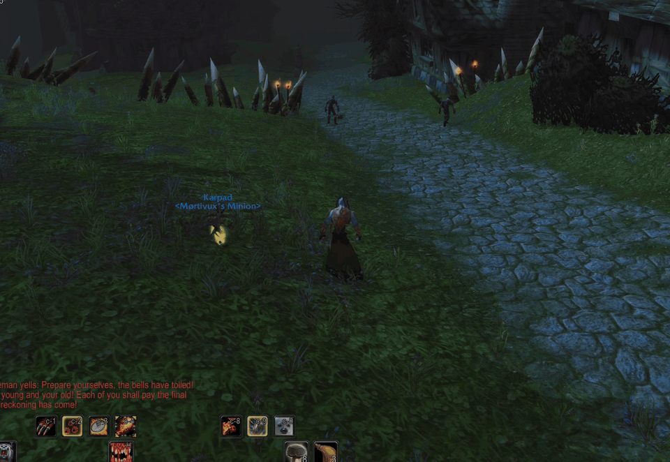
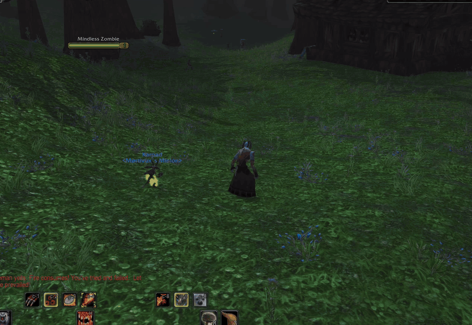
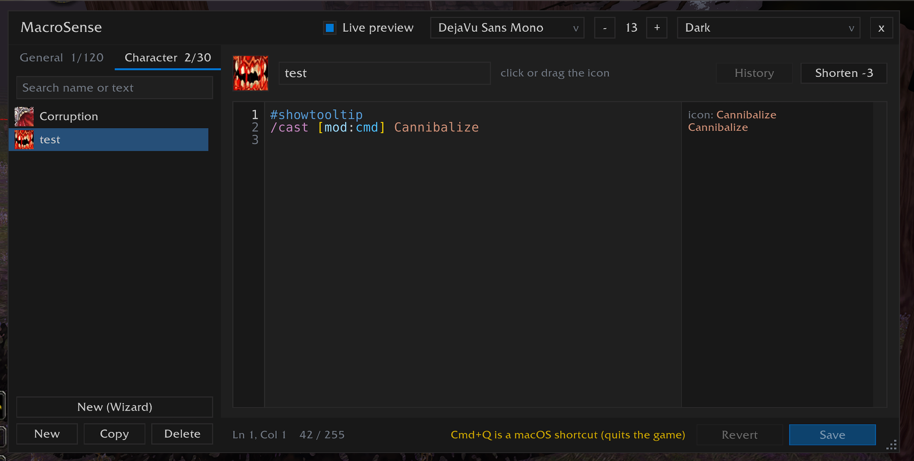
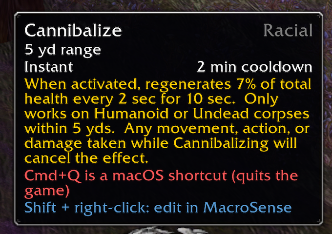
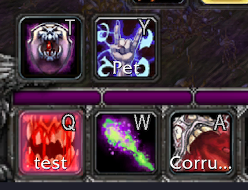

<p align="center"></p>

<p align="center">
  A macro editor for <b>World of Warcraft</b> that knows macros<br>
  macro wizard · autocomplete · syntax highlighting · error checks · live preview · icon picker
</p>

<p align="center">
  <b>English</b> · <a href="README_UA.md">Українська</a>
</p>

---

> **Early development.** MacroSense is young and still growing. If something looks wrong or you miss a
> feature, please [open an issue](https://github.com/v-gachkovsky/macro-sense/issues): I read every report and try to fix things fast. `/ms bug` in game
> prints the details to include.

## Overview

The Blizzard macro window is a plain text box. MacroSense opens your macros in a real editor: it suggests
commands, conditions, units, spells and items as you type, colors the syntax, underlines mistakes and
shows next to each line what it would do right now. The macros are the game's own (`CreateMacro` / `EditMacro`), so the Blizzard window, action bars and other
addons see every change. **New (Wizard)** builds them from a form: mouseover, focus, party members, modifier
keys, trinkets and more.

Open it with the button on the minimap, `/ms` (or `/macrosense`, `/msense`), the **MacroSense** button in
the title bar of the Blizzard macro window, or **Shift + right-click** on a macro on an action bar, which opens
that macro. Drag the editor's title bar to move it and the dotted corner to resize it (780 x 460 at least).
Drag the minimap button to move it along the edge; `/ms minimap` hides it. On Retail, MacroSense is in the
addon menu by the minimap too.

**Clients:** Retail, Mists of Pandaria Classic, TBC Anniversary, Classic Era and WoW Forever
(`## Interface: 120105, 50504, 20506, 11509, 16001`).

## Installation

Install it from [CurseForge](https://www.curseforge.com/wow/addons/macro-sense), or download the zip from
[Releases](https://github.com/v-gachkovsky/macro-sense/releases) and unpack it into
`World of Warcraft/<client>/Interface/AddOns/`. For development, symlink the `MacroSense` folder from this
repository instead.

## Macro wizard

<p align="center"></p>

**New (Wizard)**, over New / Copy / Delete, opens a window with a form for a new macro:

- **Command**: `/cast` or `/use` for one spell or item (it follows what you pick: an item sets `/use`),
  `/castsequence` for spells in turn, `/castrandom` for one of several at random. The form changes with it:
  a sequence asks what starts it over (a new target, the end of combat, Shift / Ctrl / Alt, some seconds
  without a press). `/use` offers your items first, then the equipment slots whose item has a use effect
  (`13`, `14`). `/target`, `/focus` and `/assist` take only units, party members among them: a key can take
  other units or clear the target / focus, and `/target` can also go by name (a rare, say). **Pet commands**:
  what the pet does without a key (attack, on units in order, follow, stay, move to the cursor, passive,
  defensive, aggressive, dismiss), and with each key held.
- **Cast** / **Use**: the spell or item. Type a few letters, or the first letters of its words in capitals (`FB`),
  and your spells and usable items come up; any other name works too.
- **On**: who it goes to, in order, up to three: As usual (your target, or you when the game casts on you by
  itself), Your target, Mouseover, Focus, Yourself, Your pet, Party member 1-4, Target's target, Arena enemy
  1-3, At the cursor. When one is not there, the next one is tried.
- **Only**: friends, enemies or anyone there, and **Alive only**. It follows the spell you pick, when the game
  knows what it is for.
- **With a key held**: Shift, Ctrl and Alt (and Cmd on a Mac) can cast another spell, or the same one on someone else, with a
  fallback of their own (Alt: Frostbolt on Mouseover, then Your target).
- **Also**: stop your cast first, use trinket 1 / 2 (named by what is in the slot), the nearest enemy if
  none is targeted, start auto attack, leave your form first, your pet attacks your target, get off your mount
  first, cancel a buff first, and say something in chat last (`%t` is your target's name).
- **Name** and **Tab**: the name follows the spell until you type your own; the tab is the one open first.

The macro shows under the form as you choose, with its colors and length. **Create macro** saves it under a
free name (`Frostbolt 2` when a macro has that name) and opens it in the editor, with its live preview.

| You choose | You get |
|------------|---------|
| Flash Heal on Mouseover, then As usual; friends | `/cast [@mouseover,help,nodead][] Flash Heal` |
| ... then Your target, then Yourself | `/cast [@mouseover,help,nodead][help,nodead][@player] Flash Heal` |
| Counterspell on Focus, then As usual; enemies; stop your cast first | `/stopcasting`, then `/cast [@focus,harm,nodead][] Counterspell` |
| Flash Heal on Party member 1; Shift on 2, Ctrl on 3, Alt on 4 | `/cast [mod:shift,@party2,help,nodead]...[@party1,help,nodead] Flash Heal` |
| Blizzard At the cursor | `/cast [@cursor] Blizzard` |
| /castsequence Corruption, Immolate; start over on a new target | `/castsequence reset=target Corruption, Immolate` |
| /focus on Mouseover, then Your target; Shift: Clear focus | `/clearfocus [mod:shift]`, `/stopmacro [mod:shift]`, `/focus [@mouseover,exists,nodead][@target,exists,nodead]` |
| /target Party member 1; Shift on 2, Ctrl on 3, Alt on 4 | `/target [mod:shift,@party2,help,nodead]...[@party1,help,nodead]` |
| Pet: Attack on Mouseover, then As usual; Shift: Follow; Ctrl: Move to the cursor | `/petattack [nomod:shift/ctrl,@mouseover,harm,nodead][nomod:shift/ctrl]`, `/petfollow [mod:shift]`, `/petmoveto [mod:ctrl,@cursor]` |
| Frostbolt as usual; Shift: Polymorph on Focus; trinket 1 | `#showtooltip Frostbolt`, `/use 13`, `/cast [mod:shift,@focus,harm,nodead] Polymorph; Frostbolt` |

## Autocomplete

<p align="center"></p>

| You type | You get |
|---|---|
| `/` | slash commands, emotes, chat commands (Blizzard and addons) |
| `/cast [` | macro conditions |
| `[@` / `[target=` | unit ids, then `...target` / `...pet` after one (`party1target`) |
| `[mod:` | `shift`, `ctrl`, `alt`, `cmd` on Mac, left / right keys (`lshift`, ...) |
| `[form:` / `[stance:` | your forms with their names (`1` Bear Form, ...) |
| `[spec:` / `[equipped:` / `[group:` / `[bar:` / `[btn:` / `[pet:` | specializations, weapon and armor types, `party` / `raid`, bar pages, buttons, your pet |
| `/cast ` or after `]` / `;` | spells, then usable items from bags |
| a spell with several learned ranks (Classic) | its ranks, highest first: Tab inserts `Fireball(Rank 2)`, Esc keeps `Fireball` |
| `/use ` | usable items from bags and gear, then spells |
| `/equip ` / `/equipslot 13 ` | gear from bags |
| `/use 1` / `/equipslot ` | equipment slots by number, with what is in them (`13` Trinket 1: ...) |
| `/use 0 ` | the slots of that bag that hold something, with the item (`/use 0 1`) |
| `/click ` | the buttons there are now, with what is on them: the game's bars, Bartender4, ElvUI, Dominos; then `LeftButton` ..., then `true` (a click on key press) |
| `/castsequence reset=` | `target`, `combat`, `shift`, `ctrl`, `alt` or seconds (`10`); after `/` the ones not used yet |
| `#` | `#showtooltip`, `#show` |

Two capitals or more are the first letters of words: `DA` finds Demon Armor, `SWP` Shadow Word: Pain, `CA` Curse
of Agony (words may be left out), and so does `CoA` (a small letter for a small word). The names with just those
first letters come first. Small letters stay in one word: first the names that start with them, then those with a
word that starts with them (`fi` finds Soul Fire; a space goes on to the next word, `sh wo` finds Shadow Word:
Pain), those that have them inside, and last those with a word that has them in that order from its start (`nmd`
finds `nomod`; `ds` doesn't find Demon Skin, `DS` does). Capitals that are no name's first letters count as small
ones, so Caps Lock doesn't get in the way.

Keys: **Tab** / **Enter** accept, **Up / Down** move, **PageUp / PageDown** jump 10, **Esc** closes the list.
The list shows 10 rows and scrolls (also with the mouse wheel) through the rest. Deleting never opens the list.
Editor: **Ctrl+S** save, **Ctrl+Z** undo, **Ctrl+Y** / **Ctrl+Shift+Z** redo, **Ctrl+F** search the macros
(Cmd instead of Ctrl on Mac).
Typing `[` adds the closing `]` with the cursor inside; typing `]` before it steps over it, and Backspace in
an empty `[]` removes both.

## Highlighting and error checks

- Line numbers in a gutter on the left, as in a code editor: a long line that wraps keeps one number, the
  cursor's line is bright, and the gutter follows the font and its size. Error messages refer to them.

- Fonts: DejaVu Sans Mono (default), JetBrains Mono, Fira Mono, Source Code Pro, Inconsolata, game fonts
  and any LibSharedMedia font. Size 8 to 28.
- Schemes: Dark, Light, Graphite, Charcoal, Paper, Monokai, Solarized Dark (palettes after the built-in
  themes of VS Code and JetBrains IDEs). Each macro token has a semantic role (keyword, property, string,
  ...), and a scheme colors roles, so new schemes are easy to add in `Themes.lua`.
- Syntax errors are underlined, the status bar names the first one with its line (all of them on hover) and
  Save shows a warning sign: unknown command or condition, `[` without `]`, `]` without `[`, an empty
  condition (`[harm,,dead]`), `@` or `target=` without a unit, `mod:` without a value, a wrong value
  (`btn:7`, `group:arena`, `mod:shfit`), a value for a condition that takes none (`combat:1`), a wrong
  `reset=` value (`reset=tagret`, `reset=1.5`), `reset=` outside `/castsequence`, a slot that doesn't exist
  (`/use 23`), `/equipslot` without the slot or the item, `item:` without a number. Spaces after
  commas are fine. A word you are typing that may still become valid (`comb` on its way to `combat`) is
  marked only after a short pause or on Save; a typo that can't (`mousovr`, `btn:7`) is marked at once.
- Warnings are underlined in yellow and don't mark Save: an unknown unit (`@mousover`) may be a player's
  name, which macros allow.
- `/click`: a name no button has now is a warning (an addon may make it later), and so is a frame that is
  not a button; a misspelled mouse button (`RigthButton`) gets a fix; `down` as the last word is a warning,
  since the game reads it as no (`true` clicks on key press).
- A command this game version has but does nothing with is a warning: `/petmoveto` in Classic Era and TBC
  (the pet's Move To came with Cataclysm).
- In the macro list, a macro with errors has a red name and the warning sign, one with only warnings a
  yellow name; hover it to see the issues. The marks follow the saved text.
- Typos in spell and item names: a name close to a known one (`Shadwo Bolt`) gets a warning,
  `did you mean "Shadow Bolt"?`; click it in the status bar to fix the name. Known names: your spells,
  your pets' spells (remembered from every pet you summon), items in your bags and seen before, Retail
  mounts. A name nothing is close to stays unmarked.
- Mac: when a macro with `[mod:cmd]` is on a key that macOS uses with Cmd (Cmd+Q quits the game, Cmd+W,
  Cmd+H, Cmd+Tab, Cmd+Space, ...), the status bar warns, and so does the macro's tooltip on the action bar;
  the button with that key turns red.
  Keys are found from a direct `MACRO name` binding and the standard action bars; bars of addons (Bartender,
  ElvUI) are not checked.

<p align="center"></p>
<p align="center">
</p>

## Live preview

Next to each line, a note says what it would do if you pressed the macro right now:

- the spell or item it casts, and on whom: `Fear @mouseover`
- `no match` when none of its conditions hold, so the line does nothing
- `runs` for other commands (`/petattack`, `/stopcasting`, emotes); `stops here` for a `/stopmacro` that
  fires, and `not reached` for the lines after it
- for `#showtooltip`, the icon the macro shows (`?` when nothing would be cast)

The notes follow the game several times a second: hold Shift, Ctrl, Alt (Cmd on Mac), change your target,
summon another pet or enter combat, and they change with it. While the mouse is on the editor there is no
mouseover unit: point at a unit in the world or at a unit frame to see the `@mouseover` branch. The game
itself checks the conditions (`SecureCmdOptionParse`, what macros run with). Lines with syntax errors get
no note. **Live preview** in the title bar turns it off; the text then takes the whole width.

## Shorten

Macros are limited to 255 characters. **Shorten** in the header writes the same macro in fewer characters
and says how many it saves (`Shorten -41`):

- `target=focus` becomes `@focus`; `modifier`, `button`, `actionbar`, `stance`, `equipped` become `mod`,
  `btn`, `bar`, `form`, `worn` (also their `no` forms)
- `[@mouseover,harm,nodead] Fear; Fear` becomes `[@mouseover,harm,nodead][]Fear`
- `[pet:Succubus][pet:Incubus]` becomes `[pet:Succubus/Incubus]`, `[mod:alt] X; [mod:shift] X` becomes
  `[mod:alt/shift]X` (only conditions that take alternatives, and not their `no` forms)
- spaces the game doesn't need and empty lines go

Chat, `/run`, commands of other addons and lines with errors stay as they are. Ctrl+Z (Cmd+Z on Mac)
brings the old text back.

## History

The game keeps only the last text of a macro; MacroSense keeps the ones before it. Every change saved to a
macro, in this editor, in the Blizzard macro window or by another addon, keeps the text it replaced (the last
10 per macro). **History** in the header lists them with when they were saved and how long they are: hover
one to read it, click it to put it in the editor. It is an unsaved change then: **Save** keeps it, Ctrl+Z
(Cmd+Z on Mac) takes it back. The versions follow a macro renamed here. General macros keep theirs for the
account, character macros for the character.

## Macro list

The list shows the General or the Character tab, with how many macros each holds and how many fit.
**Search** above it keeps the macros whose name or text has what you type, in any case; the tabs then say how
many match in each (`General  (3)`). Enter opens the first match, Esc clears the search. **Copy** under it
copies the macro being edited, with what the editor shows (name, icon, text): **Duplicate** into the
same tab, **Copy to Character** / **Copy to General** into the other one. The copy gets a free name (`Fear 2`,
cut to fit 16 letters), because two macros with one name would share a key binding; the macro copied keeps
its saved text.

## Icons and action bars

Click the macro icon to choose another one: the question mark first (`#showtooltip` then picks the icon),
then icons of your spells and items, then every macro icon of the game, with the icons you put in
`Interface\Icons` yourself, as in the game's macro window. Search matches the names of your
spells and items, and of any spell in the game that uses an icon (achievements too, on Retail and Mists of
Pandaria). The game has no names for its icons, so the first time the grid opens in a session they are looked
up in the background for a few seconds; its bottom line shows how far. Point at an icon to see its names.
Drag its dotted corner to show more icons at once. It sits next to the editor; drag it by an empty spot to
move it away, and drop it next to the editor's right edge to dock it again (its border lights up).

Drag a macro from the list, or its icon from the header, onto an action bar. **Shift + right-click** on it
there opens it in the editor instead of running it, and its tooltip says so: on the game's bars and those of
Bartender, Dominos and ElvUI.

## Commands

- `/ms` - open / close the editor
- `/ms minimap` - hide / show the minimap button
- `/ms bug` - print the versions to include in a bug report
- `/ms autocomplete` - toggle autocomplete
- `/ms debug` - print the editor's key events and underline positions

## Development

### Layout

- `MacroSense/Parser.lua`: what the word under the cursor is. Pure Lua.
- `MacroSense/Highlight.lua`: tokenizer, colorizer, syntax errors, cursor mapping between raw and colored
  text. Pure Lua.
- `MacroSense/Completion.lua`: ranks suggestions. Pure Lua.
- `MacroSense/Spelling.lua`: the closest known name to a typo. Pure Lua.
- `MacroSense/Shorten.lua`: the same macro in fewer characters. Pure Lua.
- `MacroSense/Preview.lua`: what each line does now, for the live preview. Pure Lua; the game's condition
  check comes in from `Sources.lua` (`tests/fakeparse.lua` stands in for it in tests).
- `MacroSense/Editing.lua`: auto-closing brackets. Pure Lua.
- `MacroSense/Data.lua`, `MacroSense/Themes.lua`: static commands, conditions, units; fonts, schemes.
- `MacroSense/Conditions.lua`: condition values and unit ids, their checks and suggestions. Pure Lua.
- `MacroSense/Sources.lua`: live slash commands, spellbook and items (Retail and Classic APIs).
- `MacroSense/Shortcuts.lua`: macOS shortcut check for `[mod:cmd]`.
- `MacroSense/Wizard.lua`: the wizard's form as macro text. Pure Lua.
- `MacroSense/History.lua`: earlier saved texts of each macro. The lists are pure Lua; watching the macros
  needs the game.
- `MacroSense/CodeBox.lua`: the highlighted EditBox with undo, line numbers, error underlines and the
  notes column.
- `MacroSense/Autocomplete.lua`, `MacroSense/Popup.lua`: suggestion list.
- `MacroSense/IconPicker.lua`: icon grid.
- `MacroSense/IconNames.lua`: names for the game's icons from its spells and achievements, looked up in
  the background.
- `MacroSense/WizardWindow.lua`: the wizard's window.
- `MacroSense/Widgets.lua`, `MacroSense/Window.lua`: the window.
- `MacroSense/MinimapButton.lua`: the minimap button. Where it sits on the edge is pure Lua.
- `MacroSense/ActionBars.lua`: Shift + right-click on a macro on an action bar, caught in the game's secure
  code, and the line in its tooltip.

### Tests

```sh
lua tests/run.lua   # parser, completion, highlighting, errors, typos, preview, shorten, history, wizard, schemes, shortcuts, minimap, icon names
lua tests/ui.lua    # the whole addon against a fake WoW API
```

### Release

Push a version tag (`v0.1.0`, or `v0.1.0-beta1` for a pre-release). The GitHub workflow puts the version
into the TOC, packs the zip, makes a GitHub Release and uploads it to CurseForge, with the notes from
`CHANGELOG.md`. CurseForge needs the repository secret `CF_API_KEY` and the variable `CURSEFORGE_PROJECT_ID`.
The CurseForge description is in `docs/CURSEFORGE.md`.

## License

Code: MIT, see `LICENSE`. Fonts keep their own free licenses: DejaVu (Bitstream Vera license),
JetBrains Mono, Fira Mono, Source Code Pro and Inconsolata (SIL OFL 1.1); the texts are in
`MacroSense/Media/Fonts/`.

---

With ❤️ from 🇺🇦
