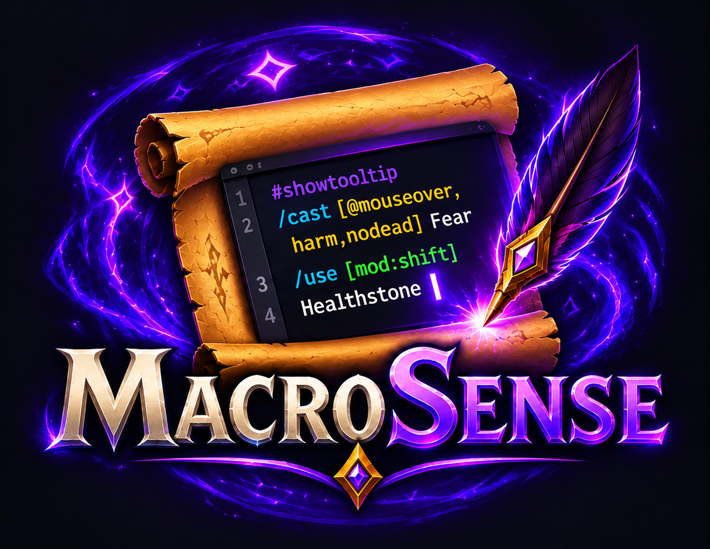

<p align="center"></p>

<p align="center">
  Редактор макросів для <b>World of Warcraft</b>, який розуміє макроси<br>
  автодоповнення · підсвітка синтаксису · перевірка помилок · вибір іконки
</p>

<p align="center">
  <a href="README.md">English</a> · <b>Українська</b>
</p>

---

> **Рання стадія розробки.** MacroSense ще молодий і росте. Якщо щось працює не так або вам бракує
> можливості, [створіть issue](https://github.com/v-gachkovsky/macro-sense/issues), будь ласка: я читаю кожне повідомлення і намагаюся швидко виправляти.
> Команда `/ms bug` у грі покаже, що додати до звіту.

## Огляд

Стандартне вікно макросів у WoW — просте текстове поле. MacroSense відкриває ваші макроси у справжньому
редакторі: підказує команди, умови, юніти, спели й предмети під час набору, підсвічує синтаксис і підкреслює
помилки. Макроси лишаються звичайними макросами гри (`CreateMacro` / `EditMacro`), тож стандартне вікно,
панелі дій та інші аддони бачать усі зміни.

Відкривається командою `/ms` (або `/macrosense`, `/msense`) чи кнопкою **MacroSense** біля стандартного
вікна макросів. Перетягуйте вікно за заголовок, а розмір змінюйте за кутик із крапками (щонайменше 780 x 460).

**Клієнти:** Retail, Mists of Pandaria Classic, TBC Anniversary, Classic Era і WoW Forever.

## Встановлення

Скопіюйте папку `MacroSense` у `World of Warcraft/<клієнт>/Interface/AddOns/` або встановіть з CurseForge,
коли аддон там з'явиться. Для розробки краще зробити симлінк на папку з цього репозиторію.

## Автодоповнення

| Набираєте | Отримуєте |
|---|---|
| `/` | slash-команди, емоції, команди чату (гри та аддонів) |
| `/cast [` | умови макросів |
| `[@` / `[target=` | юніти, а після юніта ще `...target` / `...pet` (`party1target`) |
| `[mod:` | `shift`, `ctrl`, `alt`, на Mac ще `cmd`, ліві / праві клавіші (`lshift`, ...) |
| `[form:` / `[stance:` | ваші форми з назвами (`1` Bear Form, ...) |
| `[spec:` / `[equipped:` / `[group:` / `[bar:` / `[btn:` / `[pet:` | спеціалізації, типи зброї та броні, `party` / `raid`, сторінки панелей, кнопки миші, ваш пет |
| `/cast ` або після `]` / `;` | спели, потім предмети з сумок, які можна використати |
| спел із кількома вивченими рангами (Classic) | його ранги, від найвищого: Tab вставить `Fireball(Rank 2)`, Esc лишить `Fireball` |
| `/use ` | предмети з ефектом використання (сумки та екіпіровка), потім спели |
| `/equip ` / `/equipslot 13 ` | екіпіровка з сумок |
| `#` | `#showtooltip`, `#show` |

Клавіші: **Tab** / **Enter** вставляють, **↑ / ↓** гортають список, **Esc** закриває його. Видалення список
не відкриває. У редакторі: **Ctrl+S** зберегти, **Ctrl+Z** скасувати, **Ctrl+Y** / **Ctrl+Shift+Z** повторити.
Коли набираєте `[`, редактор сам додає `]` і ставить курсор усередину; `]` перед уже вставленою дужкою
просто переступає її, а Backspace у порожніх `[]` прибирає обидві.

## Підсвітка й перевірка помилок

- Шрифти: DejaVu Sans Mono (за замовчуванням), JetBrains Mono, Fira Mono, Source Code Pro, Inconsolata,
  шрифти гри та LibSharedMedia. Розмір від 8 до 28.
- Теми: Dark, Light, Graphite, Charcoal, Paper, Monokai, Solarized Dark.
- Помилки підкреслюються, статус-бар називає першу з номером рядка (усі — при наведенні), а на кнопці Save
  з'являється знак оклику: невідома команда чи умова, `[` без `]`, `]` без `[`, порожня умова
  (`[harm,,dead]`), `@` чи `target=` без юніта, `mod:` без значення, неправильне значення (`btn:7`,
  `group:arena`, `mod:shfit`), значення для умови, яка його не приймає (`combat:1`). Пробіли після ком — не
  помилка. Слово, яке ви зараз набираєте, не позначається, поки не перейдете далі.
- Попередження підкреслюються жовтим і не позначають Save: невідомий юніт (`@mousover`) може бути іменем
  гравця, а макроси це дозволяють.
- Mac: якщо макрос із `[mod:cmd]` стоїть на клавіші, яку macOS використовує разом із Cmd (Cmd+Q закриває
  гру, Cmd+W, Cmd+H, Cmd+Tab, Cmd+Space, ...), статус-бар попередить. Перевіряються пряма прив'язка
  макросу та стандартні панелі; панелі Bartender чи ElvUI — ні.

## Іконки й панелі дій

Клікніть по іконці макросу, щоб вибрати іншу: спершу знак питання (тоді іконку вибирає `#showtooltip`),
потім іконки ваших спелів і предметів, далі всі іконки гри. Пошук — за назвою спела чи предмета.
Сітку можна розтягнути за кутик із крапками, відтягнути від редактора за порожнє місце і приліпити назад до
його правого краю (рамка підсвічується).

Макрос можна перетягнути на панель дій зі списку або за іконку в шапці.

## Команди

- `/ms` — відкрити / закрити редактор
- `/ms bug` — версії для звіту про баг
- `/ms autocomplete` — увімкнути / вимкнути автодоповнення
- `/ms debug` — друкувати події клавіш редактора та позиції підкреслень

## Розробка

Тести запускаються звичайним Lua:

```sh
lua tests/run.lua   # парсер, підказки, підсвітка, помилки, теми, сполучення macOS
lua tests/ui.lua    # увесь аддон на імітації WoW API
```

Реліз: тег `v0.1.0` (або `v0.1.0-beta1` для пре-релізу). GitHub Actions підставить версію в TOC, збере zip,
створить GitHub Release і завантажить файл на CurseForge з нотатками з `CHANGELOG.md`. Для CurseForge
потрібні секрет `CF_API_KEY` і змінна `CURSEFORGE_PROJECT_ID`. Опис для CurseForge — у `docs/CURSEFORGE.md`.

## Ліцензія

Код: MIT, див. `LICENSE`. Шрифти мають власні вільні ліцензії: DejaVu (ліцензія Bitstream Vera),
JetBrains Mono, Fira Mono, Source Code Pro та Inconsolata (SIL OFL 1.1); тексти — у `MacroSense/Media/Fonts/`.

---

З ❤️ з 🇺🇦
