<p align="center">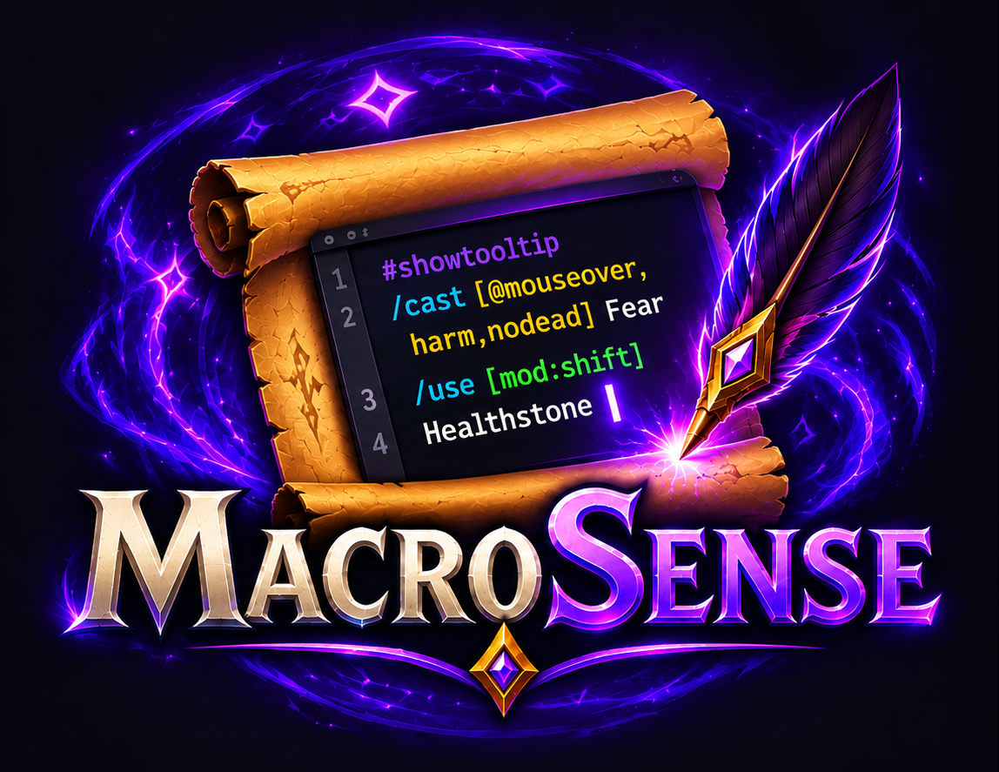</p>

<p align="center">
  Редактор макросів для <b>World of Warcraft</b>, який розуміє макроси<br>
  майстер макросів · набори макросів · макроси з книги заклинань · автодоповнення · підсвітка синтаксису · перевірка помилок · живий перегляд · вибір іконки
</p>

<p align="center">
  <a href="README.md">English</a> · <b>Українська</b>
</p>

---

> **Рання стадія розробки.** MacroSense ще молодий і росте. Якщо щось працює не так або вам бракує
> можливості, [створіть issue](https://github.com/v-gachkovsky/macro-sense/issues), будь ласка: я читаю кожне повідомлення і намагаюся швидко виправляти.
> Команда `/ms bug` у грі покаже, що додати до звіту.

**Ще не знаєтеся на макросах?** [Макроси крок за кроком](docs/GUIDE_UA.md) пояснюють, що таке макроси, що
вони вміють і як їх робити, з ілюстраціями та готовими макросами. У грі **?** у заголовку редактора (або
`/ms help`) відкриває той самий гайд коротко, розділ за розділом, а **Створити** біля готового макросу одразу його
робить. Його **Практика** дає завдання з вашими заклинаннями й під ваш клас: напишіть макрос у редакторі, і
**Перевірити** скаже, чи робить він те, що просить завдання, або що змінити.

## Огляд

Стандартне вікно макросів у WoW — просте текстове поле. MacroSense відкриває ваші макроси у справжньому
редакторі: підказує команди, умови, юніти, спели й предмети під час набору, підсвічує синтаксис, підкреслює
помилки й показує біля кожного рядка, що він зробив би прямо зараз. Макроси лишаються звичайними макросами гри (`CreateMacro` / `EditMacro`), тож стандартне вікно,
панелі дій та інші аддони бачать усі зміни. **New (Wizard)** складає їх за кількома простими питаннями або з
форми: маусовер, фокус, учасники групи, модифікатори, трінкети тощо. «З книги заклинань» робить макроси для
заклинань із вашої книги, багато за раз.

Відкривається кнопкою на мінімапі, командою `/ms` (або `/macrosense`, `/msense`), кнопкою **MacroSense** у
заголовку стандартного вікна макросів або **Shift + правим кліком** по макросу на панелі дій — тоді одразу на
цьому макросі. Перетягуйте вікно за заголовок, а розмір змінюйте за кутик із крапками (щонайменше 840 x 460).
Кнопку на мінімапі можна перетягнути вздовж краю, а `/ms minimap` її ховає. На Retail MacroSense є ще й у меню
аддонів біля мінімапи.

У бою гра не дає аддонам змінювати макроси. Тоді **Save** запам'ятає зміну, і макрос збережеться одразу
після бою; інші зміни (видалення, копіювання, майстер) чекають, доки бій скінчиться.

**Клієнти:** Retail, Mists of Pandaria Classic, TBC Anniversary, Classic Era і WoW Forever.

## Встановлення

Встановіть з [CurseForge](https://www.curseforge.com/wow/addons/macro-sense) або завантажте zip з
[Releases](https://github.com/v-gachkovsky/macro-sense/releases) і розпакуйте його в
`World of Warcraft/<клієнт>/Interface/AddOns/`. Для розробки краще зробити симлінк на папку `MacroSense` з цього
репозиторію.

## Майстер макросів

<p align="center">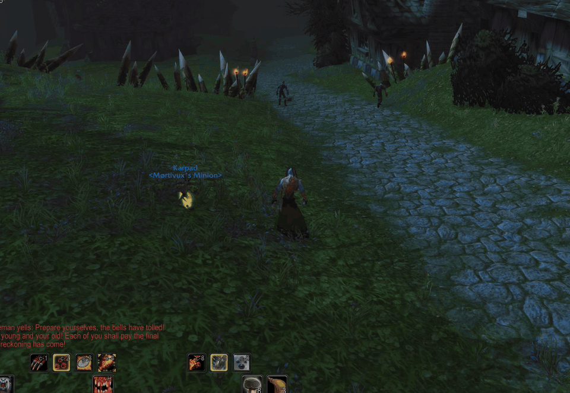</p>

**New (Wizard)** поруч із New відкриває вікно для нового макросу. Уперше воно питає **покроково**: по одному
питанню за раз, простими словами, для тих, хто ще ніколи не писав макросів. **All options** (Усі параметри) у
заголовку натомість показує одразу всю форму з уже даними відповідями, а **Step by step** (Покроково)
повертає до питань; майстер відкривається таким, яким ви його лишили.

### Покроково

<p align="center">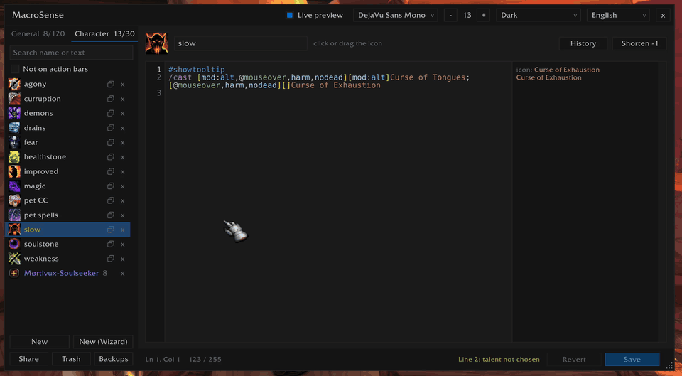</p>

- **Що має робити макрос?** Застосувати заклинання, використати предмет, кілька заклинань по черзі, одне з
  кількох навмання, взяти когось у ціль, задати фокус, взяти чужу ціль, керувати улюбленцем,
  сісти на маунта.
- Далі те, чого це потребує: спел чи предмет (наберіть кілька літер або оберіть зі списку) і його ранг, коли їх кілька (Classic), спели списку в їхньому порядку і що починає послідовність спочатку, що робить пет.
- **На кого чи куди застосувати «Flash Heal»?** На вашу ціль, як завжди, на того, хто під мишею, на землю під
  курсором, на себе, на ваш фокус, на учасника групи... Кожна відповідь показує, як це буде в макросі
  (`@mouseover`), а підказка пояснює, що це. Якщо цього юніта може не бути, наступне питання — на кого тоді
  (**А якщо під мишею нікого немає?**), до трьох. Про спел чи предмет, який діє лише на вас (Demon Armor, форма
  ведмедя: гра каже, що в нього немає дальності), не питає.
- **На танка вашої групи** і **На хілера вашої групи** (у формі Group's tank і Group's healer): `@tank` і
  `@heal` у макросі, див. нижче.
- **Для кого «Flash Heal»?** Друзі, вороги, будь-хто або друзі, живі чи мертві (для воскресіння): питає лише
  тоді, коли гра не каже, для кого спел (предмет, Holy Shock). Спел для ворогів не пропонується на себе, пета,
  учасників групи чи на танка й хілера, а для друзів — на ворогів на арені.
- **Shift, Ctrl, Alt** (на Mac ще **Cmd**): для кожної клавіші — що застосовувати замість цього і куди.
- **Сісти на маунта**: якого маунта, потім іншого там, де можна літати, і для води (обидва можна лишити
  порожніми), що робить натискання на маунті (злізти, але не в повітрі; злізти будь-де; нічого) і власний маунт
  для затиснутих клавіш.
- **Вдягнути спорядження**: який предмет, у який слот (звичайний або слот трінкета, кільця чи руки) і коли (завжди
  чи лише з затиснутою клавішею), потім наступний, до чотирьох; спершу комплект, якщо вони у вас є.
- **Макрос має працювати лише за певних умов?** У бою чи поза ним, у стелсі, у групі, з улюбленцем, під час
  потокового заклинання чи ні, у формі; потім, для заклинання чи предмета, що застосовувати в решті випадків.
- **Бажаєте додати ще щось?** Те саме, що Also у формі.
- Наостанок назва і для кого макрос: для всіх ваших персонажів чи лише для цього. **Create macro** або Enter у
  назві зберігає його й відкриває в редакторі.

Макрос видно внизу від першої відповіді. Клік по відповіді чи по заклинанню зі списку лише
вибирає його: видно, що воно пише, і можна вибрати інше. **Next >** (Далі) веде далі, а **< Back** (Назад)
повертає назад зі збереженими відповідями.

### Макрос, який у вас уже є

**Wizard** поруч з History над текстом відкриває показаний макрос у майстрі, з уже заповненими відповідями:
заклинання, юніти по черзі, клавіші, рядок «Коли», маунти, спорядження. Змініть, що треба, кількома кліками й
натисніть **Put in editor**. Новий текст з'явиться в редакторі, а Save його збереже (Ctrl+Z, на Mac Cmd+Z, усе
поверне). Так можна відкрити будь-який макрос, який міг би зробити майстер, навіть написаний вручну чи взятий з
гайду. Якщо якісь рядки майстер пише по-своєму або не має для них місця (`/run`, другий `/cast`), він скаже про
це ще до відкриття, а у вікні ці рядки буде видно під написом **lines will change**. `[nomod]` (без жодної
клавіші) для майстра — це головне заклинання макросу: він пише спершу клавіші, а потім це заклинання, і макрос
працює так само.

### Танк і хілер вашої групи: @tank і @heal

`/cast [@tank,help,nodead][@pet,help,nodead] Misdirection` діє на танка вашої групи: того, хто має роль танка,
окрім вас (у рейді спершу головний танк); `@heal` — на хілера. Гра таких юнітів не знає, тож у макросі гри
стоїть ім'я (`@Bob`, `@Ann-Realm` з іншого сервера) або `@none`, поки ролі ні в кого немає, і MacroSense
переписує його, коли змінюється група, поза боєм. Нового танка чи хілера у ваших макросах видно червоним
посеред екрана: `MacroSense: новий танк групи — Bob`, так само як і того, для кого в макросі забракло місця
(макрос вміщує 255 символів). У MacroSense макрос лишається з `@tank`: змінюйте й
зберігайте, і він далі працює. Живий перегляд виконує його з іменами, пояснення кажуть «танка вашої групи».
Лише малими літерами: `@Tank` — це гравець на ім'я Tank. Макрос, змінений поза MacroSense (у вікні Blizzard),
лишається з тими іменами, що є, і більше не оновлюється. Гра знає танка, лише коли роль обрано (пошук групи
робить це сам, у зібраній вручну групі хтось має її вибрати) або коли в рейді призначено головного танка.

### Форма

- **Command**: `/cast` чи `/use` для одного спела або предмета (команда йде за вибраним: предмет ставить
  `/use`), `/castsequence` для спелів по черзі, `/castrandom` для одного з кількох навмання. Форма змінюється
  разом із командою: для послідовності вона питає, що починає її спочатку (нова ціль, кінець бою,
  Shift / Ctrl / Alt, кілька секунд без натискання). `/use` спершу пропонує ваші предмети, потім слоти
  екіпіровки, чий предмет має ефект використання (`13`, `14`). `/target`, `/focus` і `/assist` беруть лише
  юнітів, серед них учасників групи: клавіша може взяти інших юнітів або зняти ціль / фокус, а `/target` ще й
  бере за ім'ям (наприклад, рідкісного моба). **Pet commands**: що робить пет без клавіші (атакує юнітів по черзі,
  іде за вами, стоїть, біжить до курсора, пасив, захист, агресія, відпустити) і з кожною клавішею. **Mount**: маунт для будь-якого місця, інший там, де можна літати
  (з TBC), і для води, зі списку лише ваших маунтів, і **On a mount**: що робить натискання на маунті
  (`/cast [nomounted,swimming] Sea Turtle; [nomounted,flyable] Gryphon; [nomounted] Steed`,
  `/dismount [mounted,noflying]`). Затиснута клавіша викликає іншого маунта (наприклад, наземного там, де можна
  літати). **Put on gear**: до чотирьох предметів із сумок або тих, що на вас, кожен у своєму слоті
  (`/equipslot 14` для другого трінкета) і коли його вдягати (завжди, з Shift, Ctrl чи Alt або без клавіші), та
  комплект (`/equipset PvP`), де гра їх має.
- **Cast** / **Use**: спел чи предмет. Наберіть кілька літер або великими перші літери його слів (`FB`), і з'являться
  ваші спели й предмети, які можна використати; підійде й будь-яка інша назва. Спел із кількома вивченими рангами
  (Classic) потім показує їх: спершу сам спел (найвищий ранг, і після вивчення нового), далі кожен ранг
  (`Fireball(Rank 3)`).
- **On**: на кого, по черзі, до трьох: As usual (ваша ціль, або ви, коли гра кастує на вас сама), Your target,
  Mouseover, Focus, Group's tank, Group's healer (`@tank`, `@heal`), Yourself, Your pet, Party member 1–4,
  Target's target, Arena enemy 1–3, At the cursor.
  Якщо когось немає, береться наступний. Спел, який діє лише на вас (Demon Armor), ставить As usual.
- **Only**: друзі, вороги чи будь-хто, і **Alive only** (лише живі). Ставиться за спелом, коли гра знає, для
  кого він; власний спел клавіші перевіряється за тим, для кого він.
- **With a key held**: Shift, Ctrl і Alt (на Mac ще Cmd) можуть кастувати інший спел або той самий на когось іншого, зі
  своїм запасним юнітом (Alt: Frostbolt на Mouseover, потім Your target).
- **!** у кінці поля кожного заклинання, для `/cast` і `/use`: `!` перед цим заклинанням (`!Shoot`). Якщо
  натиснути макрос ще раз, він не вимкне те, що увімкнув: Auto Shot, стелс, форму чи ауру. У кожного заклинання
  своя галочка: у головного, у кожної клавіші й у того, що застосовується інакше; у питаннях це **Не вимикати
  повторно** під заклинанням.
- **When**: лише в бою чи поза ним, у стелсі чи ні, у групі, рейді чи самому, з улюбленцем чи без, в одній із
  ваших форм чи без форми; це перевіряє кожна гілка (`[combat,@mouseover,harm,nodead][combat] Fireball`).
  Потокове заклинання (Drain Soul) зривається, коли натиснути інше: **Not while channeling it** («Не поки воно
  триває») не дає повторному натисканню почати заклинання макросу спочатку (`[nochanneling:Drain Soul]`), а **Not
  while channeling** («Не під час потокового») чекає, доки скінчиться будь-яке з них (`[nochanneling]`). Для
  `/cast` і `/use` поле під ними каже, що застосовувати інакше (`; Frostbolt`).
- **Also**: спершу перервати свій каст, використати трінкет 1 / 2 (з назвою того, що вдягнено), найближчий
  ворог, якщо цілі немає, автоатака, спершу вийти з форми, пет атакує вашу ціль, спершу злізти з маунта, спершу
  зняти баф (підказує баффи, які зараз на вас, а потім ті, що були раніше), і наприкінці сказати щось у чат
  (`%t` — ім'я вашої цілі).
- **Name** і **Tab**: назва йде за спелом, доки ви не впишете свою; вкладка — та, що відкрита в редакторі.

Макрос видно під формою, поки ви вибираєте, з підсвіткою й довжиною. **Create macro** зберігає його з
вільною назвою (`Frostbolt 2`, якщо таку вже має інший макрос) і відкриває в редакторі з живим переглядом.

| Вибираєте | Виходить |
|-----------|----------|
| Flash Heal на Mouseover, потім As usual; друзі | `/cast [@mouseover,help,nodead][] Flash Heal` |
| ... потім Your target, потім Yourself | `/cast [@mouseover,help,nodead][help,nodead][@player] Flash Heal` |
| Counterspell на Focus, потім As usual; вороги; спершу перервати каст | `/stopcasting`, далі `/cast [@focus,harm,nodead][] Counterspell` |
| Flash Heal на Party member 1; Shift на 2, Ctrl на 3, Alt на 4 | `/cast [mod:shift,@party2,help,nodead]...[@party1,help,nodead] Flash Heal` |
| Blizzard At the cursor | `/cast [@cursor] Blizzard` |
| /castsequence Corruption, Immolate; спочатку при новій цілі | `/castsequence reset=target Corruption, Immolate` |
| /focus на Mouseover, потім Your target; Shift: Clear focus | `/clearfocus [mod:shift]`, `/stopmacro [mod:shift]`, `/focus [@mouseover,exists,nodead][@target,exists,nodead]` |
| /target Party member 1; Shift на 2, Ctrl на 3, Alt на 4 | `/target [mod:shift,@party2,help,nodead]...[@party1,help,nodead]` |
| Пет: Attack на Mouseover, потім As usual; Shift: Follow; Ctrl: Move to the cursor | `/petattack [nomod:shift/ctrl,@mouseover,harm,nodead][nomod:shift/ctrl]`, `/petfollow [mod:shift]`, `/petmoveto [mod:ctrl,@cursor]` |
| Frostbolt як зазвичай; Shift: Polymorph на Focus; трінкет 1 | `#showtooltip Frostbolt`, `/use 13`, `/cast [mod:shift,@focus,harm,nodead] Polymorph; Frostbolt` |

## Макроси з книги заклинань

<p align="center">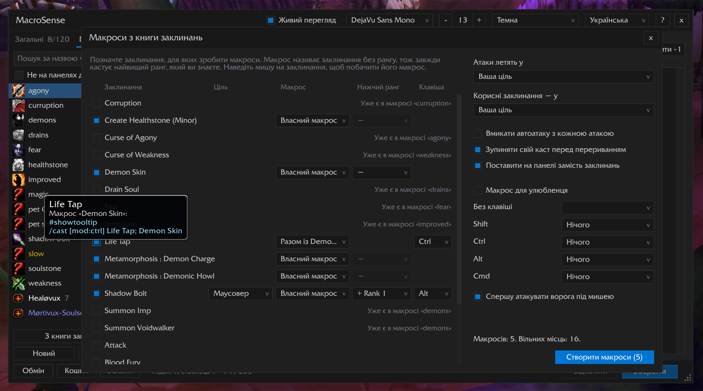</p>

«З книги заклинань» (або `/ms book`) робить макроси для заклинань із вашої книги, багато за раз. Позначте
заклинання: кожне отримає макрос, який називає його без рангу, тож у Classic він завжди кастує найвищий ранг, який
ви знаєте, навіть після того, як ви вивчите новий. Наведіть мишу на заклинання, щоб побачити його макрос.

- **Куди вони летять.** Атаки й корисні заклинання спершу летять у вашу ціль. Можна вибрати ворога (чи друга) під
  мишею або фокус для всіх одразу. «Ціль» у рядку заклинання змінює це лише для нього; «—» лишає загальний вибір.
- **Не вистачає місць.** У персонажа 30 місць для макросів, а лічильник унизу показує, скільки ви займете.
  «Макрос» у рядку кладе заклинання в макрос іншого заклинання, і воно кастується, поки ви тримаєте Shift, Ctrl чи
  Alt (Cmd на Mac): `/cast [mod:shift] Frost Nova; Frostbolt`.
- **Нижчий ранг** (Classic) ставить дешевший ранг заклинання на клавішу: щоб підлікувати потроху, повісити на
  ворога дешеве заклинання, яке він розвіє, або витратити на нього Spell Reflection воїна:
  `/cast [mod:shift] Shadow Bolt(Rank 1); Shadow Bolt`.
- **Автоатака** вмикається з кожною атакою, якщо поставити галочку (для класів ближнього бою вона стоїть одразу),
  але ніколи із заклинаннями, що виводять ворога з бою, як-от Sap чи Polymorph: вона б їх зірвала. Переривання
  спершу зупиняють ваш каст.
- **Улюбленець.** Мисливці й чорнокнижники отримують один макрос для улюбленця: що він робить без клавіші й із
  кожною клавішею.
- **На панелях.** Макроси йдуть у вкладку персонажа і на панелі дій замість своїх заклинань.
  Видаліть такий макрос у MacroSense, і на ці кнопки повернеться його заклинання, якщо макрос досі його кастує.

Заклинання, які вже кастує якийсь макрос, стоять без галочки, як і ті, що ви пропустили раніше; їх усе одно можна
позначити. Наступного разу галочки стоятимуть лише на заклинаннях, які ви вивчили відтоді. **Вибрати все**
позначає всі заклинання (коли всі позначено, кнопка стає **Зняти все**), а **Запропонувати все знову** забуває,
які заклинання ви пропустили і які макроси видалили. З увімкненими наборами макроси, яким не вистачило вільного
слота, створюються за лаштунками. Якщо гра не створила макрос, чат скаже, який саме.

**Новий ранг.** У Classic макрос із `/cast Shadow Bolt` лишався на старому ранзі після того, як ви вивчали новий,
доки ви його не редагували. Тепер MacroSense сам зберігає такі макроси ще раз (після бою, якщо ви в бою), а
історія не записує для них нової версії.

## Автодоповнення

<p align="center">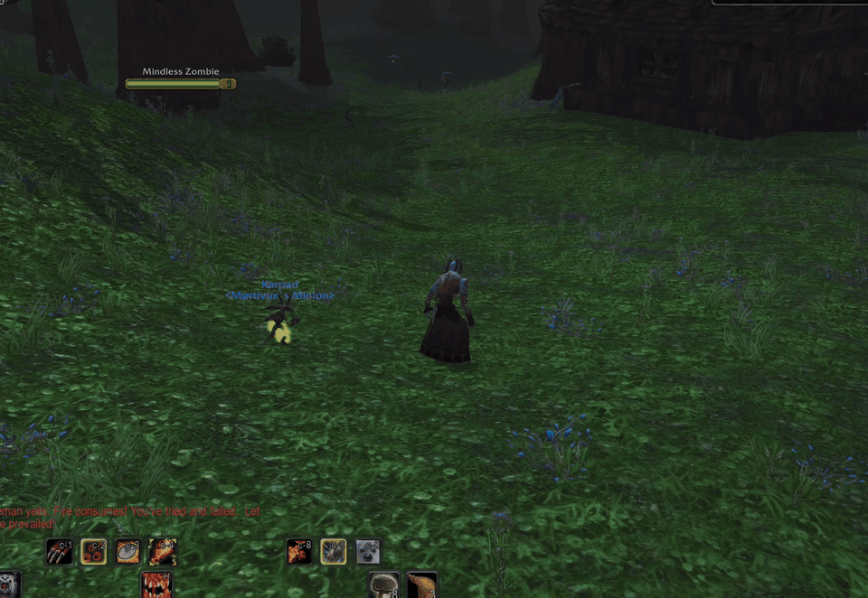</p>

| Набираєте | Отримуєте |
|---|---|
| `/` | slash-команди, емоції, команди чату (гри та аддонів) |
| `/cast [` | умови макросів |
| `[@` / `[target=` | юніти, а після юніта ще `...target` / `...pet` (`party1target`) |
| `[mod:` | `shift`, `ctrl`, `alt`, на Mac ще `cmd`, ліві / праві клавіші (`lshift`, ...) |
| `[form:` / `[stance:` | ваші форми з назвами (`1` Bear Form, ...) |
| `[spec:` / `[equipped:` / `[group:` / `[bar:` / `[btn:` / `[pet:` | спеціалізації, типи зброї та броні, `party` / `raid`, сторінки панелей, кнопки миші, ваш пет |
| `/cast ` або після `]` / `;` | спели (спели іншої спеціалізації — з її назвою), потім предмети з сумок, які можна використати |
| спел із кількома вивченими рангами (Classic) | його ранги, від найвищого: Tab вставить `Fireball(Rank 2)`, Esc лишить `Fireball` |
| `/use ` | предмети з ефектом використання (сумки та екіпіровка), потім спели |
| `/equip ` / `/equipslot 13 ` | екіпіровка з сумок |
| `/cancelaura ` | баффи, які зараз на вас, потім ті, що були раніше (останні 200, для кожного персонажа) |
| `/use 1` / `/equipslot ` | слоти екіпіровки за номером і що в них (`13` Trinket 1: ...) |
| `/use 0 ` | слоти цієї сумки, де щось лежить, з назвою предмета (`/use 0 1`) |
| `/click ` | кнопки, які є зараз, і що на них: панелі гри, Bartender4, ElvUI, Dominos; далі `LeftButton` ..., далі `true` (клік при натисканні клавіші) |
| `/castsequence reset=` | `target`, `combat`, `shift`, `ctrl`, `alt` чи секунди (`10`); після `/` — ще не вжиті |
| `#` | `#showtooltip`, `#show` |

Дві великі літери й більше — це перші літери слів: `DA` знайде Demon Armor, `SWP` — Shadow Word: Pain, `CA` —
Curse of Agony (слова можна пропускати), і `CoA` теж (мала літера — для короткого слова). Першими йдуть назви саме
з такими першими літерами. Малі літери шукаються в межах одного слова: спершу назви, що з них починаються, далі
ті, де з них починається якесь слово (`fi` знайде Soul Fire; пробіл переходить до наступного слова, `sh wo`
знайде Shadow Word: Pain), ті, що мають їх усередині, і наостанок ті, де одне слово має ці літери в тому ж порядку
від свого початку (`nmd` знайде `nomod`; `ds` не знайде Demon Skin, а `DS` знайде). Великі літери, з яких не
починаються слова жодної назви, рахуються як малі, тож Caps Lock не заважає.

Клавіші: **Tab** / **Enter** вставляють, **↑ / ↓** гортають список, **PageUp / PageDown** перескакують на 10,
**Esc** закриває його. У списку видно 10 рядків, решта прокручується (і колесом миші). Видалення список
не відкриває. У редакторі: **Ctrl+S** зберегти, **Ctrl+Z** скасувати, **Ctrl+Y** / **Ctrl+Shift+Z** повторити,
**Ctrl+F** пошук макросів, **Ctrl+H** знайти й замінити (на Mac — Cmd замість Ctrl).
Коли набираєте `[`, редактор сам додає `]` і ставить курсор усередину; `]` перед уже вставленою дужкою
просто переступає її, а Backspace у порожніх `[]` прибирає обидві.

## Підсвітка й перевірка помилок

<p align="center">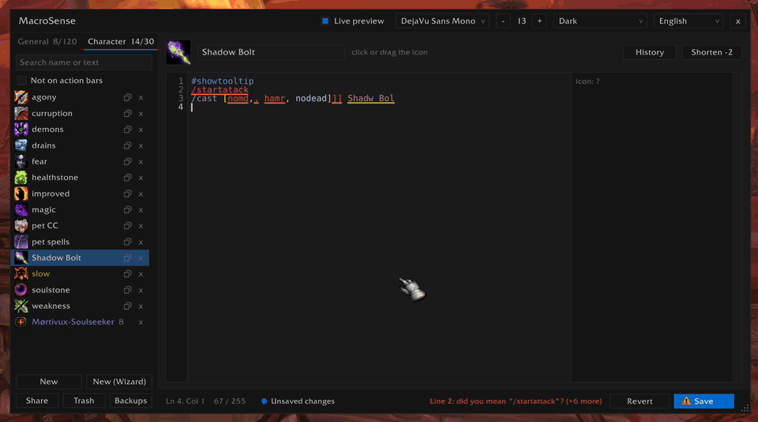</p>

- Номери рядків у смузі зліва, як у редакторі коду: довгий перенесений рядок має один номер, номер рядка з
  курсором яскравіший, смуга підлаштовується під шрифт і його розмір. Повідомлення про помилки посилаються
  саме на ці номери.

- Шрифти: DejaVu Sans Mono (за замовчуванням), JetBrains Mono, Fira Mono, Source Code Pro, Inconsolata,
  шрифти гри та LibSharedMedia. Розмір від 8 до 28.
- Теми: «Як у грі» (за замовчуванням): тло й рамка вікон самої гри, червоні кнопки й золоті літери, у тому
  вигляді, який має ваш клієнт; а також Dark, Light, Graphite, Charcoal, Paper, Monokai, Solarized Dark.
- Помилки підкреслюються, статус-бар називає першу з номером рядка (усі — при наведенні, клік переносить до
  неї), а на кнопці Save з'являється знак оклику: невідома команда чи умова, `[` без `]`, `]` без `[`, порожня умова
  (`[harm,,dead]`), `@` чи `target=` без юніта, `mod:` без значення, неправильне значення (`btn:7`,
  `group:arena`, `mod:shfit`), значення для умови, яка його не приймає (`combat:1`), неправильне значення
  `reset=` (`reset=tagret`, `reset=1.5`), `reset=` поза `/castsequence`, слот, якого немає (`/use 23`),
  `/equipslot` без слота чи предмета, `item:` без номера. Пробіли після ком — не
  помилка. Слово, яке ви набираєте і яке ще може стати правильним (`comb` на шляху до `combat`), позначається
  після короткої паузи або при збереженні; помилка, з якої правильне слово вже не вийде (`mousovr`, `btn:7`),
  позначається одразу.
- Ctrl+клік по статус-бару виправляє те, що очевидно (звичайний клік переходить до рядка): опечатку в команді, умові, юніті чи значенні (`/cats` →
  `/cast`, `harmm` → `harm`, `@mousover` → `@mouseover`), пропущену `]` чи `[`, зайву `]`, кому порожньої умови,
  значення там, де його не має бути (`combat:1`). Підказка каже, що зробить клік; Ctrl+Z скасовує.
  Ctrl+клік по підкресленому тексту в редакторі робить те саме.
- Попередження підкреслюються жовтим і не позначають Save: невідомий юніт (`@mousover`) може бути іменем
  гравця, а макроси це дозволяють.
- `/click`: назва, якої зараз не має жодна кнопка, — попередження (аддон може створити кнопку пізніше), так
  само як фрейм, що не є кнопкою; кнопка миші з опечаткою (`RigthButton`) отримує виправлення; `down`
  останнім словом — попередження, бо гра читає його як «ні» (`true` клікає при натисканні клавіші).
- Команда, яка в цій версії гри є, але нічого не робить, — попередження: `/petmoveto` у Classic Era і TBC
  (команда пета Move To з'явилася в Cataclysm).
- Частина, яка ніколи не спрацює, — попередження: у `/cast [@mouseover,harm][] Arcane Shot; [mod:alt] Hunter's Mark`
  гра завжди зупиняється на `[]` (порожні дужки завжди істинні, як і частина без умов), тож частина з Alt
  має стояти першою, і Ctrl+клік її туди поставить. Те саме для рядка після того, що завжди кастує заклинання
  з глобальним кулдауном: цей кулдаун зупиняє заклинання з ним нижче. Якщо заклинання вище має власний
  кулдаун, попередження каже, що рядок нижче спрацює лише поки те заклинання на кулдауні. Заклинання нижче
  без глобального кулдауну — без попередження. Коли кожну частину рядка нижче вибирає клавіша (`[mod:alt]`),
  Ctrl+клік переносить їх у рядок вище, на початок; без клавіші незрозуміло, що мав робити макрос, і нічого
  не змінюється.
- У переліку макросів макрос із помилками має червону назву і знак оклику, а лише з попередженнями — жовту
  назву; наведіть на нього мишу, щоб побачити, що не так. Позначки відповідають збереженому тексту. **З
  помилками** під пошуком лишає тільки такі, перевіривши всі макроси одразу; вкладки показують, скільки таких у
  кожній.
- Опечатки в назвах спелів і предметів: назва, схожа на знайому (`Shadwo Bolt`), отримує попередження
  `did you mean "Shadow Bolt"?`; клік по ньому в статус-барі виправляє назву. Знайомі назви: ваші спели,
  спели ваших петів (запам'ятовуються з кожного викликаного пета), предмети в сумках і бачені раніше, маунти
  на Retail. Назва, не схожа ні на що знайоме, не позначається.
- Спели, які макрос зараз не може використати, — попередження: талант, який ви не вибрали (`«Shadowfury»: талант
  не вибрано, макрос зараз не може його використати`), спел іншої спеціалізації (`«Chaos Bolt» належить до
  Destruction`), спел, який ви вивчите пізніше (`ви вивчите його на 40 рівні`). Гілка, чиї умови самі це
  перевіряють (`[spec:2]`, `[talent:...]`, `[known:...]`), не позначається. Такий макрос стає жовтим і на панелях
  дій, а його підказка там пояснює чому. Попередження змінюються разом із вашими талантами та спеціалізацією,
  а зміна, що ламає макроси на ваших панелях, каже про це на екрані, а їхні назви — в чаті.
  Retail і WoW Forever знають ваше дерево талантів, Mists of Pandaria — таланти кожного ряду та спели інших
  спеціалізацій, Classic Era і TBC — таланти без очок.
- Mac: якщо макрос із `[mod:cmd]` стоїть на клавіші, яку macOS використовує разом із Cmd (Cmd+Q закриває
  гру, Cmd+W, Cmd+H, Cmd+Tab, Cmd+Space, ...), статус-бар попередить, а також підказка макросу на панелі
  дій, а кнопка з цією клавішею стане червоною. Перевіряються пряма прив'язка макросу та стандартні панелі;
  панелі Bartender чи ElvUI — ні.

<p align="center">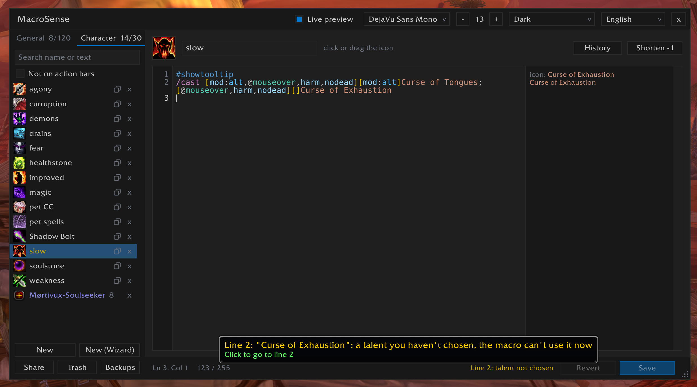</p>
<p align="center">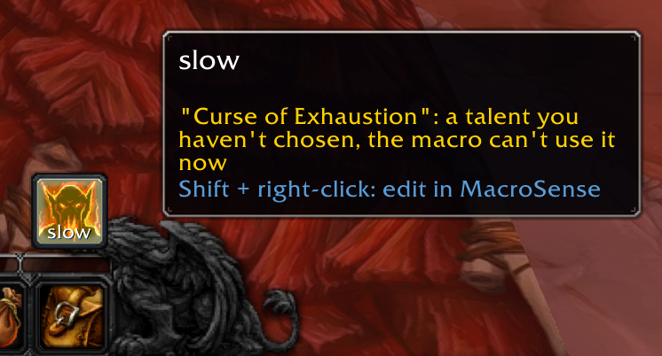</p>

<p align="center">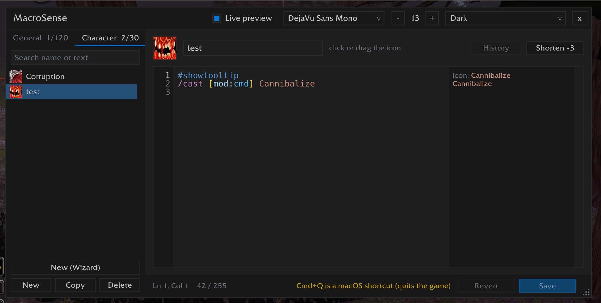</p>
<p align="center">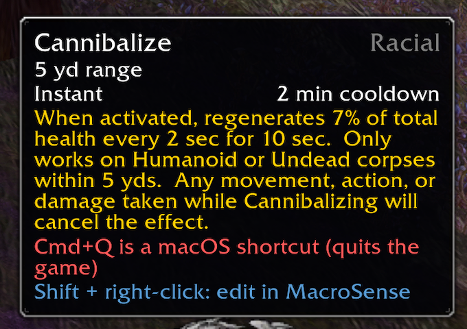
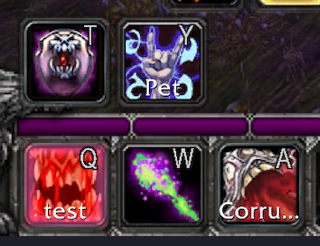</p>

## Живий перегляд

Біля кожного рядка нотатка показує, що він зробив би, якби ви натиснули макрос прямо зараз:

- спел чи предмет, і на кого: `Fear @mouseover`
- «умови не виконано», коли жодна з умов не виконується і рядок нічого не робить; «нічого не робить», коли
  умова виконується, але в ній немає спела чи предмета
- інші команди, які він виконує, з назвою: «виконує /startattack», «виконує /target @focus», чат і емоції
  («виконує /yell»); «пише в чат» для рядка без команди
- «зупиняється тут» для `/stopmacro`, який спрацює, і «не дійде» для рядків після нього
- для `#showtooltip` — іконку, яку покаже макрос (`?`, коли нічого не скастується)

Нотатки стежать за грою кілька разів на секунду: затисніть Shift, Ctrl, Alt (Cmd на Mac), змініть ціль,
викличте іншого пета чи вступіть у бій, і вони зміняться. Поки миша над редактором, mouseover-юніта немає:
наведіть на юніта у світі чи на рамку юніта, щоб побачити гілку `@mouseover`. Умови перевіряє сама гра
(`SecureCmdOptionParse`, яким виконуються макроси). Рядки із синтаксичними помилками нотаток не мають.
**Live preview** у заголовку вікна вимикає перегляд, і текст займає всю ширину.

**Що, як...** над рядком стану (з увімкненим живим переглядом) показує нотатки для моменту, який ви задаєте самі:
затиснуті клавіші (Shift, Ctrl, Alt, на Mac — Cmd), **У бою**, і хто ваша **Ціль**, хто під мишею (**Маусовер**)
і хто у **Фокусі** (нікого, ворог, друг, мертвий ворог). Поки відкритий редактор, миша не може бути над кимось у
світі, тож так видно, як працює макрос із маусовером. Він також каже, коли заклинання не піде туди, куди його
шле макрос: заклинання для ворогів на друга, мертвого ворога чи нікого (`не скастується: ціль — друг`), лікування,
назване для ворога; лікування, яке гра шле на ворожу ціль, піде на вас, як з автоматичним кастом на себе. Усе
інше, що перевіряє макрос (улюбленець, форма,
спеціалізація), — як у грі зараз. Вимкніть, і нотатки знову стежать за грою.

Наведіть мишу на номер рядка чи на його нотатку, щоб прочитати простими словами, що робить увесь рядок: кожну
гілку, а не лише ту, що спрацювала б зараз. `/cast [mod:shift,@focus,harm,nodead] Polymorph; Frostbolt`
читається як `із затиснутим Shift: Polymorph на ваш фокус, якщо він ворог і живий`, а далі `інакше: Frostbolt`;
ціль, яку макрос пробує після іншої, стоїть під нею (`якщо ні — на вашу ціль`). Номери рядків пояснюють і з
вимкненим живим переглядом.

Перетягніть заклинання, маунта чи предмет зі спелбука, сумок або панелей на текст, або клацніть по ньому з
Shift, поки пишете: назва стане там, де курсор, а на порожньому рядку — після `/cast` чи `/use`.

Наведіть мишу на слово, щоб дізнатися, що воно означає: команда (`/stopmacro`), умова (`nodead`, `mod:shift`),
юніт (`@focus`, `@party2target`), `#showtooltip`, `reset=`, `!` у `!Shoot` (лише вмикає: натискання не зупиняє
стрільбу й не виводить зі стелсу). Для заклинання чи предмета з'являється підказка гри. Рядок із `!` пояснюється
й простими словами: «Shoot (лише вмикає)».

<p align="center">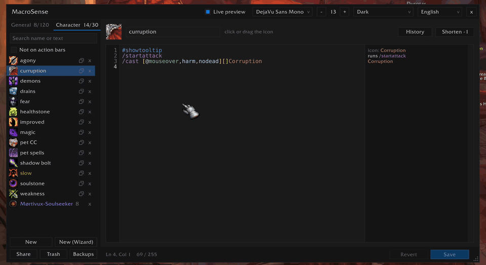</p>

## Скорочення

<p align="center">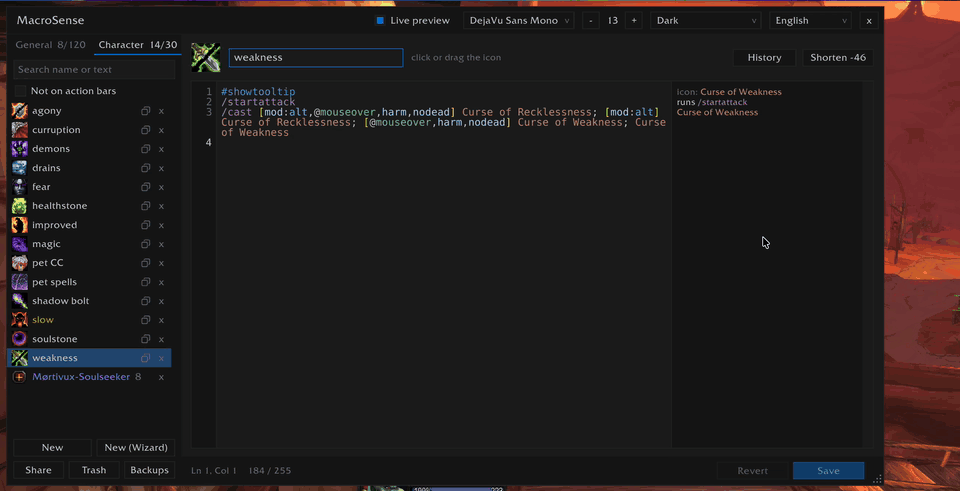</p>

Макрос обмежений 255 символами. Кнопка **Shorten** у шапці записує той самий макрос коротше і показує,
скільки символів звільниться (`Shorten -41`):

- `target=focus` стає `@focus`; `modifier`, `button`, `actionbar`, `stance`, `equipped` — `mod`, `btn`,
  `bar`, `form`, `worn` (і їхні форми з `no`)
- `[@mouseover,harm,nodead] Fear; Fear` стає `[@mouseover,harm,nodead][]Fear`
- `[pet:Succubus][pet:Incubus]` стає `[pet:Succubus/Incubus]`, `[mod:alt] X; [mod:shift] X` —
  `[mod:alt/shift]X` (лише умови, що приймають варіанти, і не їхні форми з `no`)
- зайві для гри пробіли й порожні рядки зникають

Чат, `/run`, команди інших аддонів і рядки з помилками лишаються як є. Ctrl+Z (Cmd+Z на Mac) повертає
старий текст.

## Історія

Гра пам'ятає лише останній текст макросу, а MacroSense зберігає попередні. Кожна збережена зміна — у цьому
редакторі, у стандартному вікні макросів чи іншим аддоном — лишає текст, який вона замінила (останні 10 на
макрос). Кнопка **History** у шапці показує їх із часом збереження й довжиною: наведіть на версію, щоб
побачити, що вона змінить у теперішньому тексті, як у diff (`- ` червоним: рядок зникне, `+ ` зеленим:
повернеться), клікніть, щоб вставити в редактор. Тоді це незбережена зміна: **Save** її зберігає, Ctrl+Z
(Cmd+Z на Mac) повертає попередній текст. Якщо перейменувати макрос тут чи в стандартному вікні макросів,
версії переходять за ним. Загальні макроси зберігають історію для всього акаунта, макроси персонажа — для
персонажа.

## Перелік макросів

Перелік показує вкладку General чи Character і скільки в ній макросів із можливих. Поле пошуку над ним
лишає макроси, у назві чи тексті яких є набране, без різниці великих і малих літер; вкладки тоді показують,
скільки знайдено в кожній (`General  (3)`). Enter відкриває перший знайдений, Esc очищає пошук.

**Замінити** поруч із пошуком (Ctrl+H) змінює слово чи заклинання в багатьох макросах одразу: що знайти, на що
замінити і де — у «Загальних» і «Персонажі» або, з увімкненими наборами, у кожному з наборів (у грі й за
лаштунками). Великі й малі літери різні. Перед **Замінити все** видно, скільки знайдено і в скількох макросах.
Історія макросів гри зберігає тексти, які в них були; макрос, що став би довшим за 255 символів, лишається
як був, і чат каже, який саме. У бою не працює.

У кінці кожного макросу в переліку є дві кнопки. **...** (або права кнопка миші) копіює чи переносить його:
**Дублювати** — у ту саму вкладку, **Копіювати в: Персонаж** / **Копіювати в: Загальні** — в іншу, **Перенести в:
Персонаж** / **Перенести в: Загальні** — туди; з увімкненими наборами там і все, що можна зробити з ним у наборах.
Перетягнутий на іншу вкладку, макрос переноситься, а з Ctrl — копіюється. Копія отримує вільну назву (`Fear 2`,
скорочену до 16 літер), бо два макроси з однією назвою ділили б прив'язку клавіші, і відкривається. Макрос,
який ви редагуєте, копіюється з тим, що зараз у редакторі (назва, іконка, текст), а сам лишається таким, як
був збережений; інший копіюється таким, як збережений. Хрестик **x** видаляє макрос, спершу перепитавши;
макрос, який ви редагуєте, лишається відкритим, коли видаляєте інший.

Вкладка «Загальні» може мати **улюблені** й власні **теки**: **Додати до улюблених** у **...** макросу ставить
його вгору, в «Улюблені»; **У нову теку** створює теку з назвою, яку ви дасте, **У теку: ...** кладе його в одну з
наявних, **Вийняти з теки** виймає. Або перетягніть макрос на теку чи на «Улюблені», а на макрос поза теками —
щоб вийняти. Макрос буває або в «Улюблених», або в теці, не в обох. Кожна тека відкривається й закривається кліком; правий клік по її назві
перейменовує чи видаляє її (макроси лишаються). Вони йдуть за перейменованим макросом, а макрос, перенесений у
вкладку «Персонаж», лишає їх. Зберігаються для всього акаунта, як і загальні макроси.

**Вибір** під пошуком ставить галочку біля кожного макросу й кожної групи, щоб зробити те саме з багатьма одразу:
один клік по галочці макросу вибирає його, по галочці групи (групи набору, «Улюблених», теки) — всю групу, а ще
один клік знімає вибір. **Ctrl+клік** (на Mac — Cmd+клік) по макросу теж вибирає його, і без **Вибору**. Рядок над
переліком каже, скільки вибрано: **Усі** вибирає всі макроси, які видно в переліку, або знімає з них вибір; **x**
знімає весь вибір. Його **Дії** діляться ними одним кодом, переносять в іншу вкладку (поки там є вільні слоти),
додають у набір чи теку, видаляють (ті, що в грі, потрапляють у кошик); з увімкненими наборами вони ще беруть у гру
ті, що за лаштунками (**Взяти в гру**), і ховають за лаштунки ті, що в грі (**За лаштунки**), усі одразу.

**Додати нотатку**, останній пункт у **...**, зберігає ваш власний рядок про макрос (`На пул Оніксії`) поза його 255
символами: її видно в підказці до макросу в переліку. Нотатка йде за макросом, коли його перейменувати чи
перенести, потрапляє з ним у кошик і повертається разом із ним. Нотатки загальних макросів спільні для акаунта,
макросів персонажа — лише для цього персонажа.

Власні макроси ваших інших персонажів теж є у вкладці **Character**, під вашими: ім'я кожного персонажа (спершу з
вашого реалму), а клік показує його макроси такими, якими вони були, коли ви востаннє грали ним із MacroSense; з
наборами — і ті, що за лаштунками, з назвою набору. Наведіть мишу на макрос, щоб прочитати його; клік або «...»
копіює його у вкладку цього персонажа чи
в General під вільною назвою. Пошук знаходить і їх. Хрестик **x** біля персонажа забуває його: його макроси й
панелі дій більше не показуються й не враховуються, доки ви знову не зайдете ним у гру.

**Move to Character** / **Move to General** у тому самому меню переносить макрос в іншу вкладку, чого вікно
макросів гри не вміє: його кнопки на ваших панелях дій лишаються, історія переходить разом із ним, а в кошик він не
потрапляє. Назва лишається тією самою, хіба що в іншій вкладці вже є макрос із такою назвою (тоді `Fear 2`).

Наведіть мишу на макрос, щоб побачити, де він на панелях дій: `На 2 кнопках ваших панелей дій`, `На панелях:
Destruction, Alt`. Гра показує лише панелі тієї спеціалізації, у якій ви зараз, тож MacroSense пам'ятає панелі
кожної вашої спеціалізації та кожного персонажа такими, якими бачив їх востаннє (у кожної спеціалізації свої
панелі, а загальні макроси — спільні для всіх персонажів). **Не на панелях дій** під пошуком лишає тільки
макроси, яких немає на жодній панелі: зручно, коли вкладка заповнена. Перед видаленням MacroSense каже, де стоїть
макрос, а перед перенесенням макросу, який є на панелях іншої спеціалізації чи персонажа, перепитує: звідти він
зникне.

Кнопка **Share** під переліком робить код макросу, вкладки або всіх ваших макросів: скопіюйте його й
надішліть (Discord, форум), а будь-хто з MacroSense створить ці макроси через **Share > Import a code or
text**. Ще
до створення вікно показує, що в коді й куди піде кожен макрос. Нічого не замінюється: зайнята назва
отримує номер (`Fear 2`), а макрос, якому немає вільного місця в його вкладці, пропускається. Код — один
рядок літер і цифр, якого чати не змінюють, із крапкою в кінці, тож слова довкола не заважають; обрізаний
чи змінений код не приймається. **Обмін > Експортувати набори макросів...** робить те саме для ваших
[наборів макросів](#набори-макросів).

Гайди (Wowhead, Icy Veins) і форуми пишуть макроси звичайним текстом, тож **Import a code or text** приймає і
його: вставте макрос або кілька, розділені порожнім рядком, і кожен з'явиться у вкладці, де ви є, з назвою
першого заклинання. **Share > Copy this macro's text** дає текст у зворотний бік, щоб викласти будь-де.

**Share > Link this macro in chat** або Shift+клік по макросу в переліку (вашому чи іншого персонажа) вставляє
`[MacroSense: Fear MO]` у ваше повідомлення, а коли чат закритий, відкриває його з посиланням, хоч би де стояв курсор. Гравці з MacroSense бачать посилання: клік просить у вас цей макрос
(шепіт аддона, без рядків у чаті) і відкриває його код у вікні імпорту, де видно, що в ньому, ще до імпорту. Без
MacroSense це просто назва. Віддаються лише ті макроси, на які ви вставили посилання, такими, якими вони були
тоді: останні 20. У бою в підземеллі гра блокує повідомлення аддонів, а на Retail посилання там лишається
простим текстом.

<p align="center">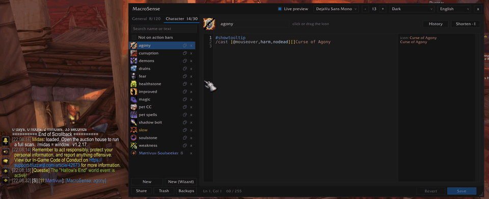</p>

Кнопка **Trash** поруч зберігає макроси, які ви видаляєте, — тут, у стандартному вікні макросів чи іншим
аддоном: останні 30 у кожній вкладці, загальні для акаунта, макроси персонажа для персонажа. Наведіть на
макрос, щоб прочитати його, клікніть, щоб повернути у його вкладку (під вільною назвою, якщо його назва
зайнята); хрестик **x** біля нього видаляє його назавжди. Макрос, перейменований у стандартному вікні, не
вважається видаленим.

Кнопка **Backups** зберігає всі ваші макроси такими, якими вони були: копія робиться сама при першому вході
за день, якщо макроси змінилися, а **Back up now** робить її будь-коли (останні 10 для кожного персонажа,
у кожній — загальні макроси, макроси персонажа, а з увімкненими наборами й ті, що за лаштунками). Оберіть
копію, щоб відновити її: її макроси отримують назад свій текст та іконку, видалені створюються знову (той,
що був за лаштунками, повертається туди ж), а створені відтоді лишаються як є. Спершу
робиться копія макросів, якими вони є зараз, тож і відновлення можна скасувати. Хрестик **x** біля копії
видаляє її.

## Набори макросів

У персонажа лише 30 слотів для макросів. Поставте в редакторі галочку **Набори макросів**, і MacroSense зберігатиме
більше: у кожної спеціалізації свої макроси, а слоти займають лише ті, що потрібні зараз. Доки ви їх не ввімкнете,
набори вимкнені, а перед увімкненням MacroSense робить резервну копію ваших макросів.

- **Три види наборів.** **Класові** однакові на всіх ваших персонажах одного класу: зміните один, і інші отримають
  зміну теж. Макроси **Цього персонажа** лишаються в кожній спеціалізації; спершу сюди потрапляють усі макроси
  персонажа. Макроси **спеціалізації** виходять у гру, коли ви її обираєте, на ті самі кнопки, де були, і чекають
  за лаштунками, поки ви граєте іншою. Макрос з однаковою назвою у двох спеціалізаціях просто міняє текст, тож його
  кнопки лишаються на місці. У Classic Era, TBC, Mists of Pandaria і WoW Forever спеціалізації — це два ваші набори
  талантів, **Основна** і **Додаткова**: там у кожного з них свої панелі дій.
- **У грі й за лаштунками.** З увімкненими наборами вкладка «Персонаж» має дві частини: макроси у ваших слотах і
  ті, що MacroSense зберігає за лаштунками, без слотів. Їх так само можна відкривати, змінювати, створювати й
  видаляти. Класові позначені жовтим, вибрана спеціалізація — зеленим, решта за лаштунками — червоним; макрос, який
  ви навмисно лишаєте за лаштунками, має сіру назву.
- **«...» біля макроса** (або права кнопка миші): **За лаштунки** / **Взяти в гру**, **Лишати за лаштунками** для
  спеціалізації, яку зараз не вибрано, **Перенести в** / **Копіювати в** інший набір, **Дублювати**, **Прибрати**
  (назад до «Цього персонажа») та інша вкладка.
- **Перетягування.** Перетягніть макрос на групу чи частину списку, щоб перенести його туди; з Ctrl — щоб
  скопіювати. На вкладку «Загальні» чи «Персонаж» він так само переноситься чи копіюється, і з вимкненими наборами
  теж. Знак біля миші показує, чи можна покласти його туди, а чат пише, чому ні.
- **Немає вільного слота.** Макрос, якому не вистачило слота, чекає за лаштунками. Новий («Новий», майстер, копія,
  кошик, «З книги заклинань», імпорт) тоді створюється за лаштунками, у «Цього персонажа», спершу з питанням.
- **Розкласти за заклинаннями** дивиться, які заклинання кастує кожен макрос, і пропонує перенести його туди, де
  він працює, щойно ви пограєте кожною спеціалізацією.
- **Після вимкнення** макроси за лаштунками виходять у гру, скільки вміститься; якщо всі не вміщаються, ви
  вибираєте, які саме. Після повторного ввімкнення вони повертаються туди, де були, разом зі змінами.
- **На іншому персонажі.** **Обмін > Експортувати набори макросів...** робить код позначених наборів (**Вибрати
  все** / **Зняти все**). **Обмін > Імпортувати код чи текст...** приймає такий код або набори іншого вашого
  персонажа: кожен набір у свій, набори іншого класу — у «Цього персонажа» (спершу з попередженням), зайнята назва
  з номером, точнісінько такий самий макрос пропускається, усе за лаштунки.
- **Усе або нічого.** Якщо зміна зламається на півдорозі, MacroSense скасує її: макроси, набори й кнопки будуть
  такі, як були. Чат про це скаже; тоді, будь ласка, повідомте про помилку.

`/ms sets log` друкує, що робили набори, для звіту про баг.

## Іконки й панелі дій

Клікніть по іконці макросу, щоб вибрати іншу: спершу знак питання (тоді іконку вибирає `#showtooltip`),
потім іконки ваших спелів і предметів, далі всі іконки гри разом із тими, які ви самі поклали в
`Interface\Icons`, як у стандартному вікні макросів. Пошук — за назвами ваших спелів і предметів,
а також будь-якого спела гри з цією іконкою (у Retail і Mists of Pandaria — ще й досягнень). Назв іконок гра
не має, тож коли сітка відкривається вперше, вони кілька секунд шукаються у фоні, а внизу видно, скільки вже
пройдено. MacroSense їх запам'ятовує, тож далі вони є одразу, аж до наступного патча гри. Наведіть мишку на
іконку, щоб побачити її назви.
Сітку можна розтягнути за кутик із крапками, відтягнути від редактора за порожнє місце і приліпити назад до
його правого краю (рамка підсвічується).

Новий макрос одразу починається з `#showtooltip` у першому рядку, а курсор стоїть на другому.

**Tab** або **Enter** у назві переводить курсор у текст макросу. Якщо ви не вибрали іконку, новий макрос
зберігається зі знаком питання, тож у грі його іконка змінюватиметься так, як це робить `#showtooltip`. У
редакторі та в списку видно іконку, яку показує гра, і там вона теж змінюється, поки ви тримаєте клавішу. Де
гра показує лише знак питання (новий макрос або щойно збережений), MacroSense підбирає іконку так само, як гра:
того, що зараз показує `#showtooltip`, а якщо його немає, то першого рядка, який зараз щось застосовує
(`/cast [mod:shift] Polymorph; Frostbolt` дасть Frostbolt, а поки ви тримаєте Shift — Polymorph). Якщо так
нічого не знайшлося (зараз не спрацьовує жоден рядок або предмета немає в сумках), береться перше заклинання
чи предмет, названі в тексті, незалежно від умов. Гра знає іконки й тих предметів, яких у вас немає. Останньою
йде назва макросу: `Kick Focus` дасть Kick, `Poly MO` — Polymorph. Поки на панелях дій гра показує знак
питання, така іконка сіра, і підказка пояснює чому. У редакторі іконка
змінюється, поки ви пишете. Іконку, яку ви вибрали самі, аддон зберігає і показує як є. Якщо в макросі є
`#showtooltip`, у кутку такої іконки з'являється замок: гра її не змінюватиме. Щоб змінювала, виберіть знак
питання.

Макрос можна перетягнути на панель дій зі списку або за іконку в шапці. **Shift + правий клік** по ньому
там відкриває його в редакторі замість запуску, і підказка кнопки про це каже: на панелях гри, а також
Bartender, Dominos і ElvUI. Макрос зі спелом, якого у вас зараз немає (талант, який ви не вибрали, спел іншої
спеціалізації), стає там жовтим, а його підказка пояснює чому.

## Мова

MacroSense говорить англійською й українською: оберіть мову в списку в шапці редактора, ліворуч від
кольорової схеми. Тексти складаються мовою тоді, коли показуються, тож для зміни мови інтерфейс
перезавантажується (спершу MacroSense питає, обраною мовою). Перекладено все, що каже MacroSense: вікно,
майстер, меню, підказки, перевірку помилок, живий перегляд і повідомлення в чаті; назви заклинань і
предметів лишаються такими, як їх дає гра. Гра не має українського клієнта, тож це власне налаштування
MacroSense, а в клієнті, шрифт якого не має кириличних літер, він пише шрифтом самої гри Friz Quadrata, у
якому вони є.

## Команди

- `/ms` — відкрити / закрити редактор
- `/ms help` — довідка з макросів у грі, з готовими макросами й посиланням на [повний гайд](docs/GUIDE_UA.md)
- `/ms book` — макроси з книги заклинань
- `/ms sets` — що таке набори макросів і як їх увімкнути; `/ms sets log` — що вони робили, для звіту про баг
- `/ms minimap` — сховати / показати кнопку на мінімапі
- `/ms bug` — версії для звіту про баг
- `/ms autocomplete` — увімкнути / вимкнути автодоповнення
- `/ms debug` — друкувати події клавіш редактора та позиції підкреслень

## Розробка

Тести запускаються звичайним Lua:

```sh
lua tests/run.lua   # парсер, підказки, підсвітка, помилки, опечатки, перегляд, пояснення, скорочення, історія, майстер, його питання, макроси з книги заклинань, нові ранги, теми, сполучення macOS, мінімапа, назви іконок, коди обміну, резервні копії
lua tests/ui.lua    # увесь аддон на імітації WoW API
```

Реліз: тег `v0.1.0` (або `v0.1.0-beta1` для пре-релізу). GitHub Actions підставить версію в TOC, збере zip,
створить GitHub Release і завантажить файл на CurseForge з нотатками з `CHANGELOG.md`. Для CurseForge
потрібні секрет `CF_API_KEY` і змінна `CURSEFORGE_PROJECT_ID`. Опис для CurseForge — у `docs/CURSEFORGE.md`.

## Підтримати

MacroSense безкоштовний. Якщо він вам допомагає, можете підтримати його розробку:

- [Ko-fi](https://ko-fi.com/mortivux)
- [Банка monobank](https://send.monobank.ua/jar/2GZjyGouqJ)

Знайшли помилку чи маєте ідею? Напишіть мені, як вам зручно:

- коментарі на [CurseForge](https://www.curseforge.com/wow/addons/macro-sense)
- [GitHub Issues](https://github.com/v-gachkovsky/macro-sense/issues)
- пошта: [volodymyr.hachkovsky@icloud.com](mailto:volodymyr.hachkovsky@icloud.com)

## Ліцензія

Код: MIT, див. `LICENSE`; так само іконка копіювання, намальована для MacroSense
(`MacroSense/Media/copy.tga`). Шрифти мають власні вільні ліцензії: DejaVu (ліцензія Bitstream Vera),
JetBrains Mono, Fira Mono, Source Code Pro та Inconsolata (SIL OFL 1.1); тексти — у `MacroSense/Media/Fonts/`.

---

З ❤️ з 🇺🇦
