<p align="center">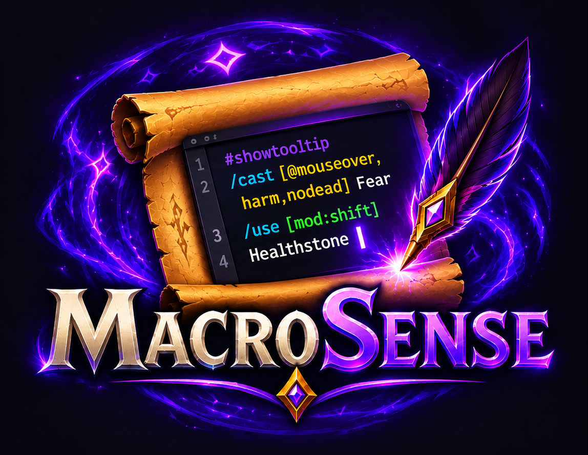</p>

<h1 align="center">Macros, step by step</h1>

<p align="center">
  What macros are, what they can do, and how to make them with MacroSense<br>
  <b>English</b> · <a href="GUIDE_UA.md">Українська</a>
</p>

---

**In this guide**

1. [What a macro is](#1-what-a-macro-is)
2. [The MacroSense window](#2-the-macrosense-window)
3. [Your first macro](#3-your-first-macro)
4. [The wizard: questions or a form](#4-the-wizard-questions-or-a-form)
5. [How a macro line reads](#5-how-a-macro-line-reads)
6. [How the game picks what to do](#6-how-the-game-picks-what-to-do)
7. [What macros can do](#7-what-macros-can-do)
8. [Conditions and targets](#8-conditions-and-targets)
9. [What macros can't do](#9-what-macros-cant-do)
10. [Ready-made macros](#10-ready-made-macros)
11. [MacroSense helps along the way](#11-macrosense-helps-along-the-way)
12. [More than 30 macros: macro sets](#12-more-than-30-macros-macro-sets)

---

## 1. What a macro is

A macro is a button that does several things at once, or a different thing depending on the moment. You put it
on an action bar like a spell and press it in the same way. Inside it are lines of text, one command each:

```
#showtooltip
/cast Fireball
```

Press it, and the game reads the lines from the top and does what they say: here, casts Fireball.

Macros are kept in two places:

<p align="center">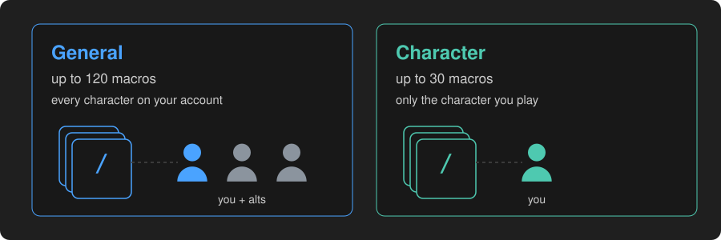</p>

- "General": up to 120, the same for every character on your account. Good for things anyone can use:
  a mount, a hearthstone, a chat message.
- "Character": up to 30, only for the character you play. Good for a class's spells. Macro sets keep more:
  see [section 12](#12-more-than-30-macros-macro-sets).

A macro is at most **255 characters** long. That is about five or six lines.

## 2. The MacroSense window

<p align="center">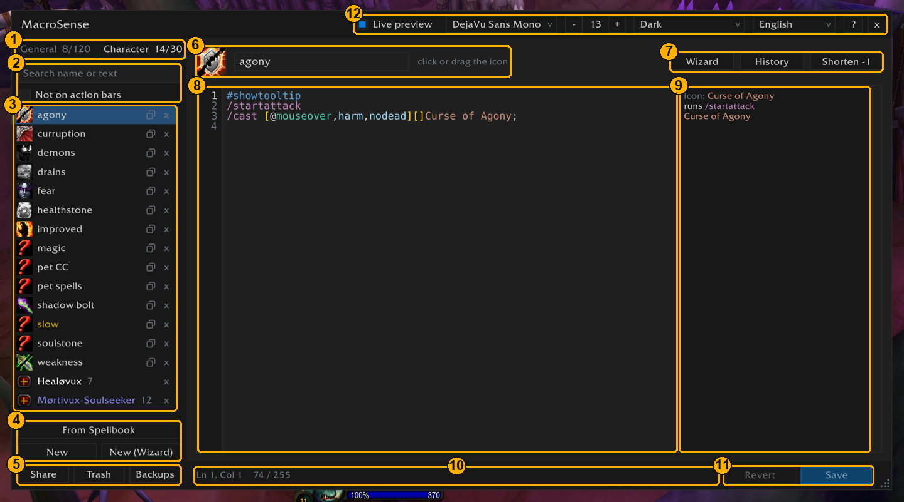</p>

1. "General" and "Character": which macros the list shows, and how many each tab holds.
2. The search, "Not on action bars" and "With mistakes": find a macro by its name or text, or keep only those
   on no bar, or only those with a mistake or a warning. "Replace" changes a word in many macros at once.
3. The list of macros. A click opens one, Ctrl+click picks it to do the same with many at once. "..." copies or
   moves it, or adds a note, "x" deletes it. In the "Character" tab,
   your other characters' macros are at the bottom.
4. "From Spellbook" makes macros for many spells of your spellbook at once, "New" starts an empty macro,
   "New (Wizard)" makes one from a few questions.
5. "Share" sends macros as a code or a chat link, "Trash" brings deleted ones back, "Backups" keeps copies of
   all your macros.
6. The macro's icon and name. A click on the icon picks another one; drag the icon onto an action bar.
7. "Wizard" changes this macro with the wizard's questions, "History" shows its earlier texts, "Shorten" writes
   it in fewer characters.
8. The macro's text, with line numbers. Point at a number to read the line in plain words, and at a word to see
   what it means.
9. The live preview: what each line would do right now.
10. The status bar: where the cursor is, how long the macro is (255 characters at most), "Unsaved changes", and
    what is wrong with the macro, if anything. A click on a mistake fixes it when the fix is clear; point at it to
    see them all.
11. "Revert" brings back the saved text, "Save" saves the macro.
12. "Live preview" on or off, the font and its size, the colors, the language, and "?" for the macro guide.

## 3. Your first macro

Let's make a macro that casts **Shadow Bolt** at the enemy under your mouse, or at your target when you point at
nobody. Swap in any spell of yours.

**Step 1. Open MacroSense.** Type `/ms` in chat, or click the MacroSense button by the minimap.

<p align="center">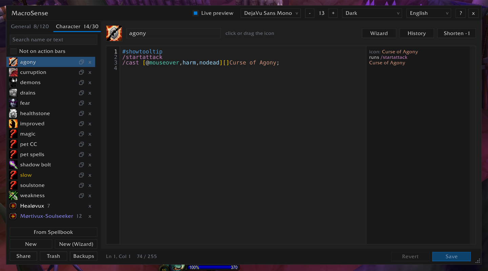</p>

Section 2 shows every part of the window.

**Step 2. Pick the tab and press "New".** Choose "Character" for a class spell, then "New". A new
macro already has `#showtooltip` on its first line, and the cursor waits on the second.

**Step 3. Name it.** Type a name, up to 16 letters, for example `Bolt MO` ("MO" for mouseover).
Press **Tab** or **Enter** to go on to the text.

**Step 4. Write the text.** Type `/ca`: a list comes up with `/cast` on top. **Tab** or **Enter** takes it.
Type `[@` and pick `@mouseover`, then a comma and `harm` (an enemy), then `]`. After the `]`, type a few letters
of the spell and take it from the list.

<p align="center">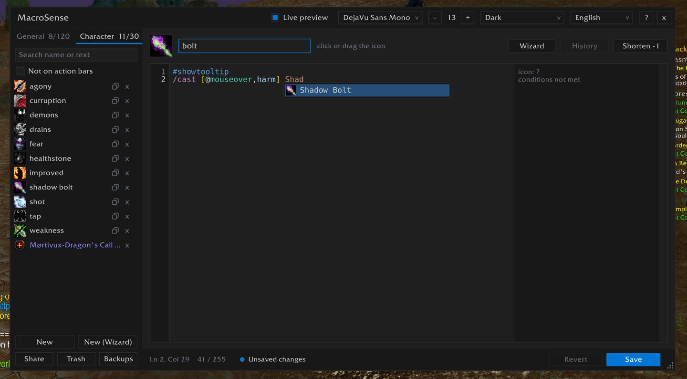</p>

```
#showtooltip
/cast [@mouseover,harm] Shadow Bolt
```

**Step 5. Check it.** Next to each line the editor says what it would do right now: `Shadow Bolt @mouseover` while
you point at an enemy, `conditions not met` when you don't.

<p align="center">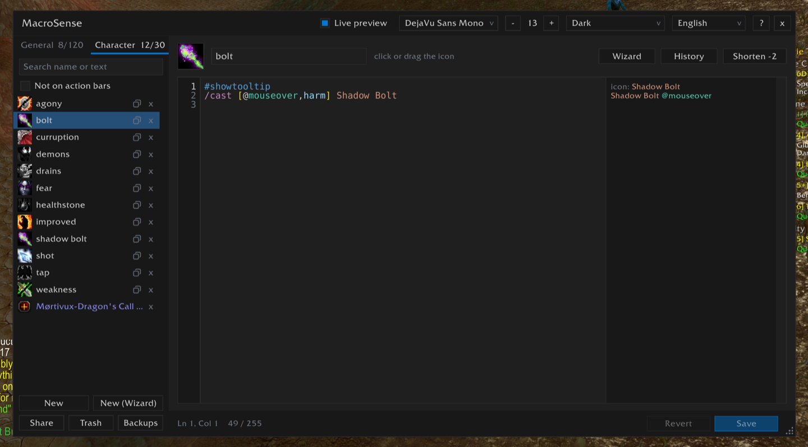</p>

Point at the line's number to read the whole line in plain words. A mistake is underlined in red, and the status bar
says what is wrong; a click there goes to that line. Ctrl+click there fixes it when the fix is clear, and so does
Ctrl+click on the underlined text.

<p align="center">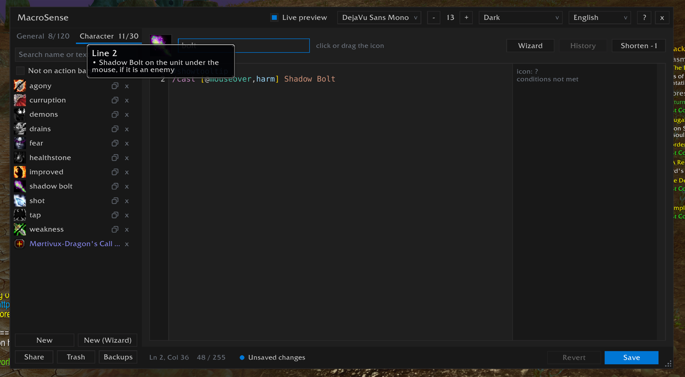</p>

Pointing at nobody, the macro does nothing yet. To cast at your target then, add `[]` before the spell name. It
means "otherwise, as usual":

```
#showtooltip
/cast [@mouseover,harm][] Shadow Bolt
```

**Step 6. Save.** Press "Save", or **Ctrl+S** (Cmd+S on a Mac). In combat the game doesn't let you change macros. "Save" then keeps your change, and the macro is saved as soon as combat ends.

**Step 7. Put it on a bar.** Drag the macro from the list, or its icon from the top of the editor, onto an action
bar. Done: press it in game.

<p align="center">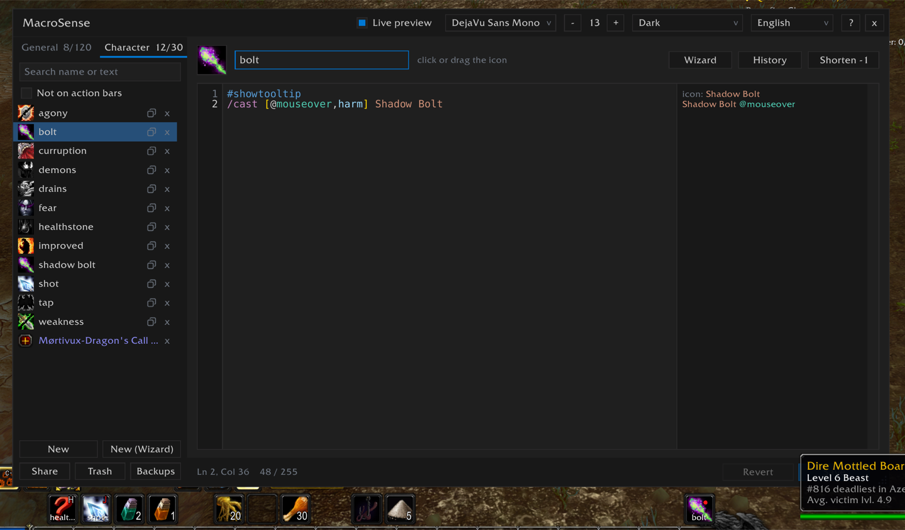</p>

> **The icon.** Leave the question mark as the macro's icon, and the game shows the icon of the spell it would
> cast. It changes as whatever the macro's conditions check changes: you hold a modifier key, point at a target,
> set a focus, and so on. Pick an icon yourself, and it stays as you picked it.

## 4. The wizard: questions or a form

You don't have to write anything. "New (Wizard)" makes the macro for you, in one of two ways:

- "Step by step": one question at a time, in plain words. The wizard opens like this the first time. Good if
  you have never written a macro.
- "All options": the whole form at once, every choice in view. Good once you know what you want.

"All options" and "Step by step" switch between them, and the answers you gave stay. The wizard opens
the way you left it. As you answer, the macro it makes grows at the bottom of the window, with its colors and
length.

### Step by step

<p align="center">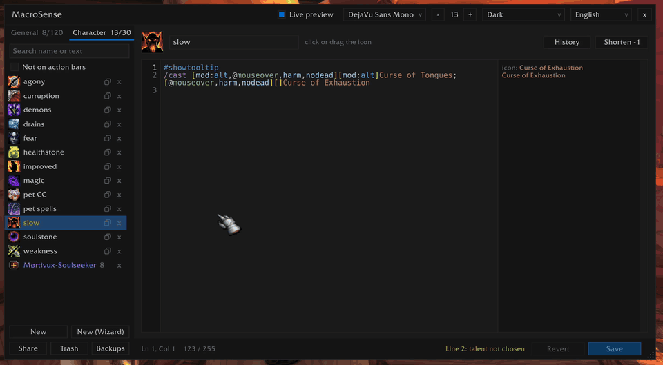</p>

The same Shadow Bolt macro as in section 3, question by question:

1. **"What should the macro do?"** Choose "Cast a spell". The other answers: use an item, several spells in
   turn, one of several at random, target someone, set your focus, take someone's target, command your pet,
   ride a mount, put on gear. A click only chooses: the macro at the bottom of the window shows what it
   writes, and you can still choose another answer. "Next" goes on when you're sure.
2. **"Which spell?"** Type a few letters, `Shad`, and pick **Shadow Bolt**. The macro at the bottom shows it;
   "Next" goes on.
3. **"Where should Shadow Bolt go?"** Choose "Whoever is under the mouse". Each answer shows the words it puts
   into the macro (`@mouseover`), and its tooltip says what they mean.
4. **"And if nobody is under the mouse?"** Choose "Your target, as usual". The wizard asks "and if not?" up to
   three times, so a heal can go to the unit under the mouse, then your target, then you.
5. **"Who is it for?"** Asked only when the game doesn't say. Shadow Bolt is for enemies, so this question is
   skipped. For an item, or a spell that can go to both, choose friends, enemies or anyone.
6. **"Should the macro do something else while you hold Shift, Ctrl or Alt?"** Skip it for now. Pick a key, and
   the next questions ask what that key casts, and where.
7. **"Should the macro work only at certain times?"** In combat or out of it, in stealth, in a group, with your
   pet out, while channeling a spell or not, in a form. Skip it for now.
8. **"Would you like to add anything else?"** Stop your cast first, use a trinket, start auto attack, say
   something in chat. Skip it for now.
9. **"Almost done: name your macro"**. Type `Bolt MO` and choose who keeps it: all your characters or only this
   one. "Create macro".

"< Back" goes back with your answers kept, "Next >" goes on with the one chosen. The macro opens in the
editor, ready to put on a bar.

### All options

<p align="center">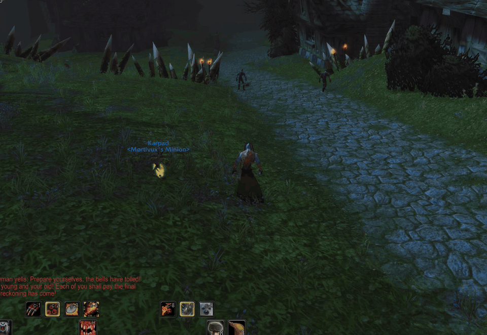</p>

The form has the same choices as the questions, each in its own row:

| Row | What it sets | In the macro |
|---|---|---|
| "Command" | what the macro does: a spell or item, a list in turn, one at random, target, focus, assist, pet, mount, gear | `/cast`, `/castsequence`, `/target`... |
| "Cast" / "Use" | the spell or item: a few letters, or the first letters of its words in capitals (`SB`) | `Shadow Bolt` |
| "On" | on whom, up to three in order: as usual, your target, mouseover, focus, yourself, a party member, at the cursor... | `[@mouseover][]` |
| "Only" | friends, enemies or anyone; "Alive only" | `harm`, `help`, `nodead` |
| "With a key held" | for Shift, Ctrl, Alt (Cmd on a Mac): another spell, or the same on someone else | `[mod:shift]...;` |
| "When" | only in or out of combat, in stealth, in a group, with your pet, not while channeling, in a form, and what it does otherwise | `[combat]`, `[nochanneling:Drain Soul]` |
| "Also" | stop your cast first, a trinket, start attack, leave your form, "Don't turn it off", cancel a buff, a chat line | `/stopcasting`, `/use 13`, `!Shoot` |
| "Name" and "Tab" | the macro's name, and General or Character | |

A few of what you can get:

| You choose | You get |
|---|---|
| Shadow Bolt; On: Mouseover, then As usual; Only: Enemies | `/cast [@mouseover,harm,nodead][] Shadow Bolt` |
| Flash Heal; On: Mouseover, then Your target, then Yourself; Only: Friends | `/cast [@mouseover,help,nodead][help,nodead][@player] Flash Heal` |
| Counterspell on Focus, then As usual; Also: stop your cast first | `/stopcasting`, then `/cast [@focus,harm,nodead][] Counterspell` |
| Frostbolt; Shift: Polymorph on Focus; Also: trinket 1 | `#showtooltip Frostbolt`, `/use 13`, `/cast [mod:shift,@focus,harm,nodead] Polymorph; Frostbolt` |
| Mount: Steed, Gryphon where you can fly, Sea Turtle in water | `/cast [nomounted,swimming] Sea Turtle; [nomounted,flyable] Gryphon; [nomounted] Steed` |

### A macro you already have

Open a macro and press "Wizard". The wizard opens with its answers filled in. Change what you
like with a few clicks, then "Put in editor": the new text goes into the editor, and "Save" keeps it
(**Ctrl+Z** takes it back). It works for any macro the wizard could have made, also one typed by hand or taken
from a guide. If the wizard would write some lines its own way, or has no place for them (`/run`, a second
`/cast`), it says so before it opens, and the window lists them under "lines will change".

### Many macros at once: from the spellbook

<p align="center">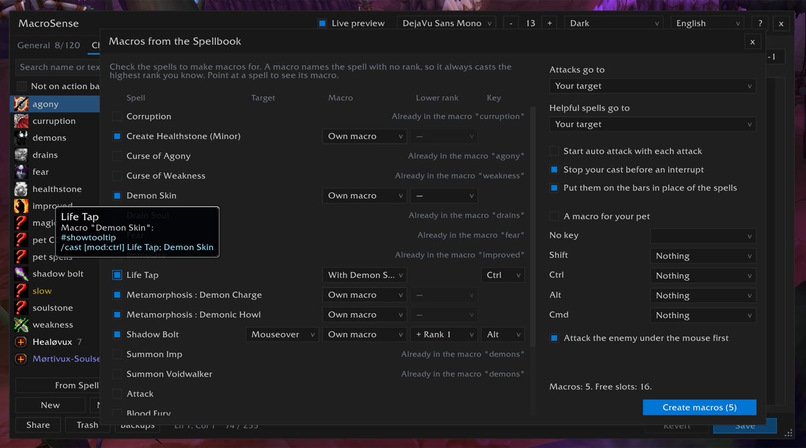</p>

"From Spellbook" (or `/ms book`) opens a window with the spells of your spellbook. Tick the ones to make
macros for, and each gets its own: `#showtooltip` and `/cast` with the spell's name and no rank. In the Classic
clients a spell with no rank is always its highest rank you know, so the macro keeps up as you learn new ones.
Point at a spell to see its macro.

On the right you choose for all the spells at once:

- **"Attacks go to"** and **"Helpful spells go to"**: your target, the unit under the mouse (or your target when
  you point at nobody), or your focus (or your target).
- "Start auto attack with each attack": `/startattack` before attacks, but not before spells that keep an enemy
  out of the fight, such as Sap or Polymorph, which it would break.
- "Stop your cast before an interrupt": `/stopcasting` before Kick, Counterspell and the like.
- "Put them on the bars in place of the spells": each macro takes its spell's places on your action bars. Delete
  such a macro in MacroSense later and the spell comes back onto those buttons, if the macro still casts it.
- "A macro for your pet" (hunters and warlocks): what the pet does with no key held, and with each key.

Each ticked spell's row has more, for that spell only:

- "Target": where this spell goes, over the choice for all. "—" keeps that choice.
- "Macro": "Own macro", or "With" another spell. Then the spell goes into that spell's macro and is cast while
  you hold the key you pick in "Key". This saves macro slots: a character has 30.
- "Lower rank" (Classic clients): a cheaper rank on a key. It costs less mana: to heal a little, to put a cheap
  spell on an enemy for them to dispel, or to waste a warrior's Spell Reflection on it.

```
#showtooltip
/cast [mod:shift] Shadow Bolt(Rank 1); Shadow Bolt
```

The count at the bottom shows how many macros you would make and how many slots are free; "Create macros" makes
them. Spells that some macro casts already are not ticked, nor those you left out before, but you can still tick
them. Next time, only the spells you learned since are ticked. "Select all" ticks every spell, and once all are
ticked it becomes "Clear all". "Offer all again" forgets which spells you left out and which macros you deleted,
and offers every spell with no macro, ticked, as the first time. With macro sets on, the macros that find no free slot are made
behind the scenes.

## 5. How a macro line reads

<p align="center">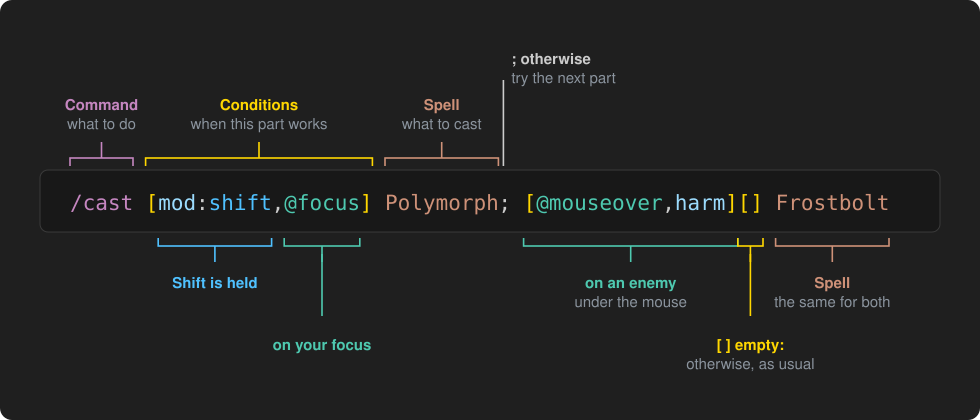</p>

- **The command** comes first, after a `/`: what to do. `/cast` casts a spell, `/use` uses an item.
- **Conditions** in square brackets `[ ]` say when this part works. Several in one pair of brackets, split by
  commas, must all be true: `[mod:shift,@focus]` is "Shift is held, on my focus".
- **`@` and a unit** say on whom: `@focus`, `@mouseover`, `@player` (you). Without it, the spell goes to your
  target as usual.
- **The spell or item** comes after the conditions.
- **`;`** separates the choices: "otherwise".
- **Two pairs of brackets in a row**, `[...][...]`, mean "this, or else that" for the same spell.
- **Empty brackets** `[]` are always true: "otherwise, as usual".
- **`!` before a spell** means "only turn it on". A press turns some spells on and off: Shoot, Auto Shot,
  Stealth, Prowl, a form. With `!`, pressing again while it is on keeps it on: `/cast !Shoot` doesn't stop your
  shooting, `/cast !Stealth` doesn't take you out of stealth. Point at the `!` in the editor to read this.

A line that starts with `#` is not a command but a setting. `#showtooltip` makes the macro show the tooltip of
the spell it would cast, and its icon too while the macro's icon is the question mark.

## 6. How the game picks what to do

On each line, the game reads the choices from left to right and takes **the first one whose conditions are
all true**. The rest of that line is skipped. Then it goes on to the next line.

<p align="center">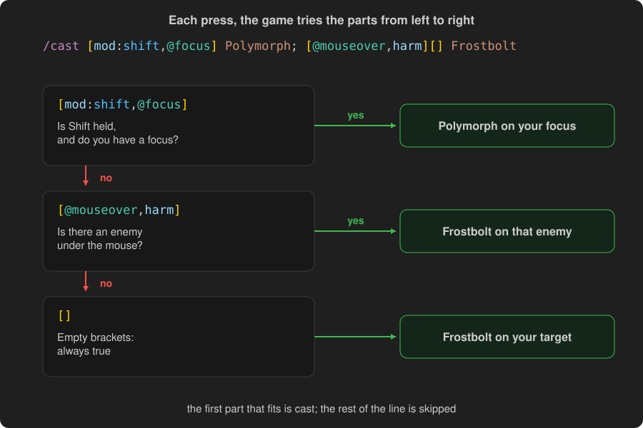</p>

So the order matters: put the special cases first and the usual one last. A choice after `[]` (or after one with
no conditions) never runs, and the editor warns about it; when a key chooses it (`[mod:alt]`), Ctrl+click on the
warning puts it first.

Most spells start the global cooldown, the short pause after a cast. **One press casts only one such spell.**
Lines after it still run if they don't need the cooldown: `/startattack`, `/use` for a trinket, a chat
message. A spell with the global cooldown on a line below one that always casts such a spell is a warning too: it
won't cast, or, when the spell above has a cooldown of its own, only while that one is on cooldown. Ctrl+click puts
a line chosen by a key into the line above, first.

## 7. What macros can do

| What | Commands | Example |
|---|---|---|
| Cast a spell | `/cast` | `/cast [@mouseover,help][] Flash Heal` |
| Use an item | `/use`, a bag slot or an equipment slot | `/use Healthstone`, `/use 13` (trinket 1) |
| Several spells in turn | `/castsequence` | `/castsequence reset=target Corruption, Immolate` |
| One at random | `/castrandom`, `/userandom` | `/userandom Hearthstone, Dalaran Hearthstone` |
| Stop | `/stopcasting`, `/stopattack`, `/stopmacro` | `/stopcasting` before an interrupt |
| Attack | `/startattack`, `/petattack` | `/startattack` with a melee spell |
| Target | `/target`, `/targetenemy`, `/assist`, `/cleartarget` | `/target [@party1]` |
| Focus | `/focus`, `/clearfocus` | `/focus [@mouseover,exists][]` |
| Command the pet | `/petattack`, `/petfollow`, `/petstay`, `/petpassive`... | `/petfollow [mod:shift]` |
| Put on gear | `/equip`, `/equipslot`, `/equipset` | `/equipslot 14 Lucky Charm` |
| Mounts | `/cast`, `/dismount` | `/cast [flyable] Gryphon; Steed` |
| Remove a buff or a form | `/cancelaura`, `/cancelform` | `/cancelaura Ice Block` |
| Talk | `/say`, `/yell`, `/party`, `/raid`, `/emote` | `/say Sheeping %t!` (`%t`: your target's name) |
| Press another button | `/click` | `/click ActionButton1` |
| Icon and tooltip | `#showtooltip`, `#show` | `#showtooltip Frostbolt` |

Type `/` in the MacroSense editor to see every command your game has, addons' too. Point at a command to read
what it does.

## 8. Conditions and targets

The conditions you will use most. Each of them works the other way round with `no` in front: `nocombat`,
`nomod`, `nodead`.

| Condition | True when |
|---|---|
| `help` / `harm` | the unit is a friend / an enemy |
| `dead`, `exists` | the unit is dead / is there at all |
| `mod`, `mod:shift`, `mod:ctrl`, `mod:alt` | a key is held (any, or that one) |
| `combat` | you are in combat |
| `stealth` | you are in stealth |
| `mounted`, `flying`, `swimming`, `flyable` | you are mounted / flying / swimming / you can fly here |
| `group`, `group:raid` | you are in a group / in a raid |
| `pet`, `pet:Imp` | your pet is out / that pet is |
| `form:1`, `stance:2` | you are in that form or stance |
| `spec:2` | you are in your second specialization |
| `known:Spell`, `talent:...` | you know that spell / have that talent |
| `equipped:Shields` | you wear that kind of item |
| `channeling` | you are channeling a spell |

The units for `@`:

| Unit | Who |
|---|---|
| `@target` | your target (the default) |
| `@mouseover` | whoever is under your mouse, in the world or on a unit frame |
| `@focus` | your focus |
| `@player` | you |
| `@pet` | your pet |
| `@party1` ... `@party4` | your party members |
| `@targettarget` | your target's target |
| `@arena1` ... `@arena3` | arena enemies |
| `@cursor` | the ground under the cursor, for spells cast on an area |

Type `[` in the editor and every condition comes up; after `[@`, every unit. Point at one to read what it means.

## 9. What macros can't do

- **Think for you in combat.** A macro can't check your health, a cooldown or a buff's time and choose by that.
  It reads only what the conditions above can say.
- **Cast several spells at once.** One spell with the global cooldown per press (see section 6).
- **Press itself.** Every cast needs your key press or click.
- **Be longer than 255 characters.** MacroSense counts them as you type; "Shorten" writes the same
  macro in fewer.
- **Cast spells from `/run`.** `/run` and `/script` run small programs: they can show text or change game
  settings, but can't cast a spell or target anyone.

## 10. Ready-made macros

Copy any of these into a new macro and change the spell names to yours.

**Heal on mouseover, or on your target:**
```
#showtooltip
/cast [@mouseover,help,nodead][help,nodead][@player] Flash Heal
```
Heals whoever is under the mouse; if nobody, your target if it is a friend; if not, you.

**Interrupt your focus, or your target:**
```
#showtooltip
/stopcasting
/cast [@focus,harm,nodead][] Counterspell
```

**Another spell with Shift held:**
```
#showtooltip
/cast [mod:shift,@focus] Polymorph; Frostbolt
```

**A trinket with your big spell:**
```
#showtooltip Arcane Power
/use 13
/cast Arcane Power
```

**Two curses in turn, starting over on a new target:**
```
#showtooltip
/castsequence reset=target Corruption, Curse of Agony
```

**Shoot with a wand, and keep shooting however often you press:**
```
#showtooltip
/cast !Shoot
```
Without `!`, a second press would stop the shooting.

**The pet attacks what you point at, follows with Shift:**
```
/petattack [nomod,@mouseover,harm,nodead][nomod]
/petfollow [mod:shift]
```

**One mount button:**
```
#showtooltip
/cast [nomounted,swimming] Sea Turtle; [nomounted,flyable] Gryphon; [nomounted] Steed
/dismount [mounted,noflying]
```

Guides on Wowhead or Icy Veins write macros as plain text. Paste them with "Share > Import a code or text",
and MacroSense makes the macros for you.

## 11. MacroSense helps along the way

- **Autocomplete**: commands, conditions, units, your spells and items as you type. `SWP` finds Shadow Word:
  Pain.
- "Live preview": what each line would do right now, changing as you hold keys or change target.
- **Explanations**: point at a line's number to read it in plain words, at a word for what it means.
- **Error checks**: mistakes underlined, a Ctrl+click fix for the clear ones, a warning for a spell you can't cast
  now and for a part of a macro that never runs.
- "Shorten": the same macro in fewer characters.
- "History", "Trash", "Backups": earlier texts, deleted macros and saved copies of all of them.
- "Share": a code to send a macro or your macro sets to a friend, or a link in chat.
- "Wizard": change a macro with the wizard's questions.

### Typing less: a few letters find the word

The list that comes up as you type doesn't need the whole word, or even its start:

| You type | It finds | How |
|---|---|---|
| `SB` | Shadow Bolt | **Capitals** are the first letters of the words |
| `SWP` | Shadow Word: Pain | as many words as you like |
| `CA` or `CoA` | Curse of Agony | small words may be left out, or typed in small letters |
| `sh wo` | Shadow Word: Pain | a **space** goes on to the next word |
| `fi` | Soul Fire | small letters: a name that starts so, then a word that starts so |
| `nct` | `nocombat` | **letters in order**, from the start of the word, with others between them |
| `mntd` | `mounted` | the same for conditions, commands and units |
| `nmd` | `nomod`, `nomounted` | the best matches come first |

Capitals that are no name's first letters count as small ones, so Caps Lock doesn't get in the way. **Tab** or
**Enter** takes the highlighted one, **Up** and **Down** move through the list, **Esc** closes it.

Each of them is described in full in the [README](../README.md).

## 12. More than 30 macros: macro sets

A character has only 30 macro slots. Macro sets let MacroSense keep more: each specialization gets macros of its
own, and only those you need right now take a slot. Tick "Macro sets" to turn them on. Until you do, nothing
changes. MacroSense makes a backup of your macros first.

### Three kinds of sets

- "Class macros": the same on all your characters of one class. Change one, and your other characters of that
  class get the change too. They are in the game in every specialization.
- "This character's": its own macros, in the game in every specialization. When you first turn the sets on, all
  your character macros are here.
- **A specialization's**: in the game only while it is chosen. Choose another, and they wait behind the scenes,
  while that one's come into the game, onto the same buttons they had on your action bars.

### In the game and behind the scenes

With the sets on, the "Character" tab has two parts. "In the game" holds the macros in your 30 slots: they are on
your bars and work. "Behind the scenes" holds the macros MacroSense keeps for you: they take no slot. Open,
change, make and delete them there like any other macro.

Class macros are yellow, the specialization chosen now green, and all that is behind the scenes red. A macro you
keep behind the scenes on purpose has a grey name. The groups open and close with a click.

### What you can do with a macro

Press "..." by a macro's name, or right-click it:

- "Put away": the macro leaves the game and waits behind the scenes, in its own set. Its slot is free for
  another.
- "Take in": it comes back into the game. It needs a free slot, and no other macro of the same name in the game.
- "Keep behind the scenes": for a specialization not chosen now. The macro stays behind the scenes even when you
  choose that specialization. "Come in with its specialization" undoes it.
- "Move to": the macro goes to another set. If it was in the game and the new set is in the game too, it stays
  on its buttons. If the set already has the very same macro, the two become one.
- "Copy to": a copy goes to another set. From then on they are two separate macros.
- "Duplicate": a copy in the same set, named like "Fear 2".
- "Remove": the macro leaves its set and goes back to "This character's".
- "Copy to: General", "Move to: General" and back: any macro can go to the other tab.

### Dragging

- Drag a macro onto any part of the list to move it there: onto "Behind the scenes", and it waits there; onto
  "In the game", and it comes into the game; onto a group, and it goes to that set.
- Hold **Ctrl** when you start dragging or when you let go, and the macro is copied instead.
- Drag it onto the "General" or "Character" tab to move it there, or with Ctrl to copy it. This works with the
  sets off too.
- A macro in the game can still be dragged onto an action bar.

While you drag, a sign by the mouse shows whether the macro can go there, and the chat says why not.

### Names

The game tells macros apart by their names, so only one macro of a name can be in the game at a time. Each set
may have a macro of the same name: two specializations' come in each with its own specialization, onto its own
buttons. A macro whose name is taken waits behind the scenes, and MacroSense says so in the chat.

### Sets on another character

- "Share" > "Export macro sets...": tick the sets you want and copy the code. "Select all" and "Clear all" tick
  or clear them at once.
- "Share" > "Import a code or text...": paste a code of sets, or choose another character of yours. Each set goes
  into its own. Another class's sets go into "This character's", and MacroSense warns you first. A name the set
  has already gets a number, and the very same macro is skipped. They all come in behind the scenes: take in
  those you need.
- In the "Character" tab, your other characters' macros include those behind the scenes, with their set's name.

### Good to know

- **No free slot**: a macro that should come into the game but finds no free slot waits behind the scenes. A new
  macro with no free slot (from "New", the wizard, a copy, the trash or "From Spellbook") is made behind the
  scenes, in "This character's". MacroSense asks first, until you tell it not to.
- "Sort by spells": MacroSense looks at the spells each macro casts and offers to move it where it works. You
  see every move first. It works once you have played each specialization at least once.
- **Turning them off**: clear "Macro sets", and the macros behind the scenes come into the game, as many as fit.
  If not all fit, you choose which. Turn the sets on again, and those macros go back where they were, with what
  you changed in them meanwhile.
- **If something breaks**: if a change breaks halfway, MacroSense undoes all of it, so your macros, sets and
  buttons are as they were. It says so in the chat; please report the error then.
- **Before level 10** a character has no specialization yet: its macros are kept as "No specialization yet".
- **Primary and Secondary.** In Classic Era, TBC, Mists of Pandaria and WoW Forever the sets follow your two
  talent groups, each with its own action bars there.
- A macro deleted behind the scenes goes to the trash, like any other.

Found something wrong, or missing something? Type `/ms bug` in game and tell me: in the comments on
[CurseForge](https://www.curseforge.com/wow/addons/macro-sense), in
[GitHub Issues](https://github.com/v-gachkovsky/macro-sense/issues), or by email at
volodymyr.hachkovsky@icloud.com.
