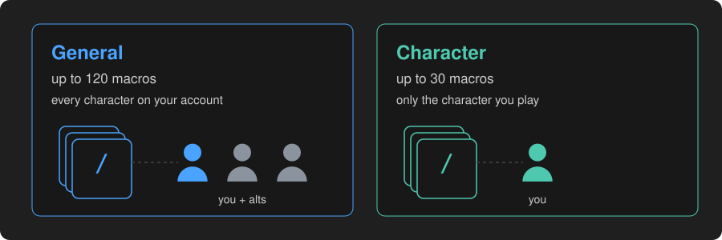
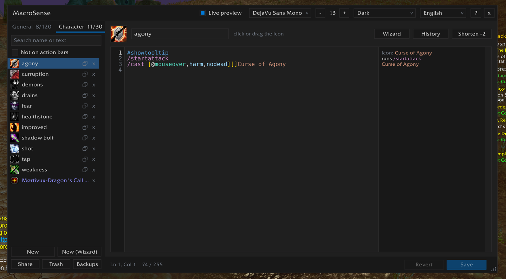
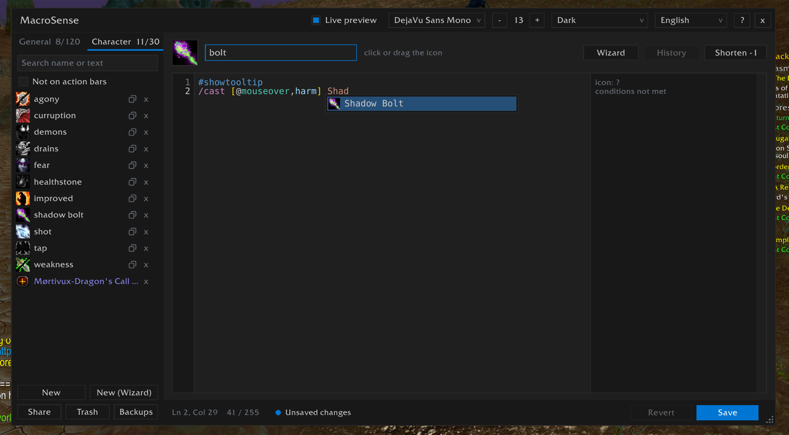
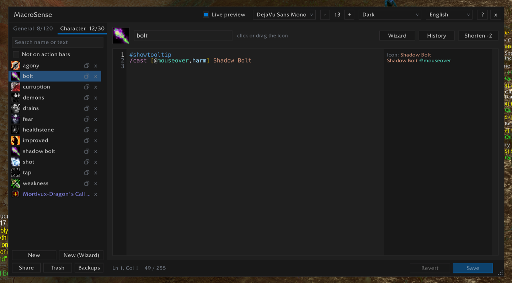
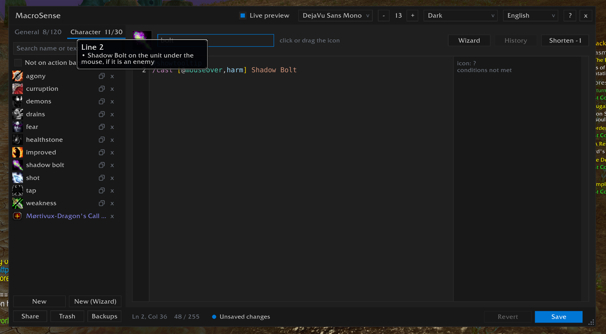
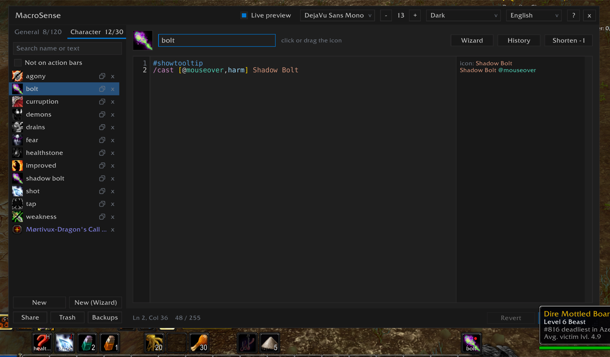
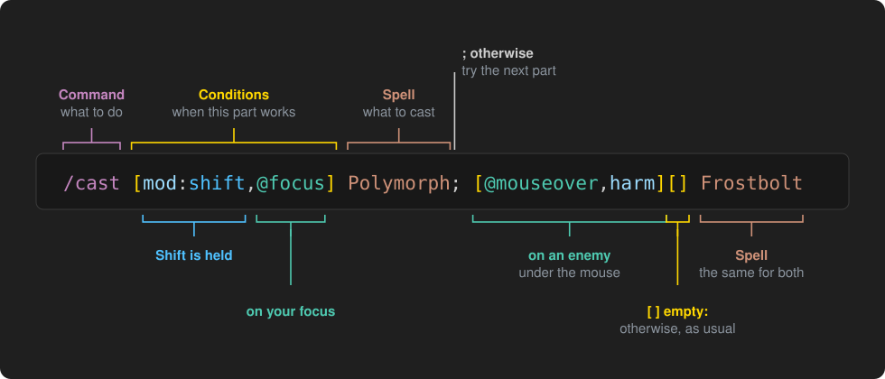
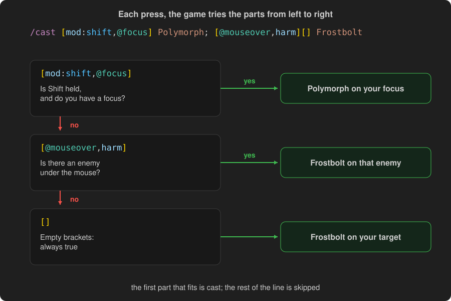

<p align="center"></p>

<h1 align="center">Macros, step by step</h1>

<p align="center">
  What macros are, what they can do, and how to make them with MacroSense<br>
  <b>English</b> · <a href="GUIDE_UA.md">Українська</a>
</p>

---

**In this guide**

1. [What a macro is](#1-what-a-macro-is)
2. [Your first macro](#2-your-first-macro)
3. [The wizard: questions or a form](#3-the-wizard-questions-or-a-form)
4. [How a macro line reads](#4-how-a-macro-line-reads)
5. [How the game picks what to do](#5-how-the-game-picks-what-to-do)
6. [What macros can do](#6-what-macros-can-do)
7. [Conditions and targets](#7-conditions-and-targets)
8. [What macros can't do](#8-what-macros-cant-do)
9. [Ready-made macros](#9-ready-made-macros)
10. [MacroSense helps along the way](#10-macrosense-helps-along-the-way)

---

## 1. What a macro is

A macro is a button that does several things at once, or a different thing depending on the moment. You put it
on an action bar like a spell and press it in the same way. Inside it are lines of text, one command each:

```
#showtooltip
/cast Fireball
```

Press it, and the game reads the lines from the top and does what they say: here, casts Fireball.

Macros are kept in two places:

<p align="center"></p>

- **General**: up to 120, the same for every character on your account. Good for things anyone can use:
  a mount, a hearthstone, a chat message.
- **Character**: up to 30, only for the character you play. Good for a class's spells.

A macro is at most **255 characters** long. That is about five or six lines.

## 2. Your first macro

Let's make a macro that casts **Shadow Bolt** at the enemy under your mouse, or at your target when you point at
nobody. Swap in any spell of yours.

**Step 1. Open MacroSense.** Type `/ms` in chat, or click the MacroSense button by the minimap.

<p align="center"></p>

On the left is the list of your macros, with the **General** and **Character** tabs. On the right is the
editor with the open macro.

**Step 2. Pick the tab and press New.** Choose **Character** for a class spell, then **New** under the list. A
new macro already has `#showtooltip` on its first line, and the cursor waits on the second.

**Step 3. Name it.** Type a name at the top, up to 16 letters, for example `Bolt MO` ("MO" for mouseover).
Press **Tab** or **Enter** to go on to the text.

**Step 4. Write the text.** Type `/ca`: a list comes up with `/cast` on top. **Tab** or **Enter** takes it.
Type `[@` and pick `@mouseover`, then a comma and `harm` (an enemy), then `]`. After the `]`, type a few letters
of the spell and take it from the list.

<p align="center"></p>

```
#showtooltip
/cast [@mouseover,harm] Shadow Bolt
```

**Step 5. Check it.** Next to each line the editor says what it would do right now: `Shadow Bolt @mouseover` while
you point at an enemy, `conditions not met` when you don't.

<p align="center"></p>

Point at the line's number to read the whole line in plain words. A mistake is underlined in red, and the bar at
the bottom says what is wrong. A click there fixes it when the fix is clear.

<p align="center"></p>

Pointing at nobody, the macro does nothing yet. To cast at your target then, add `[]` before the spell name. It
means "otherwise, as usual":

```
#showtooltip
/cast [@mouseover,harm][] Shadow Bolt
```

**Step 6. Save.** Press **Save**, or **Ctrl+S** (Cmd+S on a Mac).

**Step 7. Put it on a bar.** Drag the macro from the list, or its icon from the top of the editor, onto an action
bar. Done: press it in game.

<p align="center"></p>

> **The icon.** Leave the question mark as the macro's icon, and the game shows the icon of the spell it would
> cast. It changes as whatever the macro's conditions check changes: you hold a modifier key, point at a target,
> set a focus, and so on. Pick an icon yourself, and it stays as you picked it.

## 3. The wizard: questions or a form

You don't have to write anything. **New (Wizard)** under the list makes the macro for you, in one of two ways:

- **Step by step**: one question at a time, in plain words. The wizard opens like this the first time. Good if
  you have never written a macro.
- **All options**: the whole form at once, every choice in view. Good once you know what you want.

The button in the wizard's title bar switches between them, and the answers you gave stay. The wizard opens
the way you left it. As you answer, the macro it makes grows at the bottom of the window, with its colors and
length.

### Step by step

<p align="center"></p>

The same Shadow Bolt macro as in section 2, question by question:

1. **What should the macro do?** Choose **Cast a spell**. The other answers: use an item, several spells in
   turn, one of several at random, target someone, set your focus, take someone's target, command your pet,
   ride a mount, put on gear.
2. **Which spell?** Type a few letters, `Shad`, and pick **Shadow Bolt**. Picking it goes on to the next
   question by itself.
3. **Where should Shadow Bolt go?** Choose **Whoever is under the mouse**. Each answer shows the words it puts
   into the macro (`@mouseover`), and its tooltip says what they mean.
4. **And if nobody is under the mouse?** Choose **Your target, as usual**. The wizard asks "and if not?" up to
   three times, so a heal can go to the unit under the mouse, then your target, then you.
5. **Who is it for?** Asked only when the game doesn't say. Shadow Bolt is for enemies, so this question is
   skipped. For an item, or a spell that can go to both, choose friends, enemies or anyone.
6. **Should the macro do something else while you hold Shift, Ctrl or Alt?** Skip it for now. Pick a key, and
   the next questions ask what that key casts, and where.
7. **Should the macro work only at certain times?** In combat or out of it, in stealth, in a group, with your
   pet out, in a form. Skip it for now.
8. **Would you like to add anything else?** Stop your cast first, use a trinket, start auto attack, say
   something in chat. Skip it for now.
9. **Almost done: name your macro.** Type `Bolt MO` and choose who keeps it: all your characters or only this
   one. **Create macro**.

**< Back** goes back with your answers kept, **Next >** goes on with the one chosen. The macro opens in the
editor, ready to put on a bar.

### All options

<p align="center"></p>

The form has the same choices as the questions, each in its own row:

| Row | What it sets | In the macro |
|---|---|---|
| **Command** | what the macro does: a spell or item, a list in turn, one at random, target, focus, assist, pet, mount, gear | `/cast`, `/castsequence`, `/target`... |
| **Cast** / **Use** | the spell or item: a few letters, or the first letters of its words in capitals (`SB`) | `Shadow Bolt` |
| **On** | on whom, up to three in order: as usual, your target, mouseover, focus, yourself, a party member, at the cursor... | `[@mouseover][]` |
| **Only** | friends, enemies or anyone; **Alive only** | `harm`, `help`, `nodead` |
| **With a key held** | for Shift, Ctrl, Alt (Cmd on a Mac): another spell, or the same on someone else | `[mod:shift]...;` |
| **When** | only in or out of combat, in stealth, in a group, with your pet, in a form, and what it does otherwise | `[combat]` |
| **Also** | stop your cast first, a trinket, start attack, leave your form, cancel a buff, a chat line | `/stopcasting`, `/use 13` |
| **Name** and **Tab** | the macro's name, and General or Character | |

A few of what you can get:

| You choose | You get |
|---|---|
| Shadow Bolt; On: Mouseover, then As usual; Only: Enemies | `/cast [@mouseover,harm,nodead][] Shadow Bolt` |
| Flash Heal; On: Mouseover, then Your target, then Yourself; Only: Friends | `/cast [@mouseover,help,nodead][help,nodead][@player] Flash Heal` |
| Counterspell on Focus, then As usual; Also: stop your cast first | `/stopcasting`, then `/cast [@focus,harm,nodead][] Counterspell` |
| Frostbolt; Shift: Polymorph on Focus; Also: trinket 1 | `#showtooltip Frostbolt`, `/use 13`, `/cast [mod:shift,@focus,harm,nodead] Polymorph; Frostbolt` |
| Mount: Steed, Gryphon where you can fly, Sea Turtle in water | `/cast [nomounted,swimming] Sea Turtle; [nomounted,flyable] Gryphon; [nomounted] Steed` |

### A macro you already have

Open a macro and press **Wizard** above its text. The wizard opens with its answers filled in. Change what you
like with a few clicks, then **Put in editor**: the new text goes into the editor, and **Save** keeps it
(**Ctrl+Z** takes it back). It works for any macro the wizard could have made, also one typed by hand or taken
from a guide. If the wizard would write some lines its own way, or has no place for them (`/run`, a second
`/cast`), it says so before it opens, and the window lists them under **lines will change**.

## 4. How a macro line reads

<p align="center"></p>

- **The command** comes first, after a `/`: what to do. `/cast` casts a spell, `/use` uses an item.
- **Conditions** in square brackets `[ ]` say when this part works. Several in one pair of brackets, split by
  commas, must all be true: `[mod:shift,@focus]` is "Shift is held, on my focus".
- **`@` and a unit** say on whom: `@focus`, `@mouseover`, `@player` (you). Without it, the spell goes to your
  target as usual.
- **The spell or item** comes after the conditions.
- **`;`** separates the choices: "otherwise".
- **Two pairs of brackets in a row**, `[...][...]`, mean "this, or else that" for the same spell.
- **Empty brackets** `[]` are always true: "otherwise, as usual".
- **`!` before a spell** means "only turn it on". A press turns some spells on and off: Shoot, Auto Shot,
  Stealth, Prowl, a form. With `!`, pressing again while it is on keeps it on: `/cast !Shoot` doesn't stop your
  shooting, `/cast !Stealth` doesn't take you out of stealth. Point at the `!` in the editor to read this.

A line that starts with `#` is not a command but a setting. `#showtooltip` makes the macro show the tooltip of
the spell it would cast, and its icon too while the macro's icon is the question mark.

## 5. How the game picks what to do

On each line, the game reads the choices from left to right and takes **the first one whose conditions are
all true**. The rest of that line is skipped. Then it goes on to the next line.

<p align="center"></p>

So the order matters: put the special cases first and the usual one last.

Most spells start the global cooldown, the short pause after a cast. **One press casts only one such spell.**
Lines after it still run if they don't need the cooldown: `/startattack`, `/use` for a trinket, a chat
message.

## 6. What macros can do

| What | Commands | Example |
|---|---|---|
| Cast a spell | `/cast` | `/cast [@mouseover,help][] Flash Heal` |
| Use an item | `/use`, a bag slot or an equipment slot | `/use Healthstone`, `/use 13` (trinket 1) |
| Several spells in turn | `/castsequence` | `/castsequence reset=target Corruption, Immolate` |
| One at random | `/castrandom`, `/userandom` | `/userandom Hearthstone, Dalaran Hearthstone` |
| Stop | `/stopcasting`, `/stopattack`, `/stopmacro` | `/stopcasting` before an interrupt |
| Attack | `/startattack`, `/petattack` | `/startattack` with a melee spell |
| Target | `/target`, `/targetenemy`, `/assist`, `/cleartarget` | `/target [@party1]` |
| Focus | `/focus`, `/clearfocus` | `/focus [@mouseover,exists][]` |
| Command the pet | `/petattack`, `/petfollow`, `/petstay`, `/petpassive`... | `/petfollow [mod:shift]` |
| Put on gear | `/equip`, `/equipslot`, `/equipset` | `/equipslot 14 Lucky Charm` |
| Mounts | `/cast`, `/dismount` | `/cast [flyable] Gryphon; Steed` |
| Remove a buff or a form | `/cancelaura`, `/cancelform` | `/cancelaura Ice Block` |
| Talk | `/say`, `/yell`, `/party`, `/raid`, `/emote` | `/say Sheeping %t!` (`%t`: your target's name) |
| Press another button | `/click` | `/click ActionButton1` |
| Icon and tooltip | `#showtooltip`, `#show` | `#showtooltip Frostbolt` |

Type `/` in the MacroSense editor to see every command your game has, addons' too. Point at a command to read
what it does.

## 7. Conditions and targets

The conditions you will use most. Each of them works the other way round with `no` in front: `nocombat`,
`nomod`, `nodead`.

| Condition | True when |
|---|---|
| `help` / `harm` | the unit is a friend / an enemy |
| `dead`, `exists` | the unit is dead / is there at all |
| `mod`, `mod:shift`, `mod:ctrl`, `mod:alt` | a key is held (any, or that one) |
| `combat` | you are in combat |
| `stealth` | you are in stealth |
| `mounted`, `flying`, `swimming`, `flyable` | you are mounted / flying / swimming / you can fly here |
| `group`, `group:raid` | you are in a group / in a raid |
| `pet`, `pet:Imp` | your pet is out / that pet is |
| `form:1`, `stance:2` | you are in that form or stance |
| `spec:2` | you are in your second specialization |
| `known:Spell`, `talent:...` | you know that spell / have that talent |
| `equipped:Shields` | you wear that kind of item |
| `channeling` | you are channeling a spell |

The units for `@`:

| Unit | Who |
|---|---|
| `@target` | your target (the default) |
| `@mouseover` | whoever is under your mouse, in the world or on a unit frame |
| `@focus` | your focus |
| `@player` | you |
| `@pet` | your pet |
| `@party1` ... `@party4` | your party members |
| `@targettarget` | your target's target |
| `@arena1` ... `@arena3` | arena enemies |
| `@cursor` | the ground under the cursor, for spells cast on an area |

Type `[` in the editor and every condition comes up; after `[@`, every unit. Point at one to read what it means.

## 8. What macros can't do

- **Think for you in combat.** A macro can't check your health, a cooldown or a buff's time and choose by that.
  It reads only what the conditions above can say.
- **Cast several spells at once.** One spell with the global cooldown per press (see section 5).
- **Press itself.** Every cast needs your key press or click.
- **Be longer than 255 characters.** MacroSense counts them at the bottom; **Shorten** at the top writes the same
  macro in fewer.
- **Cast spells from `/run`.** Lua in a macro can show text or change settings, but it can't cast or target.

## 9. Ready-made macros

Copy any of these into a new macro and change the spell names to yours.

**Heal on mouseover, or on your target:**
```
#showtooltip
/cast [@mouseover,help,nodead][help,nodead][@player] Flash Heal
```
Heals whoever is under the mouse; if nobody, your target if it is a friend; if not, you.

**Interrupt your focus, or your target:**
```
#showtooltip
/stopcasting
/cast [@focus,harm,nodead][] Counterspell
```

**Another spell with Shift held:**
```
#showtooltip
/cast [mod:shift,@focus] Polymorph; Frostbolt
```

**A trinket with your big spell:**
```
#showtooltip Arcane Power
/use 13
/cast Arcane Power
```

**Two curses in turn, starting over on a new target:**
```
#showtooltip
/castsequence reset=target Corruption, Curse of Agony
```

**Shoot with a wand, and keep shooting however often you press:**
```
#showtooltip
/cast !Shoot
```
Without `!`, a second press would stop the shooting.

**The pet attacks what you point at, follows with Shift:**
```
/petattack [nomod,@mouseover,harm,nodead][nomod]
/petfollow [mod:shift]
```

**One mount button:**
```
#showtooltip
/cast [nomounted,swimming] Sea Turtle; [nomounted,flyable] Gryphon; [nomounted] Steed
/dismount [mounted,noflying]
```

Guides on Wowhead or Icy Veins write macros as plain text. Paste them with **Share > Import a code or text**,
and MacroSense makes the macros for you.

## 10. MacroSense helps along the way

- **Autocomplete**: commands, conditions, units, your spells and items as you type. `SWP` finds Shadow Word:
  Pain.
- **Live preview**: what each line would do right now, changing as you hold keys or change target.
- **Explanations**: point at a line's number to read it in plain words, at a word for what it means.
- **Error checks**: mistakes underlined, a one-click fix for the clear ones, a warning for a spell you can't cast
  now.
- **Shorten**: the same macro in fewer characters.
- **History**, **Trash**, **Backups**: earlier texts, deleted macros and saved copies of all of them.
- **Share**: a code to send a macro to a friend, or a link in chat.
- **Wizard** above the text: change a macro with the wizard's questions.

### Typing less: a few letters find the word

The list that comes up as you type doesn't need the whole word, or even its start:

| You type | It finds | How |
|---|---|---|
| `SB` | Shadow Bolt | **Capitals** are the first letters of the words |
| `SWP` | Shadow Word: Pain | as many words as you like |
| `CA` or `CoA` | Curse of Agony | small words may be left out, or typed in small letters |
| `sh wo` | Shadow Word: Pain | a **space** goes on to the next word |
| `fi` | Soul Fire | small letters: a name that starts so, then a word that starts so |
| `nct` | `nocombat` | **letters in order**, from the start of the word, with others between them |
| `mntd` | `mounted` | the same for conditions, commands and units |
| `nmd` | `nomod`, `nomounted` | the best matches come first |

Capitals that are no name's first letters count as small ones, so Caps Lock doesn't get in the way. **Tab** or
**Enter** takes the highlighted one, **Up** and **Down** move through the list, **Esc** closes it.

Each of them is described in full in the [README](../README.md).

Found something wrong, or missing something? Type `/ms bug` in game and tell me: in the comments on
[CurseForge](https://www.curseforge.com/wow/addons/macro-sense), in
[GitHub Issues](https://github.com/v-gachkovsky/macro-sense/issues), or by email at
volodymyr.hachkovsky@icloud.com.
