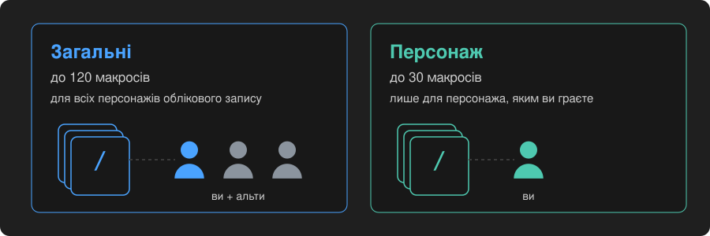
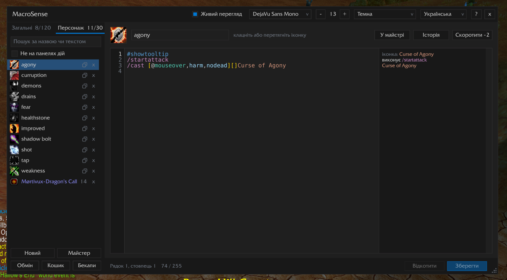
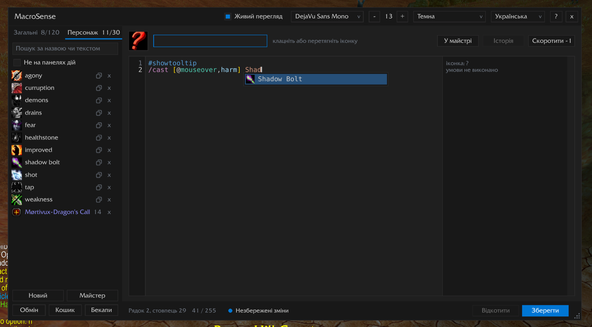
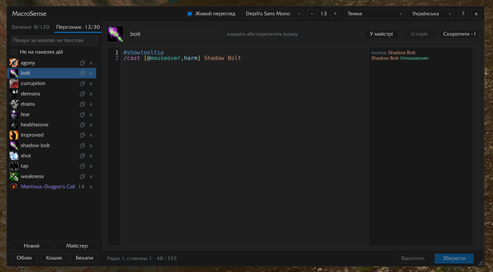
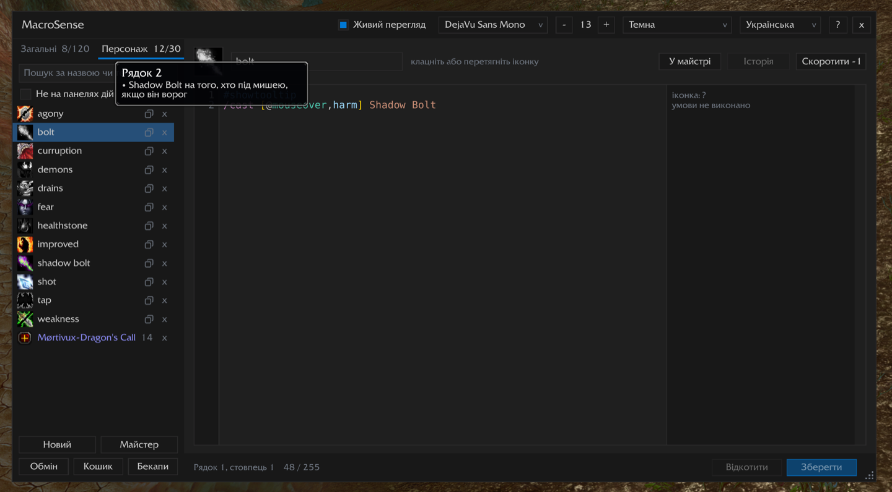
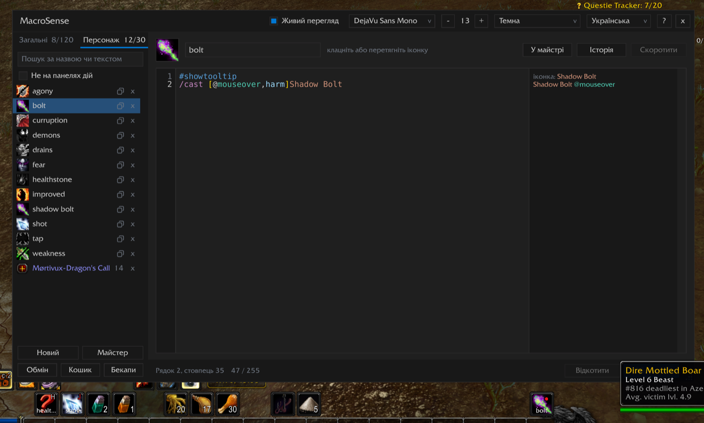
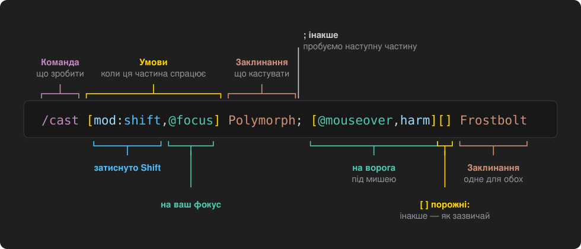
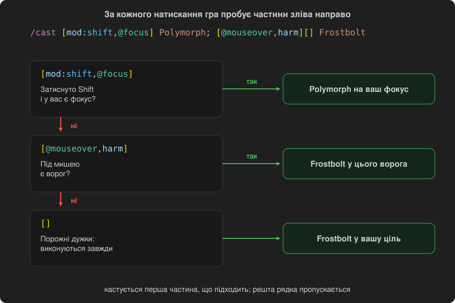

<p align="center"></p>

<h1 align="center">Макроси крок за кроком</h1>

<p align="center">
  Що таке макроси, що вони вміють і як їх робити в MacroSense<br>
  <a href="GUIDE.md">English</a> · <b>Українська</b>
</p>

---

**Зміст**

1. [Що таке макрос](#1-що-таке-макрос)
2. [Перший макрос](#2-перший-макрос)
3. [Той самий макрос через майстра](#3-той-самий-макрос-через-майстра)
4. [Як читається рядок макросу](#4-як-читається-рядок-макросу)
5. [Як гра вибирає, що зробити](#5-як-гра-вибирає-що-зробити)
6. [Що вміють макроси](#6-що-вміють-макроси)
7. [Умови та цілі](#7-умови-та-цілі)
8. [Чого макроси не вміють](#8-чого-макроси-не-вміють)
9. [Готові макроси](#9-готові-макроси)
10. [Чим допомагає MacroSense](#10-чим-допомагає-macrosense)

---

## 1. Що таке макрос

Макрос — це кнопка, яка робить кілька речей одразу або різне залежно від ситуації. Її ставлять на панель дій,
як заклинання, і натискають так само. Усередині — рядки тексту, по одній команді в кожному:

```
#showtooltip
/cast Fireball
```

Коли ви натискаєте макрос, гра читає рядки згори вниз і робить, що в них написано. Тут — кастує Fireball.

Макроси зберігаються у двох місцях:

<p align="center"></p>

- **Загальні**: до 120, однакові для всіх персонажів облікового запису. Зручно для того, що потрібно всім:
  маунт, камінь повернення, повідомлення в чат.
- **Персонаж**: до 30, лише для персонажа, яким ви граєте. Зручно для заклинань класу.

Макрос може мати щонайбільше **255 символів**. Це приблизно п'ять-шість рядків.

## 2. Перший макрос

Зробімо макрос, який кастує **Shadow Bolt** у ворога під мишею, а якщо там нікого немає — у вашу ціль. Замість
Shadow Bolt можна взяти будь-яке своє заклинання.

**Крок 1. Відкрийте MacroSense.** Наберіть у чаті `/ms` або клацніть кнопку MacroSense біля мінімапи.

<p align="center"></p>

Ліворуч — список ваших макросів із вкладками **Загальні** та **Персонаж**. Праворуч — редактор із відкритим
макросом.

**Крок 2. Виберіть вкладку й натисніть «Новий».** Для заклинання класу виберіть **Персонаж**, а потім **Новий**
під списком. У новому макросі вже є `#showtooltip` у першому рядку, а курсор стоїть на другому.

**Крок 3. Дайте назву.** Угорі введіть назву до 16 літер, наприклад `Bolt MO` («MO» — це mouseover, «під
мишею»). **Tab** або **Enter** переведе курсор у текст.

**Крок 4. Напишіть текст.** Наберіть `/ca`: з'явиться список, і першою в ньому буде `/cast`. **Tab** або
**Enter** вставить її. Наберіть `[@` і виберіть `@mouseover`, потім кому й `harm` (ворог), потім `]`. Після `]`
наберіть кілька літер заклинання й виберіть його зі списку.

<p align="center"></p>

```
#showtooltip
/cast [@mouseover,harm] Shadow Bolt
```

**Крок 5. Перевірте.** Біля кожного рядка редактор пише, що той зробив би прямо зараз: `Shadow Bolt @mouseover`,
поки ви наводите мишу на ворога, і «умови не виконано», коли не наводите.

<p align="center"></p>

Наведіть мишу на номер рядка, щоб прочитати весь рядок простими словами. Помилку буде підкреслено червоним, а
смужка внизу скаже, що не так. Якщо виправлення очевидне, клацання по смужці його зробить.

<p align="center"></p>

Поки ви ні на кого не наводите мишу, макрос нічого не робить. Щоб тоді він кастував у вашу ціль, додайте `[]`
перед назвою заклинання. Це означає «інакше — як зазвичай»:

```
#showtooltip
/cast [@mouseover,harm][] Shadow Bolt
```

**Крок 6. Збережіть.** Натисніть **Зберегти** або **Ctrl+S** (Cmd+S на Mac).

**Крок 7. Поставте на панель.** Перетягніть макрос зі списку або його іконку з верхньої частини редактора на
панель дій. Готово: натискайте його в грі.

<p align="center"></p>

> **Іконка.** Якщо лишити знак питання, гра показуватиме іконку заклинання, яке макрос скастує, і міняти її,
> коли ви затискаєте клавіші. Якщо вибрати іконку самому, вона лишатиметься такою, як ви вибрали.

## 3. Той самий макрос через майстра

Писати нічого не обов'язково. **Майстер** під списком поставить кілька питань простими словами й напише макрос
за вас:

1. **Що має робити макрос?** Кастувати заклинання.
2. **Яке заклинання?** Наберіть кілька літер і виберіть.
3. **На кого?** На того, хто під мишею. А якщо там нікого? На вашу ціль, як зазвичай.
4. Клавіші, умови й доповнення поки пропустіть.
5. Назва і хто зберігає макрос: усі ваші персонажі чи лише цей. **Створити**.

<p align="center"></p>

Макрос відкриється в редакторі, і його можна ставити на панель. Щоб пізніше змінити його тими самими
питаннями, відкрийте його й натисніть **У майстрі** над текстом.

## 4. Як читається рядок макросу

<p align="center"></p>

- **Команда** йде першою, після `/`: що зробити. `/cast` кастує заклинання, `/use` використовує предмет.
- **Умови** у квадратних дужках `[ ]` кажуть, коли ця частина спрацьовує. Кілька умов в одних дужках,
  через кому, мають виконуватися всі разом: `[mod:shift,@focus]` — це «затиснуто Shift, на мій фокус».
- **`@` і юніт** кажуть, на кого: `@focus`, `@mouseover`, `@player` (ви самі). Без нього заклинання йде у
  вашу ціль, як зазвичай.
- **Заклинання чи предмет** стоїть після умов.
- **`;`** розділяє варіанти: «інакше».
- **Дві пари дужок поспіль**, `[...][...]`, означають «це, а якщо ні — то те» для того самого заклинання.
- **Порожні дужки** `[]` виконуються завжди: «інакше — як зазвичай».

Рядок, що починається з `#`, — не команда, а налаштування. `#showtooltip` показує на макросі підказку
заклинання, яке він скастує, а поки іконка макросу — знак питання, то й іконку цього заклинання.

## 5. Як гра вибирає, що зробити

У кожному рядку гра читає варіанти зліва направо й бере **перший, усі умови якого виконуються**. Решту цього
рядка вона пропускає й переходить до наступного рядка.

<p align="center"></p>

Тож порядок важливий: особливі випадки ставте першими, звичайний — останнім.

Більшість заклинань запускає глобальний кулдаун — коротку паузу після касту. **Одне натискання кастує лише одне
таке заклинання.** Рядки після нього все одно виконуються, якщо кулдаун їм не потрібен: `/startattack`, `/use`
для трінкета, повідомлення в чат.

## 6. Що вміють макроси

| Що | Команди | Приклад |
|---|---|---|
| Кастувати заклинання | `/cast` | `/cast [@mouseover,help][] Flash Heal` |
| Використати предмет | `/use`, слот у сумці чи слот спорядження | `/use Healthstone`, `/use 13` (трінкет 1) |
| Кілька заклинань по черзі | `/castsequence` | `/castsequence reset=target Corruption, Immolate` |
| Одне навмання | `/castrandom`, `/userandom` | `/userandom Hearthstone, Dalaran Hearthstone` |
| Зупинити | `/stopcasting`, `/stopattack`, `/stopmacro` | `/stopcasting` перед перериванням |
| Атакувати | `/startattack`, `/petattack` | `/startattack` разом із ближнім ударом |
| Взяти в ціль | `/target`, `/targetenemy`, `/assist`, `/cleartarget` | `/target [@party1]` |
| Фокус | `/focus`, `/clearfocus` | `/focus [@mouseover,exists][]` |
| Керувати улюбленцем | `/petattack`, `/petfollow`, `/petstay`, `/petpassive`... | `/petfollow [mod:shift]` |
| Вдягти спорядження | `/equip`, `/equipslot`, `/equipset` | `/equipslot 14 Lucky Charm` |
| Маунти | `/cast`, `/dismount` | `/cast [flyable] Gryphon; Steed` |
| Зняти баф чи форму | `/cancelaura`, `/cancelform` | `/cancelaura Ice Block` |
| Писати в чат | `/say`, `/yell`, `/party`, `/raid`, `/emote` | `/say Вівцюю %t!` (`%t` — ім'я вашої цілі) |
| Натиснути іншу кнопку | `/click` | `/click ActionButton1` |
| Іконка й підказка | `#showtooltip`, `#show` | `#showtooltip Frostbolt` |

Наберіть `/` у редакторі MacroSense, і побачите всі команди вашої гри, зокрема й команди аддонів. Наведіть
мишу на команду, щоб прочитати, що вона робить.

## 7. Умови та цілі

Умови, які знадобляться найчастіше. Кожна працює й навпаки, якщо додати `no` спереду: `nocombat`, `nomod`,
`nodead`.

| Умова | Виконується, коли |
|---|---|
| `help` / `harm` | юніт — друг / ворог |
| `dead`, `exists` | юніт мертвий / юніт узагалі є |
| `mod`, `mod:shift`, `mod:ctrl`, `mod:alt` | затиснуто клавішу (будь-яку або саме цю) |
| `combat` | ви в бою |
| `stealth` | ви в стелсі |
| `mounted`, `flying`, `swimming`, `flyable` | ви на маунті / летите / пливете / тут можна літати |
| `group`, `group:raid` | ви в групі / в рейді |
| `pet`, `pet:Imp` | улюбленця викликано / викликано саме цього |
| `form:1`, `stance:2` | ви в цій формі чи стійці |
| `spec:2` | у вас друга спеціалізація |
| `known:Spell`, `talent:...` | ви знаєте це заклинання / маєте цей талант |
| `equipped:Shields` | на вас предмет цього типу |
| `channeling` | ви зараз потоково кастуєте заклинання |

Юніти для `@`:

| Юніт | Хто це |
|---|---|
| `@target` | ваша ціль (так і без `@`) |
| `@mouseover` | той, хто під мишею: у світі чи на рамці юніта |
| `@focus` | ваш фокус |
| `@player` | ви самі |
| `@pet` | ваш улюбленець |
| `@party1` ... `@party4` | учасники вашої групи |
| `@targettarget` | ціль вашої цілі |
| `@arena1` ... `@arena3` | вороги на арені |
| `@cursor` | земля під курсором, для заклинань по площі |

Наберіть `[` у редакторі, і з'являться всі умови, а після `[@` — усі юніти. Наведіть мишу на будь-яку, щоб
прочитати, що вона означає.

## 8. Чого макроси не вміють

- **Думати за вас у бою.** Макрос не може перевірити ваше здоров'я, кулдаун чи час бафа й вибрати за цим. Він
  бачить лише те, що можуть сказати умови вище.
- **Кастувати кілька заклинань одразу.** Одне заклинання з глобальним кулдауном за одне натискання (див.
  розділ 5).
- **Натискатися самостійно.** Кожен каст потребує вашого натискання клавіші чи клацання.
- **Бути довшим за 255 символів.** MacroSense рахує їх унизу, а **Скоротити** вгорі записує той самий макрос
  коротше.
- **Кастувати з `/run`.** Lua в макросі може показати текст чи змінити налаштування, але не може кастувати чи
  брати в ціль.

## 9. Готові макроси

Скопіюйте будь-який у новий макрос і замініть назви заклинань на свої.

**Лікування того, хто під мишею, або вашої цілі:**
```
#showtooltip
/cast [@mouseover,help,nodead][help,nodead][@player] Flash Heal
```
Лікує того, хто під мишею; якщо там нікого — вашу ціль, якщо вона друг; інакше — вас.

**Переривання фокуса або цілі:**
```
#showtooltip
/stopcasting
/cast [@focus,harm,nodead][] Counterspell
```

**Інше заклинання із затиснутим Shift:**
```
#showtooltip
/cast [mod:shift,@focus] Polymorph; Frostbolt
```

**Трінкет разом із великим заклинанням:**
```
#showtooltip Arcane Power
/use 13
/cast Arcane Power
```

**Два прокляття по черзі, з початку на новій цілі:**
```
#showtooltip
/castsequence reset=target Corruption, Curse of Agony
```

**Улюбленець атакує того, на кого ви наводите мишу, а з Shift іде за вами:**
```
/petattack [nomod,@mouseover,harm,nodead][nomod]
/petfollow [mod:shift]
```

**Одна кнопка для всіх маунтів:**
```
#showtooltip
/cast [nomounted,swimming] Sea Turtle; [nomounted,flyable] Gryphon; [nomounted] Steed
/dismount [mounted,noflying]
```

Гайди на Wowhead чи Icy Veins пишуть макроси звичайним текстом. Вставте його через **Обмін > Імпортувати код
чи текст**, і MacroSense сам створить макроси.

## 10. Чим допомагає MacroSense

- **Підказки**: команди, умови, юніти, ваші заклинання й предмети, поки ви пишете. `SWP` знайде Shadow Word:
  Pain.
- **Живий перегляд**: що кожен рядок зробив би прямо зараз; змінюється, коли ви затискаєте клавіші чи міняєте
  ціль.
- **Пояснення**: наведіть мишу на номер рядка, щоб прочитати його простими словами, а на слово — щоб дізнатися,
  що воно означає.
- **Перевірка помилок**: помилки підкреслено, очевидні виправляються одним клацанням, а заклинання, яке зараз
  не скастувати, позначено попередженням.
- **Скоротити**: той самий макрос меншою кількістю символів.
- **Історія**, **Кошик**, **Бекапи**: попередні тексти, видалені макроси й збережені копії всіх макросів.
- **Обмін**: код, щоб надіслати макрос другові, або посилання в чаті.
- **У майстрі** над текстом: змінити макрос питаннями майстра.

Усе це докладно описано в [README](../README_UA.md).

Знайшли помилку чи чогось бракує? Наберіть у грі `/ms bug` і напишіть мені: у коментарях на
[CurseForge](https://www.curseforge.com/wow/addons/macro-sense), у
[GitHub Issues](https://github.com/v-gachkovsky/macro-sense/issues) або на пошту
volodymyr.hachkovsky@icloud.com.
