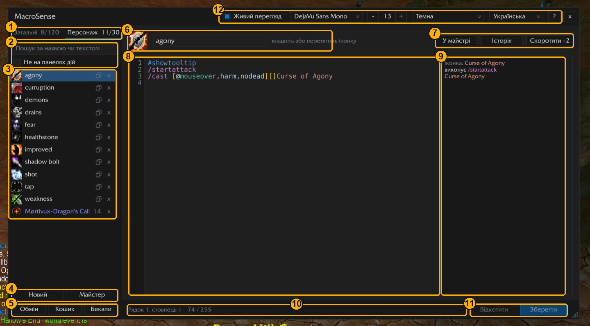

<p align="center"></p>

<h1 align="center">Макроси крок за кроком</h1>

<p align="center">
  Що таке макроси, що вони вміють і як їх робити в MacroSense<br>
  <a href="GUIDE.md">English</a> · <b>Українська</b>
</p>

---

**Зміст**

1. [Що таке макрос](#1-що-таке-макрос)
2. [Вікно MacroSense](#2-вікно-macrosense)
3. [Перший макрос](#3-перший-макрос)
4. [Майстер: питання або форма](#4-майстер-питання-або-форма)
5. [Як читається рядок макросу](#5-як-читається-рядок-макросу)
6. [Як гра вибирає, що зробити](#6-як-гра-вибирає-що-зробити)
7. [Що вміють макроси](#7-що-вміють-макроси)
8. [Умови та цілі](#8-умови-та-цілі)
9. [Чого макроси не вміють](#9-чого-макроси-не-вміють)
10. [Готові макроси](#10-готові-макроси)
11. [Чим допомагає MacroSense](#11-чим-допомагає-macrosense)

---

## 1. Що таке макрос

Макрос — це кнопка, яка робить кілька речей одразу або різне залежно від ситуації. Її ставлять на панель дій,
як заклинання, і натискають так само. Усередині — рядки тексту, по одній команді в кожному:

```
#showtooltip
/cast Fireball
```

Коли ви натискаєте макрос, гра читає рядки згори вниз і робить, що в них написано. Тут — кастує Fireball.

Макроси зберігаються у двох місцях:

<p align="center"></p>

- «Загальні»: до 120, однакові для всіх персонажів облікового запису. Зручно для того, що потрібно всім:
  маунт, камінь повернення, повідомлення в чат.
- «Персонаж»: до 30, лише для персонажа, яким ви граєте. Зручно для заклинань класу.

Макрос може мати щонайбільше **255 символів**. Це приблизно п'ять-шість рядків.

## 2. Вікно MacroSense

<p align="center"></p>

1. «Загальні» та «Персонаж»: які макроси показує список і скільки їх у кожній вкладці.
2. Пошук і «Не на панелях дій»: знайти макрос за назвою чи текстом або лишити тільки ті, яких немає на
   панелях.
3. Список макросів. Клацання відкриває макрос. Два квадратики копіюють його, «x» видаляє. У вкладці «Персонаж»
   унизу є макроси ваших інших персонажів.
4. «Новий» починає порожній макрос, «Майстер» складає макрос за кількома питаннями.
5. «Обмін» надсилає макроси кодом чи посиланням у чаті, «Кошик» повертає видалені, «Бекапи» зберігає копії всіх
   ваших макросів.
6. Іконка й назва макросу. Клацання по іконці дає вибрати іншу; іконку можна перетягнути на панель дій.
7. «У майстрі» змінює цей макрос питаннями майстра, «Історія» показує його попередні тексти, «Скоротити»
   записує його меншою кількістю символів.
8. Текст макросу з номерами рядків. Наведіть мишу на номер, щоб прочитати рядок простими словами, а на слово —
   щоб дізнатися, що воно означає.
9. Живий перегляд: що кожен рядок зробив би прямо зараз.
10. Рядок стану: де стоїть курсор, яка довжина макросу (щонайбільше 255 символів), «Незбережені зміни» і що в
    макросі не так, якщо щось не так. Клацання по помилці виправляє її, якщо виправлення очевидне; наведіть мишу,
    щоб побачити всі.
11. «Відкотити» повертає збережений текст, «Зберегти» зберігає макрос.
12. «Живий перегляд» увімкнути чи вимкнути, шрифт і його розмір, кольори, мова і «?» — довідка з макросів.

## 3. Перший макрос

Зробімо макрос, який кастує **Shadow Bolt** у ворога під мишею, а якщо там нікого немає — у вашу ціль. Замість
Shadow Bolt можна взяти будь-яке своє заклинання.

**Крок 1. Відкрийте MacroSense.** Наберіть у чаті `/ms` або клацніть кнопку MacroSense біля мінімапи.

<p align="center"></p>

Розділ 2 показує кожну частину вікна.

**Крок 2. Виберіть вкладку й натисніть «Новий».** Для заклинання класу виберіть «Персонаж», а потім
«Новий». У новому макросі вже є `#showtooltip` у першому рядку, а курсор стоїть на другому.

**Крок 3. Дайте назву.** Введіть назву до 16 літер, наприклад `Bolt MO` («MO» — це mouseover, «під
мишею»). **Tab** або **Enter** переведе курсор у текст.

**Крок 4. Напишіть текст.** Наберіть `/ca`: з'явиться список, і першою в ньому буде `/cast`. **Tab** або
**Enter** вставить її. Наберіть `[@` і виберіть `@mouseover`, потім кому й `harm` (ворог), потім `]`. Після `]`
наберіть кілька літер заклинання й виберіть його зі списку.

<p align="center"></p>

```
#showtooltip
/cast [@mouseover,harm] Shadow Bolt
```

**Крок 5. Перевірте.** Біля кожного рядка редактор пише, що той зробив би прямо зараз: `Shadow Bolt @mouseover`,
поки ви наводите мишу на ворога, і «умови не виконано», коли не наводите.

<p align="center"></p>

Наведіть мишу на номер рядка, щоб прочитати весь рядок простими словами. Помилку буде підкреслено червоним, а
рядок стану скаже, що не так. Якщо виправлення очевидне, клацання по ньому його зробить.

<p align="center"></p>

Поки ви ні на кого не наводите мишу, макрос нічого не робить. Щоб тоді він кастував у вашу ціль, додайте `[]`
перед назвою заклинання. Це означає «інакше — як зазвичай»:

```
#showtooltip
/cast [@mouseover,harm][] Shadow Bolt
```

**Крок 6. Збережіть.** Натисніть «Зберегти» або **Ctrl+S** (Cmd+S на Mac).

**Крок 7. Поставте на панель.** Перетягніть макрос зі списку або його іконку з верхньої частини редактора на
панель дій. Готово: натискайте його в грі.

<p align="center"></p>

> **Іконка.** Якщо лишити знак питання, гра показуватиме іконку заклинання, яке макрос скастує, і мінятиме її,
> коли змінюється те, що перевіряють умови макросу: ви затискаєте модифікатори, наводите мишу на ціль, задаєте
> фокус тощо. Якщо вибрати іконку самому, вона лишатиметься такою, як ви вибрали.

## 4. Майстер: питання або форма

Писати нічого не обов'язково. «Майстер» зробить макрос за вас, одним із двох способів:

- «Покроково»: по одному питанню за раз, простими словами. Уперше майстер відкривається саме так. Підходить,
  якщо ви ще ніколи не писали макросів.
- «Усі параметри»: уся форма одразу, видно кожен вибір. Підходить, коли ви вже знаєте, чого хочете.

«Усі параметри» та «Покроково» перемикають між ними, а дані відповіді лишаються. Майстер відкривається таким, яким
ви його лишили. Поки ви відповідаєте, внизу вікна з'являється макрос, який він складе, з підсвіткою й
довжиною.

### Покроково

<p align="center"></p>

Той самий макрос зі Shadow Bolt, що в розділі 3, питання за питанням:

1. **«Що має робити макрос?»** Виберіть «Застосувати заклинання». Інші відповіді: використати предмет, кілька
   заклинань по черзі, одне з кількох навмання, взяти когось у ціль, задати фокус, взяти чужу ціль, керувати
   улюбленцем, сісти на маунта, вдягнути спорядження.
2. **«Яке заклинання?»** Наберіть кілька літер, `Shad`, і виберіть **Shadow Bolt**. Щойно ви його виберете,
   майстер сам перейде до наступного питання.
3. **«На кого чи куди застосувати „Shadow Bolt“?»** Виберіть «Той, хто під мишею». Кожна відповідь показує
   слова, які вона додасть у макрос (`@mouseover`), а її підказка пояснює, що вони означають.
4. **«А якщо під мишею нікого немає?»** Виберіть «Ваша ціль, як завжди». Майстер питає «а якщо ні?» до трьох
   разів, тож лікування може йти на того, хто під мишею, потім на вашу ціль, потім на вас.
5. **«Для кого „Shadow Bolt“?»** Майстер питає це лише тоді, коли гра сама не каже. Shadow Bolt — для ворогів,
   тож питання пропускається. Для предмета чи заклинання, яке може йти на обох, виберіть друзів, ворогів чи
   будь-кого.
6. **«Чи має макрос робити щось інше, поки ви тримаєте Shift, Ctrl чи Alt?»** Поки пропустіть. Якщо вибрати
   клавішу, наступні питання спитають, що вона кастує і куди.
7. **«Макрос має працювати лише за певних умов?»** У бою чи поза ним, у стелсі, у групі, з викликаним
   улюбленцем, у формі. Поки пропустіть.
8. **«Бажаєте додати ще щось?»** Спершу перервати каст, використати трінкет, почати автоатаку, написати щось у
   чат. Поки пропустіть.
9. **«Майже готово: назвіть макрос»**. Наберіть `Bolt MO` і виберіть, хто його зберігає: усі ваші персонажі чи
   лише цей. «Створити».

«< Назад» повертає до попереднього питання з уже даними відповідями, «Далі >» іде далі з вибраною. Макрос
відкриється в редакторі, і його можна ставити на панель.

### Усі параметри

<p align="center"></p>

У формі ті самі варіанти, що в питаннях, кожен у своєму рядку:

| Рядок | Що задає | У макросі |
|---|---|---|
| «Команда» | що робить макрос: заклинання чи предмет, список по черзі, одне навмання, ціль, фокус, чужа ціль, улюбленець, маунт, спорядження | `/cast`, `/castsequence`, `/target`... |
| «Заклинання» / «Предмет» | заклинання чи предмет: кілька літер або перші літери його слів великими (`SB`) | `Shadow Bolt` |
| «На кого» | на кого, до трьох по черзі: як завжди, ваша ціль, маусовер, фокус, ви самі, учасник групи, під курсор... | `[@mouseover][]` |
| «Лише» | друзі, вороги чи будь-хто; «Лише живі» | `harm`, `help`, `nodead` |
| «З клавішею» | для Shift, Ctrl, Alt (Cmd на Mac): інше заклинання або те саме на когось іншого | `[mod:shift]...;` |
| «Коли» | лише в бою чи поза ним, у стелсі, у групі, з улюбленцем, у формі, і що робити інакше | `[combat]` |
| «Ще» | спершу перервати каст, трінкет, почати атаку, вийти з форми, зняти баф, рядок у чат | `/stopcasting`, `/use 13` |
| «Назва» і «Вкладка» | назва макросу і вкладка «Загальні» чи «Персонаж» | |

Кілька прикладів того, що можна отримати:

| Ви вибираєте | Ви отримуєте |
|---|---|
| Shadow Bolt; На кого: Маусовер, потім Як завжди; Лише: Вороги | `/cast [@mouseover,harm,nodead][] Shadow Bolt` |
| Flash Heal; На кого: Маусовер, потім Ваша ціль, потім Ви самі; Лише: Друзі | `/cast [@mouseover,help,nodead][help,nodead][@player] Flash Heal` |
| Counterspell на Фокус, потім Як завжди; Ще: спершу перервати каст | `/stopcasting`, далі `/cast [@focus,harm,nodead][] Counterspell` |
| Frostbolt; Shift: Polymorph на Фокус; Ще: трінкет 1 | `#showtooltip Frostbolt`, `/use 13`, `/cast [mod:shift,@focus,harm,nodead] Polymorph; Frostbolt` |
| Маунт: Steed, Gryphon там, де можна літати, Sea Turtle у воді | `/cast [nomounted,swimming] Sea Turtle; [nomounted,flyable] Gryphon; [nomounted] Steed` |

### Макрос, який у вас уже є

Відкрийте макрос і натисніть «У майстрі». Майстер відкриється з уже заповненими
відповідями. Змініть що хочете кількома клацаннями, потім «Вставити в редактор»: новий текст з'явиться в
редакторі, а «Зберегти» його збереже (**Ctrl+Z** поверне старий). Це працює для будь-якого макросу, який міг
би скласти майстер, навіть написаного вручну чи взятого з гайду. Якщо майстер запише якісь рядки по-своєму
або не має для них місця (`/run`, другий `/cast`), він скаже про це ще до відкриття, а вікно покаже їх під
написом про те, скільки рядків зміниться.

## 5. Як читається рядок макросу

<p align="center"></p>

- «Команда» йде першою, після `/`: що зробити. `/cast` кастує заклинання, `/use` використовує предмет.
- **Умови** у квадратних дужках `[ ]` кажуть, коли ця частина спрацьовує. Кілька умов в одних дужках,
  через кому, мають виконуватися всі разом: `[mod:shift,@focus]` — це «затиснуто Shift, на мій фокус».
- **`@` і юніт** кажуть, на кого: `@focus`, `@mouseover`, `@player` (ви самі). Без нього заклинання йде у
  вашу ціль, як зазвичай.
- **Заклинання чи предмет** стоїть після умов.
- **`;`** розділяє варіанти: «інакше».
- **Дві пари дужок поспіль**, `[...][...]`, означають «це, а якщо ні — то те» для того самого заклинання.
- **Порожні дужки** `[]` виконуються завжди: «інакше — як зазвичай».
- **`!` перед заклинанням** означає «лише ввімкнути». Деякі заклинання одне натискання вмикає, а наступне
  вимикає: Shoot, Auto Shot, Stealth, Prowl, форми. Із `!` натискання, коли воно вже увімкнене, нічого не
  вимикає: `/cast !Shoot` не зупиняє стрільбу, `/cast !Stealth` не виводить зі стелсу. Наведіть мишу на `!` у
  редакторі, щоб прочитати це.

Рядок, що починається з `#`, — не команда, а налаштування. `#showtooltip` показує на макросі підказку
заклинання, яке він скастує, а поки іконка макросу — знак питання, то й іконку цього заклинання.

## 6. Як гра вибирає, що зробити

У кожному рядку гра читає варіанти зліва направо й бере **перший, усі умови якого виконуються**. Решту цього
рядка вона пропускає й переходить до наступного рядка.

<p align="center"></p>

Тож порядок важливий: особливі випадки ставте першими, звичайний — останнім.

Більшість заклинань запускає глобальний кулдаун — коротку паузу після касту. **Одне натискання кастує лише одне
таке заклинання.** Рядки після нього все одно виконуються, якщо кулдаун їм не потрібен: `/startattack`, `/use`
для трінкета, повідомлення в чат.

## 7. Що вміють макроси

| Що | Команди | Приклад |
|---|---|---|
| Кастувати заклинання | `/cast` | `/cast [@mouseover,help][] Flash Heal` |
| Використати предмет | `/use`, слот у сумці чи слот спорядження | `/use Healthstone`, `/use 13` (трінкет 1) |
| Кілька заклинань по черзі | `/castsequence` | `/castsequence reset=target Corruption, Immolate` |
| Одне навмання | `/castrandom`, `/userandom` | `/userandom Hearthstone, Dalaran Hearthstone` |
| Зупинити | `/stopcasting`, `/stopattack`, `/stopmacro` | `/stopcasting` перед перериванням |
| Атакувати | `/startattack`, `/petattack` | `/startattack` разом із ближнім ударом |
| Взяти в ціль | `/target`, `/targetenemy`, `/assist`, `/cleartarget` | `/target [@party1]` |
| Фокус | `/focus`, `/clearfocus` | `/focus [@mouseover,exists][]` |
| Керувати улюбленцем | `/petattack`, `/petfollow`, `/petstay`, `/petpassive`... | `/petfollow [mod:shift]` |
| Вдягти спорядження | `/equip`, `/equipslot`, `/equipset` | `/equipslot 14 Lucky Charm` |
| Маунти | `/cast`, `/dismount` | `/cast [flyable] Gryphon; Steed` |
| Зняти баф чи форму | `/cancelaura`, `/cancelform` | `/cancelaura Ice Block` |
| Писати в чат | `/say`, `/yell`, `/party`, `/raid`, `/emote` | `/say Вівцюю %t!` (`%t` — ім'я вашої цілі) |
| Натиснути іншу кнопку | `/click` | `/click ActionButton1` |
| Іконка й підказка | `#showtooltip`, `#show` | `#showtooltip Frostbolt` |

Наберіть `/` у редакторі MacroSense, і побачите всі команди вашої гри, зокрема й команди аддонів. Наведіть
мишу на команду, щоб прочитати, що вона робить.

## 8. Умови та цілі

Умови, які знадобляться найчастіше. Кожна працює й навпаки, якщо додати `no` спереду: `nocombat`, `nomod`,
`nodead`.

| Умова | Виконується, коли |
|---|---|
| `help` / `harm` | юніт — друг / ворог |
| `dead`, `exists` | юніт мертвий / юніт узагалі є |
| `mod`, `mod:shift`, `mod:ctrl`, `mod:alt` | затиснуто клавішу (будь-яку або саме цю) |
| `combat` | ви в бою |
| `stealth` | ви в стелсі |
| `mounted`, `flying`, `swimming`, `flyable` | ви на маунті / летите / пливете / тут можна літати |
| `group`, `group:raid` | ви в групі / в рейді |
| `pet`, `pet:Imp` | улюбленця викликано / викликано саме цього |
| `form:1`, `stance:2` | ви в цій формі чи стійці |
| `spec:2` | у вас друга спеціалізація |
| `known:Spell`, `talent:...` | ви знаєте це заклинання / маєте цей талант |
| `equipped:Shields` | на вас предмет цього типу |
| `channeling` | ви зараз потоково кастуєте заклинання |

Юніти для `@`:

| Юніт | Хто це |
|---|---|
| `@target` | ваша ціль (так і без `@`) |
| `@mouseover` | той, хто під мишею: у світі чи на рамці юніта |
| `@focus` | ваш фокус |
| `@player` | ви самі |
| `@pet` | ваш улюбленець |
| `@party1` ... `@party4` | учасники вашої групи |
| `@targettarget` | ціль вашої цілі |
| `@arena1` ... `@arena3` | вороги на арені |
| `@cursor` | земля під курсором, для заклинань по площі |

Наберіть `[` у редакторі, і з'являться всі умови, а після `[@` — усі юніти. Наведіть мишу на будь-яку, щоб
прочитати, що вона означає.

## 9. Чого макроси не вміють

- **Думати за вас у бою.** Макрос не може перевірити ваше здоров'я, кулдаун чи час бафа й вибрати за цим. Він
  бачить лише те, що можуть сказати умови вище.
- **Кастувати кілька заклинань одразу.** Одне заклинання з глобальним кулдауном за одне натискання (див.
  розділ 6).
- **Натискатися самостійно.** Кожен каст потребує вашого натискання клавіші чи клацання.
- **Бути довшим за 255 символів.** MacroSense рахує їх, поки ви пишете, а «Скоротити» записує той самий макрос
  коротше.
- **Кастувати з `/run`.** `/run` і `/script` запускають маленькі програми: вони можуть показати текст чи
  змінити налаштування гри, але не можуть кастувати заклинання чи брати когось у ціль.

## 10. Готові макроси

Скопіюйте будь-який у новий макрос і замініть назви заклинань на свої.

**Лікування того, хто під мишею, або вашої цілі:**
```
#showtooltip
/cast [@mouseover,help,nodead][help,nodead][@player] Flash Heal
```
Лікує того, хто під мишею; якщо там нікого — вашу ціль, якщо вона друг; інакше — вас.

**Переривання фокуса або цілі:**
```
#showtooltip
/stopcasting
/cast [@focus,harm,nodead][] Counterspell
```

**Інше заклинання із затиснутим Shift:**
```
#showtooltip
/cast [mod:shift,@focus] Polymorph; Frostbolt
```

**Трінкет разом із великим заклинанням:**
```
#showtooltip Arcane Power
/use 13
/cast Arcane Power
```

**Два прокляття по черзі, з початку на новій цілі:**
```
#showtooltip
/castsequence reset=target Corruption, Curse of Agony
```

**Стрільба з жезла, яку не зупиняють повторні натискання:**
```
#showtooltip
/cast !Shoot
```
Без `!` друге натискання зупинило б стрільбу.

**Улюбленець атакує того, на кого ви наводите мишу, а з Shift іде за вами:**
```
/petattack [nomod,@mouseover,harm,nodead][nomod]
/petfollow [mod:shift]
```

**Одна кнопка для всіх маунтів:**
```
#showtooltip
/cast [nomounted,swimming] Sea Turtle; [nomounted,flyable] Gryphon; [nomounted] Steed
/dismount [mounted,noflying]
```

Гайди на Wowhead чи Icy Veins пишуть макроси звичайним текстом. Вставте його через **Обмін > Імпортувати код
чи текст**, і MacroSense сам створить макроси.

## 11. Чим допомагає MacroSense

- **Підказки**: команди, умови, юніти, ваші заклинання й предмети, поки ви пишете. `SWP` знайде Shadow Word:
  Pain.
- «Живий перегляд»: що кожен рядок зробив би прямо зараз; змінюється, коли ви затискаєте клавіші чи міняєте
  ціль.
- **Пояснення**: наведіть мишу на номер рядка, щоб прочитати його простими словами, а на слово — щоб дізнатися,
  що воно означає.
- **Перевірка помилок**: помилки підкреслено, очевидні виправляються одним клацанням, а заклинання, яке зараз
  не скастувати, позначено попередженням.
- «Скоротити»: той самий макрос меншою кількістю символів.
- «Історія», «Кошик», «Бекапи»: попередні тексти, видалені макроси й збережені копії всіх макросів.
- «Обмін»: код, щоб надіслати макрос другові, або посилання в чаті.
- «У майстрі»: змінити макрос питаннями майстра.

### Менше набирати: кілька літер знаходять слово

Списку, що з'являється, поки ви пишете, не потрібне ціле слово і навіть не обов'язково його початок:

| Ви набираєте | Знаходиться | Як |
|---|---|---|
| `SB` | Shadow Bolt | **великі літери** — перші літери слів |
| `SWP` | Shadow Word: Pain | слів скільки завгодно |
| `CA` або `CoA` | Curse of Agony | короткі слова можна пропустити або набрати малими |
| `sh wo` | Shadow Word: Pain | **пробіл** переходить до наступного слова |
| `fi` | Soul Fire | малі літери: назва, що так починається, потім слово, що так починається |
| `nct` | `nocombat` | **літери по порядку** від початку слова, з іншими між ними |
| `mntd` | `mounted` | так само для умов, команд і юнітів |
| `nmd` | `nomod`, `nomounted` | найкращі збіги йдуть першими |

Великі літери, які не є першими літерами жодної назви, вважаються малими, тож Caps Lock не заважає. **Tab** або
**Enter** вставляє виділене, **Вгору** й **Вниз** гортають список, **Esc** його закриває.

Усе це докладно описано в [README](../README_UA.md).

Знайшли помилку чи чогось бракує? Наберіть у грі `/ms bug` і напишіть мені: у коментарях на
[CurseForge](https://www.curseforge.com/wow/addons/macro-sense), у
[GitHub Issues](https://github.com/v-gachkovsky/macro-sense/issues) або на пошту
volodymyr.hachkovsky@icloud.com.
