<p align="center">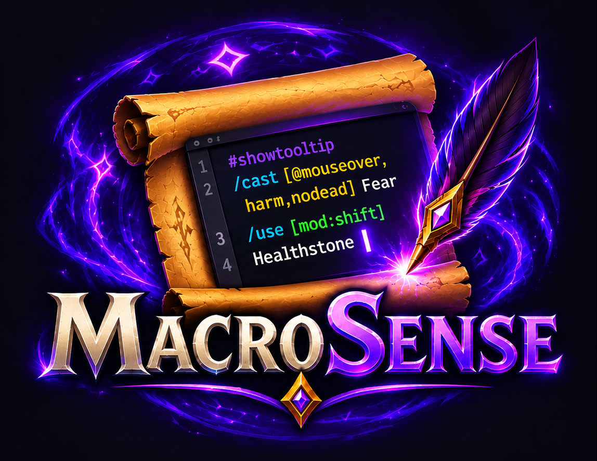</p>

<h1 align="center">Макроси крок за кроком</h1>

<p align="center">
  Що таке макроси, що вони вміють і як їх робити в MacroSense<br>
  <a href="GUIDE.md">English</a> · <b>Українська</b>
</p>

---

**Зміст**

1. [Що таке макрос](#1-що-таке-макрос)
2. [Вікно MacroSense](#2-вікно-macrosense)
3. [Перший макрос](#3-перший-макрос)
4. [Майстер: питання або форма](#4-майстер-питання-або-форма)
5. [Як читається рядок макросу](#5-як-читається-рядок-макросу)
6. [Як гра вибирає, що зробити](#6-як-гра-вибирає-що-зробити)
7. [Що вміють макроси](#7-що-вміють-макроси)
8. [Умови та цілі](#8-умови-та-цілі)
9. [Чого макроси не вміють](#9-чого-макроси-не-вміють)
10. [Готові макроси](#10-готові-макроси)
11. [Чим допомагає MacroSense](#11-чим-допомагає-macrosense)
12. [Більше 30 макросів: набори](#12-більше-30-макросів-набори)

---

## 1. Що таке макрос

Макрос — це кнопка, яка робить кілька речей одразу або різне залежно від ситуації. Її ставлять на панель дій,
як заклинання, і натискають так само. Усередині — рядки тексту, по одній команді в кожному:

```
#showtooltip
/cast Fireball
```

Коли ви натискаєте макрос, гра читає рядки згори вниз і робить, що в них написано. Тут — кастує Fireball.

Макроси зберігаються у двох місцях:

<p align="center">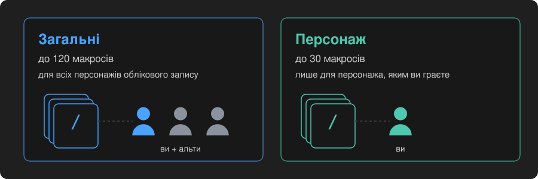</p>

- «Загальні»: до 120, однакові для всіх персонажів облікового запису. Зручно для того, що потрібно всім:
  маунт, камінь повернення, повідомлення в чат.
- «Персонаж»: до 30, лише для персонажа, яким ви граєте. Зручно для заклинань класу. Набори макросів дають
  більше: див. [розділ 12](#12-більше-30-макросів-набори).

Макрос може мати щонайбільше **255 символів**. Це приблизно п'ять-шість рядків.

## 2. Вікно MacroSense

<p align="center">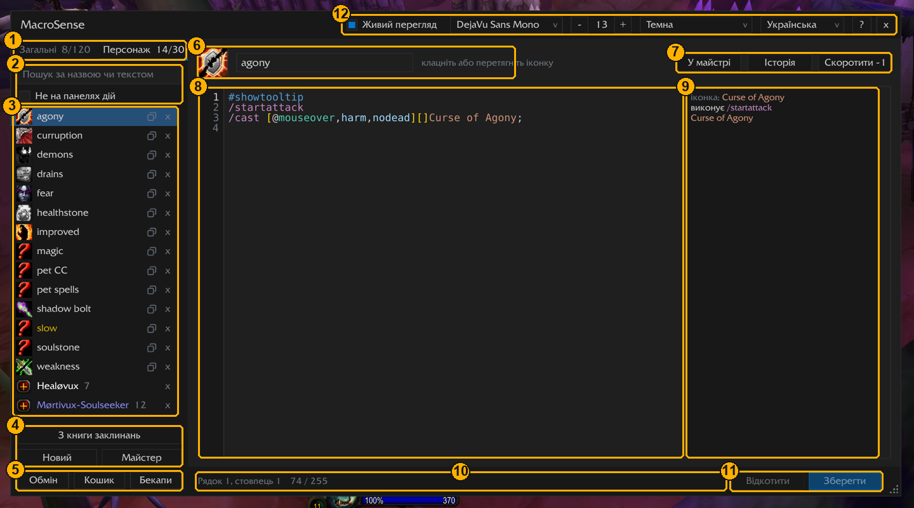</p>

1. «Загальні» та «Персонаж»: які макроси показує список і скільки їх у кожній вкладці.
2. Пошук, «Не на панелях дій» і «З помилками»: знайти макрос за назвою чи текстом або лишити тільки ті,
   яких немає на панелях, чи тільки ті, у яких є помилка чи попередження. «Замінити» змінює слово в багатьох
   макросах одразу.
3. Список макросів. Клацання відкриває макрос, Ctrl+клік вибирає його, щоб зробити те саме з багатьма
   одразу. «...» копіює чи переносить його, додає до улюблених, кладе в теку або додає нотатку, «x» видаляє.
   У вкладці «Персонаж» унизу є макроси ваших інших персонажів.
4. «З книги заклинань» робить макроси для багатьох заклинань із вашої книги за раз, «Новий» починає порожній
   макрос, «Майстер» складає макрос за кількома питаннями.
5. «Обмін» надсилає макроси кодом чи посиланням у чаті, «Кошик» повертає видалені, «Бекапи» зберігає копії всіх
   ваших макросів.
6. Іконка й назва макросу. Клацання по іконці дає вибрати іншу; іконку можна перетягнути на панель дій.
7. «У майстрі» змінює цей макрос питаннями майстра, «Історія» показує його попередні тексти, «Скоротити»
   записує його меншою кількістю символів.
8. Текст макросу з номерами рядків. Наведіть мишу на номер, щоб прочитати рядок простими словами, а на слово —
   щоб дізнатися, що воно означає.
9. Живий перегляд: що кожен рядок зробив би прямо зараз.
10. Рядок стану: де стоїть курсор, яка довжина макросу (щонайбільше 255 символів), «Незбережені зміни» і що в
    макросі не так, якщо щось не так. Клацання по помилці виправляє її, якщо виправлення очевидне; наведіть мишу,
    щоб побачити всі.
11. «Відкотити» повертає збережений текст, «Зберегти» зберігає макрос.
12. «Живий перегляд» увімкнути чи вимкнути, шрифт і його розмір, кольори, мова і «?» — довідка з макросів.

## 3. Перший макрос

Зробімо макрос, який кастує **Shadow Bolt** у ворога під мишею, а якщо там нікого немає — у вашу ціль. Замість
Shadow Bolt можна взяти будь-яке своє заклинання.

**Крок 1. Відкрийте MacroSense.** Наберіть у чаті `/ms` або клацніть кнопку MacroSense біля мінімапи.

<p align="center">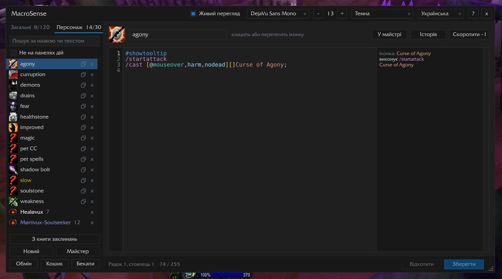</p>

Розділ 2 показує кожну частину вікна.

**Крок 2. Виберіть вкладку й натисніть «Новий».** Для заклинання класу виберіть «Персонаж», а потім
«Новий». У новому макросі вже є `#showtooltip` у першому рядку, а курсор стоїть на другому.

**Крок 3. Дайте назву.** Введіть назву до 16 літер, наприклад `Bolt MO` («MO» — це mouseover, «під
мишею»). **Tab** або **Enter** переведе курсор у текст.

**Крок 4. Напишіть текст.** Наберіть `/ca`: з'явиться список, і першою в ньому буде `/cast`. **Tab** або
**Enter** вставить її. Наберіть `[@` і виберіть `@mouseover`, потім кому й `harm` (ворог), потім `]`. Після `]`
наберіть кілька літер заклинання й виберіть його зі списку.

<p align="center">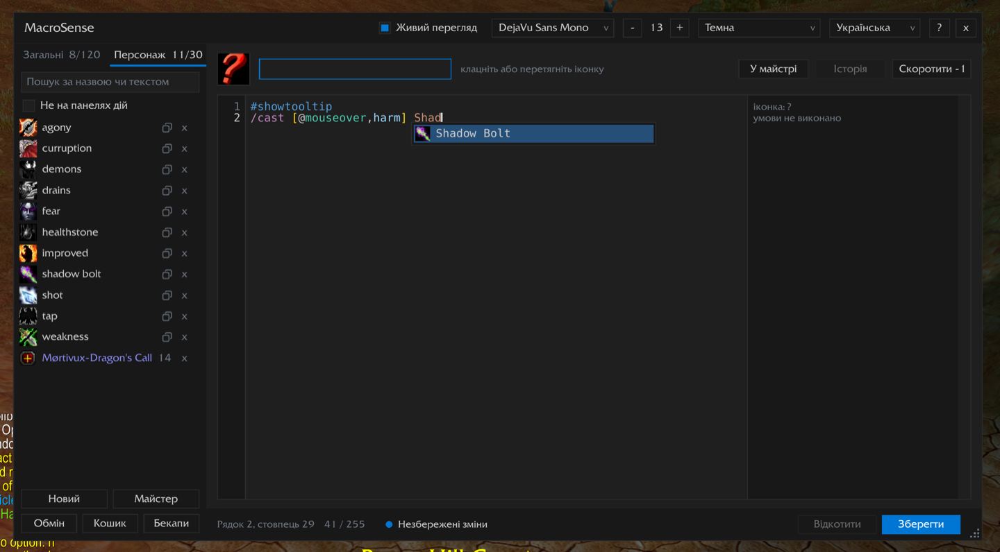</p>

```
#showtooltip
/cast [@mouseover,harm] Shadow Bolt
```

**Крок 5. Перевірте.** Біля кожного рядка редактор пише, що той зробив би прямо зараз: `Shadow Bolt @mouseover`,
поки ви наводите мишу на ворога, і «умови не виконано», коли не наводите.

<p align="center">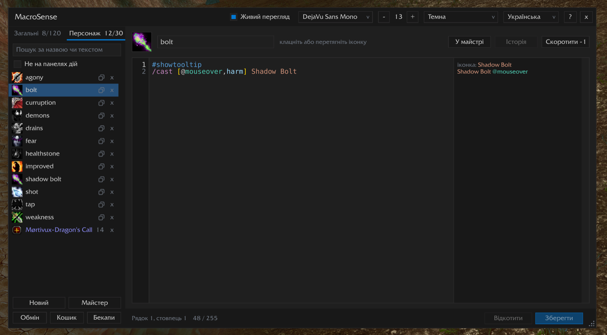</p>

Наведіть мишу на номер рядка, щоб прочитати весь рядок простими словами. Помилку буде підкреслено червоним, а
рядок стану скаже, що не так; клацання по ньому переходить до цього рядка. Якщо виправлення очевидне, його
зробить Ctrl+клік по рядку стану або по підкресленому тексту.

<p align="center">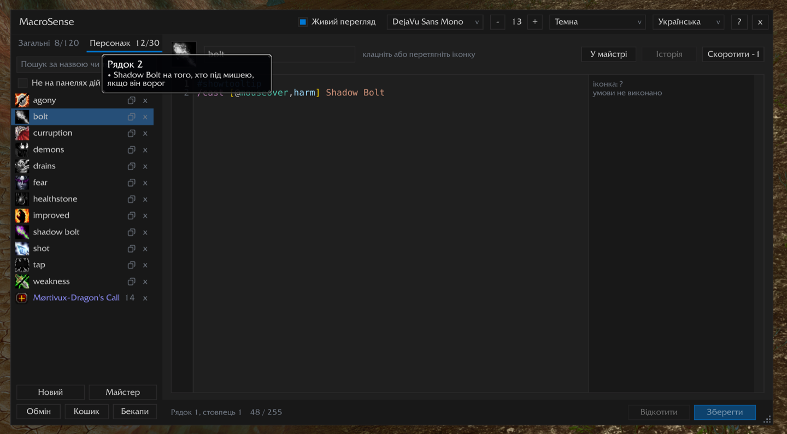</p>

Поки ви ні на кого не наводите мишу, макрос нічого не робить. Щоб тоді він кастував у вашу ціль, додайте `[]`
перед назвою заклинання. Це означає «інакше — як зазвичай»:

```
#showtooltip
/cast [@mouseover,harm][] Shadow Bolt
```

**Крок 6. Збережіть.** Натисніть «Зберегти» або **Ctrl+S** (Cmd+S на Mac). У бою гра не дає змінювати макроси. Тоді «Зберегти» запам'ятає зміну, і макрос збережеться одразу після бою.

**Крок 7. Поставте на панель.** Перетягніть макрос зі списку або його іконку з верхньої частини редактора на
панель дій. Готово: натискайте його в грі.

<p align="center">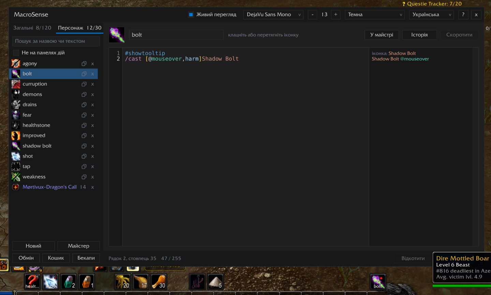</p>

> **Іконка.** Якщо лишити знак питання, гра показуватиме іконку заклинання, яке макрос скастує, і мінятиме її,
> коли змінюється те, що перевіряють умови макросу: ви затискаєте модифікатори, наводите мишу на ціль, задаєте
> фокус тощо. Якщо вибрати іконку самому, вона лишатиметься такою, як ви вибрали.

## 4. Майстер: питання або форма

Писати нічого не обов'язково. «Майстер» зробить макрос за вас, одним із двох способів:

- «Покроково»: по одному питанню за раз, простими словами. Уперше майстер відкривається саме так. Підходить,
  якщо ви ще ніколи не писали макросів.
- «Усі параметри»: уся форма одразу, видно кожен вибір. Підходить, коли ви вже знаєте, чого хочете.

«Усі параметри» та «Покроково» перемикають між ними, а дані відповіді лишаються. Майстер відкривається таким, яким
ви його лишили. Поки ви відповідаєте, внизу вікна з'являється макрос, який він складе, з підсвіткою й
довжиною.

### Покроково

<p align="center">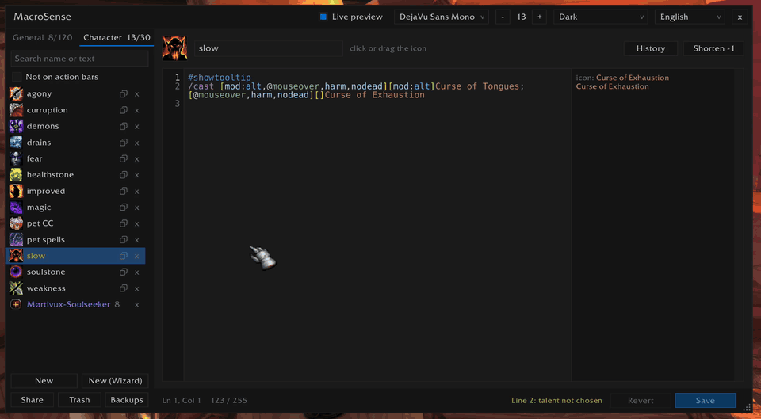</p>

Той самий макрос зі Shadow Bolt, що в розділі 3, питання за питанням:

1. **«Що має робити макрос?»** Виберіть «Застосувати заклинання». Інші відповіді: використати предмет, кілька
   заклинань по черзі, одне з кількох навмання, взяти когось у ціль, задати фокус, взяти чужу ціль, керувати
   улюбленцем, сісти на маунта, вдягнути спорядження. Клік лише вибирає відповідь: унизу вікна видно, що
   вона пише в макрос, і можна вибрати іншу. Коли будете певні, натисніть «Далі».
2. **«Яке заклинання?»** Наберіть кілька літер, `Shad`, і виберіть **Shadow Bolt**. Макрос унизу вікна одразу
   його покаже, а «Далі» перейде до наступного питання.
3. **«На кого чи куди застосувати „Shadow Bolt“?»** Виберіть «Той, хто під мишею». Кожна відповідь показує
   слова, які вона додасть у макрос (`@mouseover`), а її підказка пояснює, що вони означають.
4. **«А якщо під мишею нікого немає?»** Виберіть «Ваша ціль, як завжди». Майстер питає «а якщо ні?» до трьох
   разів, тож лікування може йти на того, хто під мишею, потім на вашу ціль, потім на вас.
5. **«Для кого „Shadow Bolt“?»** Майстер питає це лише тоді, коли гра сама не каже. Shadow Bolt — для ворогів,
   тож питання пропускається. Для предмета чи заклинання, яке може йти на обох, виберіть друзів, ворогів чи
   будь-кого.
6. **«Чи має макрос робити щось інше, поки ви тримаєте Shift, Ctrl чи Alt?»** Поки пропустіть. Якщо вибрати
   клавішу, наступні питання спитають, що вона кастує і куди.
7. **«Макрос має працювати лише за певних умов?»** У бою чи поза ним, у стелсі, у групі, з викликаним
   улюбленцем, під час потокового заклинання чи ні, у формі. Поки пропустіть.
8. **«Бажаєте додати ще щось?»** Спершу перервати каст, використати трінкет, почати автоатаку, написати щось у
   чат. Поки пропустіть.
9. **«Майже готово: назвіть макрос»**. Наберіть `Bolt MO` і виберіть, хто його зберігає: усі ваші персонажі чи
   лише цей. «Створити».

«< Назад» повертає до попереднього питання з уже даними відповідями, «Далі >» іде далі з вибраною. Макрос
відкриється в редакторі, і його можна ставити на панель.

### Усі параметри

<p align="center">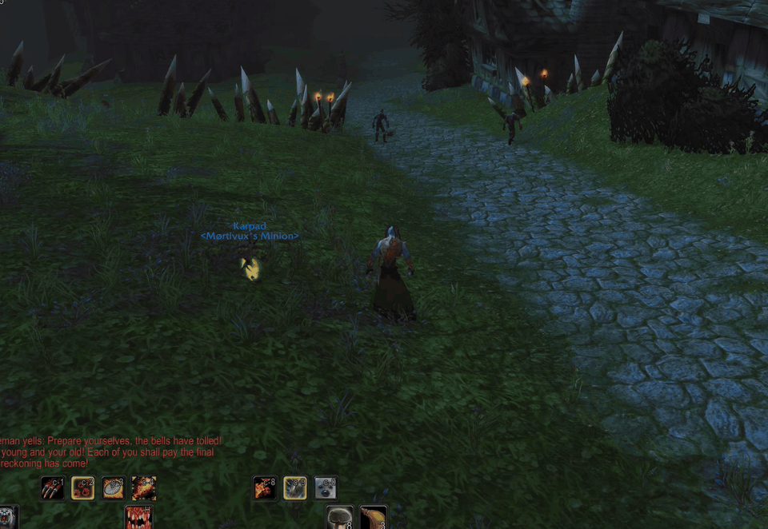</p>

У формі ті самі варіанти, що в питаннях, кожен у своєму рядку:

| Рядок | Що задає | У макросі |
|---|---|---|
| «Команда» | що робить макрос: заклинання чи предмет, список по черзі, одне навмання, ціль, фокус, чужа ціль, улюбленець, маунт, спорядження | `/cast`, `/castsequence`, `/target`... |
| «Заклинання» / «Предмет» | заклинання чи предмет: кілька літер або перші літери його слів великими (`SB`) | `Shadow Bolt` |
| «На кого» | на кого, до трьох по черзі: як завжди, ваша ціль, маусовер, фокус, ви самі, учасник групи, під курсор... | `[@mouseover][]` |
| «Лише» | друзі, вороги чи будь-хто; «Лише живі» | `harm`, `help`, `nodead` |
| «З клавішею» | для Shift, Ctrl, Alt (Cmd на Mac): інше заклинання або те саме на когось іншого | `[mod:shift]...;` |
| «Коли» | лише в бою чи поза ним, у стелсі, у групі, з улюбленцем, не під час потокового заклинання, у формі, і що робити інакше | `[combat]`, `[nochanneling:Drain Soul]` |
| «Ще» | спершу перервати каст, трінкет, почати атаку, вийти з форми, «Не вимикати повторно», зняти баф, рядок у чат | `/stopcasting`, `/use 13`, `!Shoot` |
| «Назва» і «Вкладка» | назва макросу і вкладка «Загальні» чи «Персонаж» | |

Кілька прикладів того, що можна отримати:

| Ви вибираєте | Ви отримуєте |
|---|---|
| Shadow Bolt; На кого: Маусовер, потім Як завжди; Лише: Вороги | `/cast [@mouseover,harm,nodead][] Shadow Bolt` |
| Flash Heal; На кого: Маусовер, потім Ваша ціль, потім Ви самі; Лише: Друзі | `/cast [@mouseover,help,nodead][help,nodead][@player] Flash Heal` |
| Counterspell на Фокус, потім Як завжди; Ще: спершу перервати каст | `/stopcasting`, далі `/cast [@focus,harm,nodead][] Counterspell` |
| Frostbolt; Shift: Polymorph на Фокус; Ще: трінкет 1 | `#showtooltip Frostbolt`, `/use 13`, `/cast [mod:shift,@focus,harm,nodead] Polymorph; Frostbolt` |
| Маунт: Steed, Gryphon там, де можна літати, Sea Turtle у воді | `/cast [nomounted,swimming] Sea Turtle; [nomounted,flyable] Gryphon; [nomounted] Steed` |

### Макрос, який у вас уже є

Відкрийте макрос і натисніть «У майстрі». Майстер відкриється з уже заповненими
відповідями. Змініть що хочете кількома клацаннями, потім «Вставити в редактор»: новий текст з'явиться в
редакторі, а «Зберегти» його збереже (**Ctrl+Z** поверне старий). Це працює для будь-якого макросу, який міг
би скласти майстер, навіть написаного вручну чи взятого з гайду. Якщо майстер запише якісь рядки по-своєму
або не має для них місця (`/run`, другий `/cast`), він скаже про це ще до відкриття, а вікно покаже їх під
написом про те, скільки рядків зміниться.

### Багато макросів за раз: з книги заклинань

<p align="center">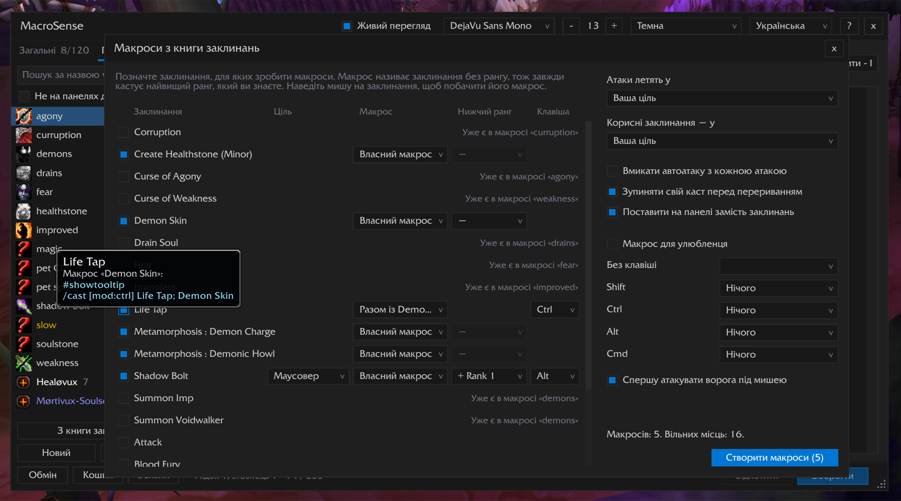</p>

«З книги заклинань» (або `/ms book`) відкриває вікно із заклинаннями з вашої книги. Позначте ті, для яких
потрібні макроси, і кожне отримає свій: `#showtooltip` і `/cast` з назвою заклинання без рангу. У Classic
заклинання без рангу — це завжди найвищий ранг, який ви знаєте, тож макрос не відстає, коли ви вчите нові.
Наведіть мишу на заклинання, щоб побачити його макрос.

Праворуч вибір одразу для всіх заклинань:

- **«Атаки летять у»** і **«Корисні заклинання — у»**: ваша ціль, той, хто під мишею (або ваша ціль, коли під
  мишею нікого), або фокус (або ваша ціль).
- «Вмикати автоатаку з кожною атакою»: `/startattack` перед атаками, але не перед заклинаннями, що виводять ворога
  з бою, як-от Sap чи Polymorph: автоатака б їх зірвала.
- «Зупиняти свій каст перед перериванням»: `/stopcasting` перед Kick, Counterspell тощо.
- «Поставити на панелі замість заклинань»: кожен макрос займає місця свого заклинання на панелях дій. Видаліть
  потім такий макрос у MacroSense, і на ці кнопки повернеться заклинання, якщо макрос досі його кастує.
- «Макрос для улюбленця» (мисливці й чорнокнижники): що улюбленець робить без клавіші й із кожною клавішею.

У рядку кожного позначеного заклинання є ще вибір, лише для нього:

- «Ціль»: куди летить це заклинання, замість загального вибору. «—» лишає загальний.
- «Макрос»: «Власний макрос» або «Разом із» іншим заклинанням. Тоді заклинання йде в макрос того заклинання й
  кастується, поки ви тримаєте клавішу, вибрану в «Клавіша». Так економляться місця: у персонажа їх 30.
- «Нижчий ранг» (Classic): дешевший ранг на клавішу. Він коштує менше мани: щоб підлікувати потроху, повісити на
  ворога дешеве заклинання, яке він розвіє, або витратити на нього Spell Reflection воїна.

```
#showtooltip
/cast [mod:shift] Shadow Bolt(Rank 1); Shadow Bolt
```

Лічильник унизу показує, скільки макросів вийде і скільки вільних місць; «Створити макроси» їх створює.
Заклинання, які вже кастує якийсь макрос, стоять без галочки, як і ті, що ви пропустили раніше, але їх усе одно
можна позначити. Наступного разу галочки стоятимуть лише на заклинаннях, які ви вивчили відтоді. «Вибрати все»
позначає всі заклинання, а коли всі позначено, кнопка стає «Зняти все». «Запропонувати все знову» забуває, які
заклинання ви пропустили і які макроси видалили, і знову пропонує всі заклинання без макроса з галочками, як
уперше. З увімкненими наборами
макроси, яким не вистачило вільного слота, створюються за лаштунками.

## 5. Як читається рядок макросу

<p align="center">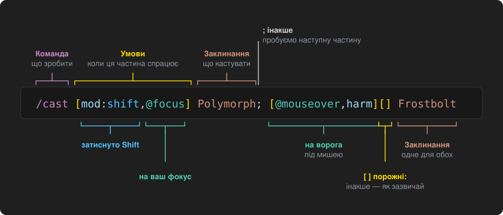</p>

- «Команда» йде першою, після `/`: що зробити. `/cast` кастує заклинання, `/use` використовує предмет.
- **Умови** у квадратних дужках `[ ]` кажуть, коли ця частина спрацьовує. Кілька умов в одних дужках,
  через кому, мають виконуватися всі разом: `[mod:shift,@focus]` — це «затиснуто Shift, на мій фокус».
- **`@` і юніт** кажуть, на кого: `@focus`, `@mouseover`, `@player` (ви самі). Без нього заклинання йде у
  вашу ціль, як зазвичай.
- **Заклинання чи предмет** стоїть після умов.
- **`;`** розділяє варіанти: «інакше».
- **Дві пари дужок поспіль**, `[...][...]`, означають «це, а якщо ні — то те» для того самого заклинання.
- **Порожні дужки** `[]` виконуються завжди: «інакше — як зазвичай».
- **`!` перед заклинанням** означає «лише ввімкнути». Деякі заклинання одне натискання вмикає, а наступне
  вимикає: Shoot, Auto Shot, Stealth, Prowl, форми. Із `!` натискання, коли воно вже увімкнене, нічого не
  вимикає: `/cast !Shoot` не зупиняє стрільбу, `/cast !Stealth` не виводить зі стелсу. Наведіть мишу на `!` у
  редакторі, щоб прочитати це.

Рядок, що починається з `#`, — не команда, а налаштування. `#showtooltip` показує на макросі підказку
заклинання, яке він скастує, а поки іконка макросу — знак питання, то й іконку цього заклинання.

## 6. Як гра вибирає, що зробити

У кожному рядку гра читає варіанти зліва направо й бере **перший, усі умови якого виконуються**. Решту цього
рядка вона пропускає й переходить до наступного рядка.

<p align="center">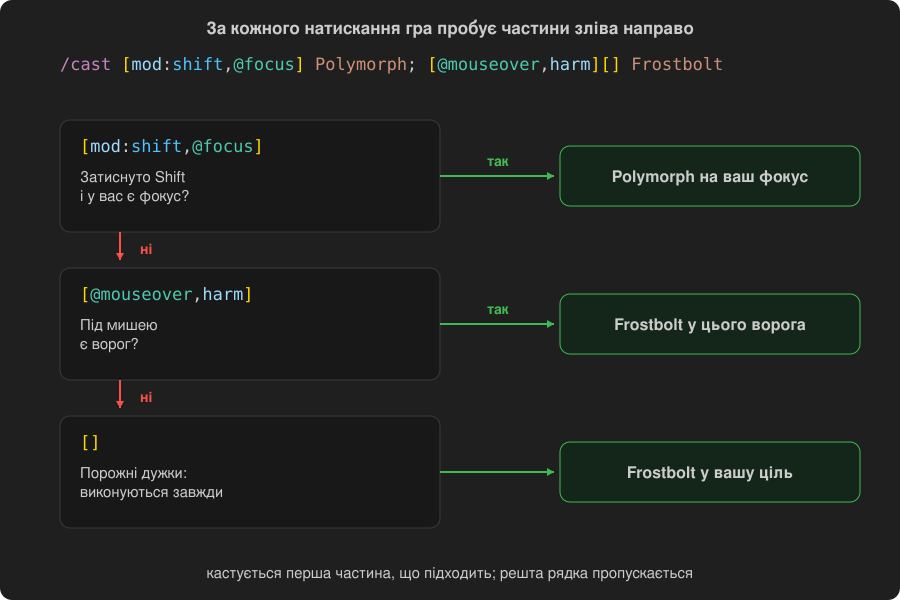</p>

Тож порядок важливий: особливі випадки ставте першими, звичайний — останнім. Варіант після `[]` (або після
варіанта без умов) ніколи не спрацює, і редактор про це попереджає; коли його вибирає клавіша (`[mod:alt]`),
Ctrl+клік по попередженню ставить його першим.

Більшість заклинань запускає глобальний кулдаун — коротку паузу після касту. **Одне натискання кастує лише одне
таке заклинання.** Рядки після нього все одно виконуються, якщо кулдаун їм не потрібен: `/startattack`, `/use`
для трінкета, повідомлення в чат. Заклинання з глобальним кулдауном у рядку під тим, що завжди кастує таке
заклинання, теж позначено попередженням: воно не скаститься або, якщо заклинання вище має власний кулдаун,
скаститься лише поки те на кулдауні. Ctrl+клік переносить рядок, який вибирає клавіша, у рядок вище, на початок.

## 7. Що вміють макроси

| Що | Команди | Приклад |
|---|---|---|
| Кастувати заклинання | `/cast` | `/cast [@mouseover,help][] Flash Heal` |
| Використати предмет | `/use`, слот у сумці чи слот спорядження | `/use Healthstone`, `/use 13` (трінкет 1) |
| Кілька заклинань по черзі | `/castsequence` | `/castsequence reset=target Corruption, Immolate` |
| Одне навмання | `/castrandom`, `/userandom` | `/userandom Hearthstone, Dalaran Hearthstone` |
| Зупинити | `/stopcasting`, `/stopattack`, `/stopmacro` | `/stopcasting` перед перериванням |
| Атакувати | `/startattack`, `/petattack` | `/startattack` разом із ближнім ударом |
| Взяти в ціль | `/target`, `/targetenemy`, `/assist`, `/cleartarget` | `/target [@party1]` |
| Фокус | `/focus`, `/clearfocus` | `/focus [@mouseover,exists][]` |
| Керувати улюбленцем | `/petattack`, `/petfollow`, `/petstay`, `/petpassive`... | `/petfollow [mod:shift]` |
| Вдягти спорядження | `/equip`, `/equipslot`, `/equipset` | `/equipslot 14 Lucky Charm` |
| Маунти | `/cast`, `/dismount` | `/cast [flyable] Gryphon; Steed` |
| Зняти баф чи форму | `/cancelaura`, `/cancelform` | `/cancelaura Ice Block` |
| Писати в чат | `/say`, `/yell`, `/party`, `/raid`, `/emote` | `/say Вівцюю %t!` (`%t` — ім'я вашої цілі) |
| Натиснути іншу кнопку | `/click` | `/click ActionButton1` |
| Іконка й підказка | `#showtooltip`, `#show` | `#showtooltip Frostbolt` |

Наберіть `/` у редакторі MacroSense, і побачите всі команди вашої гри, зокрема й команди аддонів. Наведіть
мишу на команду, щоб прочитати, що вона робить.

## 8. Умови та цілі

Умови, які знадобляться найчастіше. Кожна працює й навпаки, якщо додати `no` спереду: `nocombat`, `nomod`,
`nodead`.

| Умова | Виконується, коли |
|---|---|
| `help` / `harm` | юніт — друг / ворог |
| `dead`, `exists` | юніт мертвий / юніт узагалі є |
| `mod`, `mod:shift`, `mod:ctrl`, `mod:alt` | затиснуто клавішу (будь-яку або саме цю) |
| `combat` | ви в бою |
| `stealth` | ви в стелсі |
| `mounted`, `flying`, `swimming`, `flyable` | ви на маунті / летите / пливете / тут можна літати |
| `group`, `group:raid` | ви в групі / в рейді |
| `pet`, `pet:Imp` | улюбленця викликано / викликано саме цього |
| `form:1`, `stance:2` | ви в цій формі чи стійці |
| `spec:2` | у вас друга спеціалізація |
| `known:Spell`, `talent:...` | ви знаєте це заклинання / маєте цей талант |
| `equipped:Shields` | на вас предмет цього типу |
| `channeling` | ви зараз потоково кастуєте заклинання |

Юніти для `@`:

| Юніт | Хто це |
|---|---|
| `@target` | ваша ціль (так і без `@`) |
| `@mouseover` | той, хто під мишею: у світі чи на рамці юніта |
| `@focus` | ваш фокус |
| `@player` | ви самі |
| `@pet` | ваш улюбленець |
| `@party1` ... `@party4` | учасники вашої групи |
| `@targettarget` | ціль вашої цілі |
| `@arena1` ... `@arena3` | вороги на арені |
| `@cursor` | земля під курсором, для заклинань по площі |

Наберіть `[` у редакторі, і з'являться всі умови, а після `[@` — усі юніти. Наведіть мишу на будь-яку, щоб
прочитати, що вона означає.

## 9. Чого макроси не вміють

- **Думати за вас у бою.** Макрос не може перевірити ваше здоров'я, кулдаун чи час бафа й вибрати за цим. Він
  бачить лише те, що можуть сказати умови вище.
- **Кастувати кілька заклинань одразу.** Одне заклинання з глобальним кулдауном за одне натискання (див.
  розділ 6).
- **Натискатися самостійно.** Кожен каст потребує вашого натискання клавіші чи клацання.
- **Бути довшим за 255 символів.** MacroSense рахує їх, поки ви пишете, а «Скоротити» записує той самий макрос
  коротше.
- **Кастувати з `/run`.** `/run` і `/script` запускають маленькі програми: вони можуть показати текст чи
  змінити налаштування гри, але не можуть кастувати заклинання чи брати когось у ціль.

## 10. Готові макроси

Скопіюйте будь-який у новий макрос і замініть назви заклинань на свої.

**Лікування того, хто під мишею, або вашої цілі:**
```
#showtooltip
/cast [@mouseover,help,nodead][help,nodead][@player] Flash Heal
```
Лікує того, хто під мишею; якщо там нікого — вашу ціль, якщо вона друг; інакше — вас.

**Переривання фокуса або цілі:**
```
#showtooltip
/stopcasting
/cast [@focus,harm,nodead][] Counterspell
```

**Інше заклинання із затиснутим Shift:**
```
#showtooltip
/cast [mod:shift,@focus] Polymorph; Frostbolt
```

**Трінкет разом із великим заклинанням:**
```
#showtooltip Arcane Power
/use 13
/cast Arcane Power
```

**Два прокляття по черзі, з початку на новій цілі:**
```
#showtooltip
/castsequence reset=target Corruption, Curse of Agony
```

**Стрільба з жезла, яку не зупиняють повторні натискання:**
```
#showtooltip
/cast !Shoot
```
Без `!` друге натискання зупинило б стрільбу.

**Улюбленець атакує того, на кого ви наводите мишу, а з Shift іде за вами:**
```
/petattack [nomod,@mouseover,harm,nodead][nomod]
/petfollow [mod:shift]
```

**Одна кнопка для всіх маунтів:**
```
#showtooltip
/cast [nomounted,swimming] Sea Turtle; [nomounted,flyable] Gryphon; [nomounted] Steed
/dismount [mounted,noflying]
```

Гайди на Wowhead чи Icy Veins пишуть макроси звичайним текстом. Вставте його через **Обмін > Імпортувати код
чи текст**, і MacroSense сам створить макроси.

## 11. Чим допомагає MacroSense

- **Підказки**: команди, умови, юніти, ваші заклинання й предмети, поки ви пишете. `SWP` знайде Shadow Word:
  Pain.
- «Живий перегляд»: що кожен рядок зробив би прямо зараз; змінюється, коли ви затискаєте клавіші чи міняєте
  ціль.
- **Пояснення**: наведіть мишу на номер рядка, щоб прочитати його простими словами, а на слово — щоб дізнатися,
  що воно означає.
- **Перевірка помилок**: помилки підкреслено, очевидні виправляються Ctrl+кліком, а заклинання, яке зараз
  не скастувати, і частину макросу, що ніколи не спрацює, позначено попередженням.
- «Скоротити»: той самий макрос меншою кількістю символів.
- «Історія», «Кошик», «Бекапи»: попередні тексти, видалені макроси й збережені копії всіх макросів.
- «Обмін»: код, щоб надіслати другові макрос чи свої набори макросів, або посилання в чаті.
- «У майстрі»: змінити макрос питаннями майстра.

### Менше набирати: кілька літер знаходять слово

Списку, що з'являється, поки ви пишете, не потрібне ціле слово і навіть не обов'язково його початок:

| Ви набираєте | Знаходиться | Як |
|---|---|---|
| `SB` | Shadow Bolt | **великі літери** — перші літери слів |
| `SWP` | Shadow Word: Pain | слів скільки завгодно |
| `CA` або `CoA` | Curse of Agony | короткі слова можна пропустити або набрати малими |
| `sh wo` | Shadow Word: Pain | **пробіл** переходить до наступного слова |
| `fi` | Soul Fire | малі літери: назва, що так починається, потім слово, що так починається |
| `nct` | `nocombat` | **літери по порядку** від початку слова, з іншими між ними |
| `mntd` | `mounted` | так само для умов, команд і юнітів |
| `nmd` | `nomod`, `nomounted` | найкращі збіги йдуть першими |

Великі літери, які не є першими літерами жодної назви, вважаються малими, тож Caps Lock не заважає. **Tab** або
**Enter** вставляє виділене, **Вгору** й **Вниз** гортають список, **Esc** його закриває.

Усе це докладно описано в [README](../README_UA.md).

## 12. Більше 30 макросів: набори

У персонажа лише 30 слотів для макросів. З наборами MacroSense зберігає більше: у кожної спеціалізації свої
макроси, а слоти займають лише ті, що потрібні зараз. Увімкніть їх галочкою «Набори макросів». Доки ви цього не
зробите, нічого не зміниться. Спершу MacroSense зробить резервну копію ваших макросів.

### Три види наборів

- «Класові»: однакові на всіх ваших персонажах одного класу. Зміните один — зміна дійде й до інших персонажів
  цього класу. Вони в грі в кожній спеціалізації.
- «Цього персонажа»: його власні макроси, у грі в кожній спеціалізації. Коли ви вперше вмикаєте набори, сюди
  потрапляють усі макроси персонажа.
- **Набір спеціалізації**: у грі, лише поки її вибрано. Оберете іншу — ці макроси підуть за лаштунки, а в гру
  вийдуть макроси тієї, на ті самі кнопки панелей дій, де вони були.

### У грі й за лаштунками

Коли набори ввімкнені, вкладка «Персонаж» має дві частини. «У грі» — макроси, що займають ваші 30 слотів: вони на
панелях і працюють. «За лаштунками» — макроси, які зберігає для вас MacroSense: слотів вони не займають. Їх так
само можна відкривати, змінювати, створювати й видаляти.

Класові макроси позначені жовтим, вибрана зараз спеціалізація — зеленим, а все, що за лаштунками, — червоним.
Макрос, який ви навмисно лишаєте за лаштунками, має сіру назву. Групи розгортаються й згортаються клацанням.

### Що можна зробити з макросом

Натисніть «...» біля назви макроса або клацніть по ньому правою кнопкою:

- «За лаштунки»: макрос виходить із гри й чекає за лаштунками у своєму наборі. Його слот звільняється для
  іншого.
- «Взяти в гру»: макрос повертається в гру. Для цього потрібен вільний слот, і в грі не має бути іншого макроса
  з такою самою назвою.
- «Лишати за лаштунками»: для спеціалізації, яку зараз не вибрано. Макрос лишається за лаштунками, навіть коли
  ви її оберете. «З'являтися разом зі спеціалізацією» це скасовує.
- «Перенести в»: макрос переходить в інший набір. Якщо він був у грі й новий набір теж у грі, макрос лишається на
  своїх кнопках. Якщо в наборі вже є точнісінько такий самий макрос, вони стають одним.
- «Копіювати в»: копія йде в інший набір. Відтепер це два окремі макроси.
- «Дублювати»: копія в тому самому наборі, з назвою на кшталт «Fear 2».
- «Прибрати»: макрос іде зі свого набору й повертається до «Цього персонажа».
- «Копіювати в: Загальні», «Перенести в: Загальні» й назад: будь-який макрос можна відправити в іншу вкладку.

### Перетягування

- Перетягніть макрос на будь-яку частину списку, і він переміститься туди: на «За лаштунками» — чекатиме там; на
  «У грі» — вийде в гру; на групу — перейде в її набір.
- Затисніть **Ctrl**, коли починаєте тягнути або коли відпускаєте, і макрос скопіюється, а не переміститься.
- Перетягніть його на вкладку «Загальні» чи «Персонаж», щоб перенести туди, або з Ctrl — щоб скопіювати. Це
  працює й з вимкненими наборами.
- Макрос, що в грі, як і раніше можна перетягнути на панель дій.

Поки ви тягнете, знак біля миші показує, чи можна покласти макрос туди, а в чаті написано, чому ні.

### Назви

Гра розрізняє макроси за назвами, тож у грі водночас може бути лише один макрос із певною назвою. У кожному
наборі може бути макрос з однаковою назвою: макроси двох спеціалізацій виходять у гру кожен зі своєю
спеціалізацією, на свої кнопки. Макрос, чию назву вже зайнято, чекає за лаштунками, і MacroSense пише про це в
чаті.

### Набори на іншому персонажі

- «Обмін» > «Експортувати набори макросів...»: позначте потрібні набори й скопіюйте код. «Вибрати все» і «Зняти
  все» позначають або знімають усі одразу.
- «Обмін» > «Імпортувати код чи текст...»: вставте код наборів або виберіть іншого свого персонажа. Кожен набір
  іде у свій. Набори іншого класу йдуть у «Цього персонажа», і MacroSense спершу про це попередить. Якщо в
  наборі вже є така назва, до неї додасться номер, а точнісінько такий самий макрос пропуститься. Усі вони
  приходять за лаштунки: візьміть у гру ті, що потрібні.
- У вкладці «Персонаж» серед макросів інших ваших персонажів видно і ті, що в них за лаштунками, з назвою набору.

### Варто знати

- **Немає вільного слота**: макрос, який мав би вийти в гру, але не знайшов вільного слота, чекає за
  лаштунками. Новий макрос без вільного слота («Новий», майстер, копія, кошик чи «З книги заклинань»)
  створюється за лаштунками, у «Цього персонажа». Спершу MacroSense перепитає, доки ви не попросите більше не
  нагадувати.
- «Розкласти за заклинаннями»: MacroSense дивиться, які заклинання кастує кожен макрос, і пропонує перенести
  його туди, де він працює. Спершу ви побачите всі зміни. Це запрацює, коли ви хоча б раз пограєте кожною
  спеціалізацією.
- **Вимкнення**: зніміть галочку «Набори макросів», і макроси за лаштунками вийдуть у гру, скільки вміститься.
  Якщо всі не вміщаються, ви вибираєте, які саме. Увімкнете набори знову — і ці макроси повернуться туди, де були,
  разом зі змінами, які ви тим часом у них зробили.
- **Якщо щось зламалося**: якщо зміна зламається на півдорозі, MacroSense скасує її повністю, тож макроси,
  набори й кнопки будуть такі, як були. Він напише про це в чаті; тоді, будь ласка, повідомте про помилку.
- **До 10 рівня** у персонажа ще немає спеціалізації: його макроси зберігаються як «Ще без спеціалізації».
- **Основна і додаткова.** У Classic Era, TBC, Mists of Pandaria і WoW Forever набори йдуть за двома наборами
  талантів, і в кожного з них там свої панелі дій.
- Макрос, видалений за лаштунками, потрапляє в кошик, як і будь-який інший.

Знайшли помилку чи чогось бракує? Наберіть у грі `/ms bug` і напишіть мені: у коментарях на
[CurseForge](https://www.curseforge.com/wow/addons/macro-sense), у
[GitHub Issues](https://github.com/v-gachkovsky/macro-sense/issues) або на пошту
volodymyr.hachkovsky@icloud.com.
